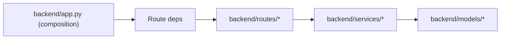
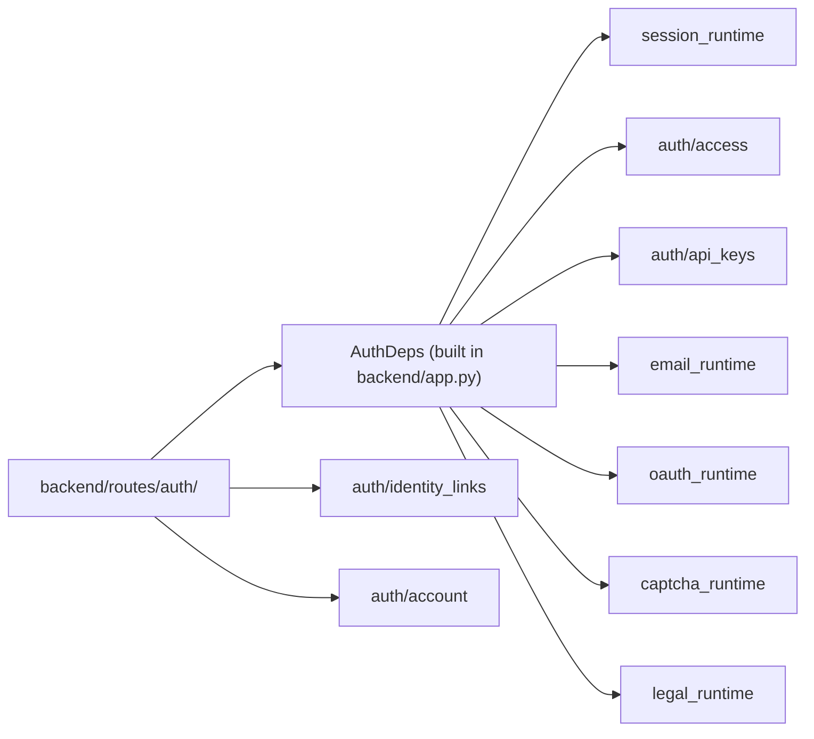

# Backend API Architecture

## Overview
- `backend/app.py` is the application composition layer: `create_app`, typed route deps (`_build_route_deps`, `_build_favorites_deps`), request-hook and blueprint registration, and the CLI commands. It holds no request logic. It still re-exports names tests reach for (`backend.app._create_api_key`, `_rate_limit_state`, ...); mutable state is re-exported by identity, but scalar tunables must be patched on the owning module.
- `backend/routes/*` own HTTP resource wiring and response shaping.
- `backend/services/*` own query orchestration and side-effect orchestration:
  - `notifications.py` for maintainer emails (sign-ups, issue reports); the recipient is `ADMIN_NOTIFICATION_EMAIL`
  - `dumps.py` for the R2 client and the active dump version (`X-Pandects-Dump-Hash`)
  - `side_effects.py` for the per-app async task runner, usage buffer, and the after-request usage recorder
  - `favorites_service.py` for favorites, projects, and tags (plus `FavoritesDeps`)
- `backend/models/*` own ORM/reflection surfaces.
- `backend/schemas/*` own request/response validation and serialization.
- `backend/core/*` owns shared runtime plumbing:
  - `config.py` for app/bootstrap config composition
  - `errors.py` for the API error envelope and error handlers
  - `hooks.py` for request hook wiring and header policy
  - `rate_limit.py` for per-tier, per-endpoint, and per-account rate limits
  - `caching.py` for `ttl_cached`, the in-process TTL cache
- Auth runtime logic is split by domain in `backend/auth/`:
  - `session_runtime.py` for session transport, cookies, auth DB/mock store, session tokens, request identity helpers
  - `access.py` for resolving a request into an `AccessContext`, the `require_user` / `require_verified_user` gates, and the temporary lockdown gate
  - `api_keys.py` for API key issuance, lookup, and last-used throttling
  - `account.py` for account self-service (API key listings, usage rollups, issue-report validation, password policy)
  - `identity_links.py` for linking external (Zitadel) identities to local users and parsing Zitadel notifications
  - `email_runtime.py` for email normalization and Resend delivery helpers
  - `oauth_runtime.py` for provider token exchange / JSON fetch helpers
  - `captcha_runtime.py` for Turnstile verification helpers
  - `legal_runtime.py` for legal acceptance validation/persistence and sign-on event logging
  - `mcp_runtime.py` / `mcp_oauth_runtime.py` for MCP bearer-token identity and the MCP OAuth server

## Runtime Flow

## Auth Flow

## Route Dependency Injection
- Route registration is explicit and typed through `backend/routes/deps.py`.
- `backend.app._build_route_deps()` constructs, once per app:
  - `SectionsDeps`
  - `AgreementsDeps`
  - `ReferenceDataDeps`
  - `TaxClausesDeps` (defined in `backend/routes/tax_clauses.py`)
  - `AuthDeps`
- `backend.app._build_favorites_deps()` constructs `FavoritesDeps` (defined in `backend/services/favorites_service.py`).
- `McpDeps` reuses the sections, agreements, reference-data, and tax-clauses deps.
- Routes consume these dependency objects rather than dynamic module lookups.
- `AccessContextProtocol` is the shared typed access-context contract for runtime route/service calls.
- Keep dependency typing strict for helper call signatures; keep reflected SQLAlchemy model handles pragmatic where strict typing would add fragile casts.

## Runtime Contracts
- Refactors keep public paths, operationIds, payloads, and status codes stable (`test_route_contracts.py`); an intentional public change gets a `bulk/changelog/changelog.yml` entry.
- Internal contracts are explicit:
  - `register_sections_routes(*, deps: SectionsDeps) -> Blueprint`
  - `register_agreements_routes(target_app: Flask, *, deps: AgreementsDeps) -> tuple[Blueprint, Blueprint, Blueprint]`
  - `register_reference_data_routes(*, deps: ReferenceDataDeps) -> tuple[Blueprint, ...]` (taxonomy, NAICS, counsel, dumps, tax-clause taxonomy, changelog)
  - `register_tax_clauses_routes(*, deps: TaxClausesDeps) -> Blueprint`
  - `register_auth_routes(app: Flask, *, deps: AuthDeps) -> Blueprint`
  - `register_favorites_routes(target_app: Flask, *, deps: FavoritesDeps) -> Blueprint`

## Error Envelope
- Every `/v1` error body is `{"error": <code>, "message": <text>}` (`backend/core/errors.py`). `error` is a stable snake_case machine code; `message` is human text.
- Generic errors (`abort(status, description=...)`, routing errors, marshmallow `ValidationError`, webargs 422s, SQLAlchemy failures) get the code for their status from `ERROR_CODES_BY_STATUS`: `bad_request`, `unauthorized`, `forbidden`, `not_found`, `method_not_allowed`, `conflict`, `payload_too_large`, `unsupported_media_type`, `validation_error` (422), `rate_limited`, `internal_error`, `bad_gateway`, `service_unavailable`, `gateway_timeout`; any other status uses its snake_case reason phrase.
- A route with a more specific condition returns `json_error(status, error=<code>, message=...)` (for example `validation_error` from `load_json`, `rate_limited`, `captcha_required`, `legal_required`, `auth_failed`). Pass the response to `abort(...)` to raise it.
- `/mcp` keeps JSON-RPC 2.0 error objects; the MCP OAuth metadata endpoints outside `/v1` are not covered.
- Public docs: `docs/docs/guides/error-model.md`.

## Caching
- `backend/core/caching.py` provides `ttl_cached(seconds, *, key=None, max_keys=None, retry_none_after=None)`. The decorated function is thread-safe, keyed by its arguments (or `key(...)`), bounded by `max_keys`, and exposes `.cache_clear()`, `.cache_set(value, *args)`, and `.cache_len()`. `clear_all_ttl_caches()` clears every instance.
- It is bypassed when the current app has `testing = True`, so tests never see a payload cached by an earlier test; a test of caching itself sets `app.config["TTL_CACHE_IN_TESTS"] = True`.
- `retry_none_after` treats a `None` result as an upstream failure: the last good value keeps serving and the call is not retried for that many seconds (used by `services/dumps.fetch_latest_dump_version`).
- Remaining hand-rolled `{"ts", "payload"}` + `Lock` caches: the agreements-summary and filter-options caches (storage in `app.py`, logic in `routes/agreements`), the four `_cached_summary` caches in `routes/agreements`, and the taxonomy / tax-clause taxonomy / counsel / NAICS / dumps / changelog / dumps-manifest caches (storage in `app.py`, logic in `routes/reference_data.py`). New caches use `ttl_cached`.
- The paginated-search exact-count cache (`backend.app._cached_exact_query_count` over `backend/search_counts.py`) is a separate keyed memo scoped to the dump version.

## Agreements Domain
- `backend/filtering.py` owns the agreement metadata filter chain and the public-eligibility rule:
  - `agreement_filter_predicates(cols, args, ...)` / `apply_agreement_filters(query, cols, args, ...)` build every agreement metadata filter (year and filing-date ranges, parties, price buckets, types, counsel, industries, deal fields, PE flags, `agreement_uuid`). `cols` is either `agreements` or `latest_sections_search`, which carry the same column names. Every REST route and MCP tool that filters agreements goes through it.
  - `agreement_is_public_eligible_expr(agreements)` is the gated/unverified rule; `ineligible_agreement_uuids_query(...)` finds gated, unverified agreements that have rows in `latest_sections_search`; section search runs it once per request and adds an `agreement_uuid NOT IN (...)` exclusion only when it returns any, so the normal-case query plan is unchanged.
- `backend/services/agreements_service.py` owns agreement query logic for REST and MCP: `AGREEMENT_METADATA_COLUMNS` / `agreement_metadata_columns()` / `row_to_agreement_metadata()` (the one metadata projection), list/search/index, single reads, tax-clause reads, summaries, trends, and filter options. `backend/routes/agreements/*` only parses arguments, applies caches, and shapes responses.
- `backend/services/snippets.py` owns XML text extraction and match-focused snippets shared by agreement search and the MCP snippet tools.
- `backend/services/sections_service.py` exposes the text-search plan race (`fetch_with_text_plan_race`) and the budgeted exact count (`budgeted_exact_count`) that agreement text search reuses.
- Services never import route modules.

## Testing Guardrails
- `backend/tests/test_route_contracts.py` checks route and operationId stability.
- `backend/tests/test_auth_dependencies.py` checks auth dependency wiring.
- `backend/tests/test_runtime_typing_guards.py` blocks broad file-level pyright suppressions in runtime files.
- `backend/tests/test_runtime_typing_guards.py` also guards narrow `Callable[..., Any]` usage in `backend/routes/deps.py` (allowed only where SQLAlchemy expression typing is still dynamic).
- `backend/tests/test_core_caching.py` covers `ttl_cached`; `backend/tests/test_api_validation.py` covers the error envelope codes.

## Where New Code Should Live
- New endpoint logic: `backend/routes/*` + `backend/services/*`.
- New request/response schema: `backend/schemas/*`.
- New DB model/reflection logic: `backend/models/*`.
- Request-scoped plumbing shared across routes (limits, caches, error shapes): `backend/core/*`.
- Auth/account behavior: `backend/auth/*`, wired into routes through `AuthDeps`.
- App bootstrap/config-only changes and new route deps wiring: `backend/app.py`.
