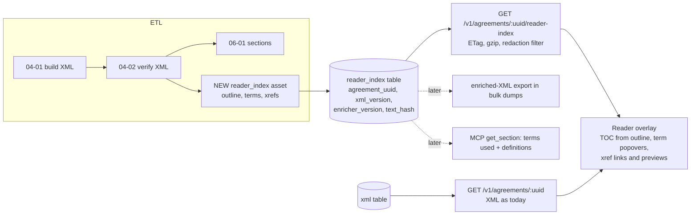

# Smart reader: live TOC, defined terms and cross-references

Status: design approved 2026-10-22 (Section 11); Phase 1 next. Owner: maintainer. Last updated 2026-10-22.

Prototype: [`smart-reader/prototype_enrich.py`](smart-reader/prototype_enrich.py) (read-only, local XML files).

## 1. Problem

A merger agreement is a graph that looks like a scroll. "Acquisition Proposal" is defined once in Section 1.1 or an Exhibit A and used 60 times. "Section 7.2(b)" points 40 pages away. Today a Pandects reader resolves both by hand: ⌘F, scroll, lose their place, scroll back.

Goals the user set:

1. **Smart TOC.** Clickable, jumps to the section, tracks your position, works on 150-section agreements.
2. **Live defined terms.** Hover or tap a term to see its definition in place; jump to where it is defined.
3. **Live cross-references.** "Section 7.2(b)", "Article IV" and "as defined in Section 1.1" become links with previews.
4. **Use the XML.** Pandects already stores every agreement as verified XML, so the enrichment should probably come from that XML rather than from browser-side guessing.

Non-goals for v1: editing, comparing agreements, linking to *other* agreements, and statute lookup (Section 11 covers these).

## 2. Current state

### 2.1 Reader (frontend)

| Piece | Where | What it does today |
|---|---|---|
| Page | `frontend/client/pages/Agreement.tsx` | Renders `AgreementReader` with `?focusSectionUuid=` and `?from=`. |
| Fetch | `frontend/client/hooks/use-agreement.ts:15` | `GET /v1/agreements/{uuid}` returns metadata plus the **whole XML as one string**. |
| Parse | `frontend/client/lib/xml-parser.ts:43` | Hand-written tag scanner. Keeps only `uuid` and `title` (`:34-35`). **Drops every other attribute, including `definition@term`.** |
| Render | `frontend/client/components/XMLRenderer.tsx:667` | Articles and sections become collapsible containers with `data-section-uuid`. **`<definition>` renders as a plain `div`** (`:523`). There is no virtualization; mounting uses `useTransition` and memoized nodes. |
| TOC | `frontend/client/components/TableOfContents.tsx:313` | A second regex pass over the raw XML. Two levels deep (article, section). |
| Scroll-spy | `frontend/client/hooks/use-scroll-spy.ts:76` | **Already solid**: IntersectionObserver reading line, hysteresis, suppression during programmatic jumps. |
| Jump | `frontend/client/components/AgreementReader.tsx:311` | `scrollToSection(uuid)` expands ancestors, retries, offsets for the sticky header. **No URL hash and no history entry**, so the browser Back button does not return you to where you were. |
| Find | `frontend/client/components/reader/find-highlight.tsx` | ⌘F highlighting with `<mark>`. |

There is no defined-term or cross-reference handling anywhere in the reader.

### 2.2 API (backend)

- `GET /v1/agreements/<uuid>` (`backend/services/agreements_service.py:976`) returns metadata plus `xml.xml` for the latest OK version. No ETag, no Cache-Control and no compression.
- **Anonymous callers get redacted XML.** `backend/redaction.py:9` replaces every section outside focus ± N with `[REDACTED]`. *Any feature that shows text from elsewhere in the document (definition popovers, xref previews) must respect this, or it leaks the redacted text.*
- `GET /v1/agreements/<uuid>/sections` returns the flat section index; `GET /v1/sections/<uuid>` returns one section's `xml_content`.
- There are no tables for definitions or terms.

### 2.3 XML and ETL

Built by `generate_xml` / `convert_to_xml` in `etl/src/etl/domain/f_xml.py:696-1165`. Verified by `04-02_verify_xml` (`etl/src/etl/defs/f_xml_asset.py:2626`, hard rules at `:1057-1266`).

```xml
<document uuid="…">
  <metadata>…</metadata>
  <frontMatter/> <tableOfContents/>
  <body>
    <text>recitals …</text>
    <article title="ARTICLE I DESCRIPTION OF TRANSACTIONS" uuid order standardId pageUUID>
      <section title="Section 1.5 Conversion of Shares." uuid order standardId pageUUID>
        <text>(a) Subject to the terms …</text>
        <text>(i) each share of Newco Common Stock held in treasury …</text>
        <definition standardID="&lt;placeholder&gt;" term="acquisition proposal">
          <text>“Acquisition Proposal” shall mean …</text>
        </definition>
        <pageUUID>…</pageUUID>
      </section>
    </article>
  </body>
  <sigPages/> <backMatter>  flat <text> lines: exhibits, schedules, annexes  </backMatter>
</document>
```

What matters for this design:

- **Text is flat.** A section is a list of `<text>` lines. "(a)" and "(i)" are characters at the start of a line, not structure, and there is no inline markup.
- **`<definition>` exists but is thin.** It is created only when a line *starts* with a quoted term followed by "means / shall mean / shall have the meaning" (`f_xml.py:757-788`). `term` is lowercased. It misses parenthetical definitions (`(the “Company”)`), mid-sentence definitions and the common glossary layout `Acquisition Proposal. “Acquisition Proposal” shall mean …` (sample `054f4c7c`: 165 "means" definitions in an Exhibit A, 0 `<definition>` elements).
- **Section uuids are deterministic** (uuid5 over agreement, normalized titles and orders; `f_xml.py:40-54`), so they are stable across rebuilds unless numbering or titles change. Inserting a section shifts every later uuid in that article. Article uuids ignore order, so two articles with the same title collide.
- **Versions.** Every build inserts `xml.version = max+1` and flips `latest`. Taxonomy then rewrites `standardId` into the same version in place, through an ElementTree round-trip (`etl/src/etl/domain/h_taxonomy.py:334`).
- **Exhibits and schedules are not structured.** Back matter is flat text; disclosure schedules are never filed at all.
- **Corpus (local, 2026-10-20):** 9,873 latest verified XMLs, averaging 337 KB (largest 2.4 MB), and 966,534 section rows. About 8,185 latest XMLs contain at least one `<definition>`.

## 3. The reference implementation (kirkland `standard-k` and `ingester`)

`standard-k` is a document *format* (ODX), not a detector. The detection lives in the sibling repo `kirkland/ingester` (`packages/docx/src/definitions.ts`, `citations.ts`). Both were read read-only.

**What transfers:**

- **Model.** Terms and cross-references are inline marks or nodes (`def`, `term`, `xref{target}`) over a block tree. Citation text is *derived* from the target's number, and a status overlay records `resolved | broken | ambiguous | out-of-scope`. We should keep the same separation between "what the text says" and "what we decided it points to".
- **Definition detection.** It uses an ordered set of declaration patterns with a `consumed` span list: leading (`“X” means`), named-as, "the term X", parenthetical (`(the “Company”)`, `(each, a “Seller”)`) and appositive. A **pointer** declaration ("has the meaning set forth in Section 5.4") counts only if nothing else declares the term; otherwise it becomes a link to the real declaration.
- **Term-use matching.** One case-sensitive alternation, longest spelling first ("Escrow Amount" before "Escrow"), with plural and possessive forms, a case-insensitive pass only over ALL-CAPS runs, and no marks in headings or inside the declaration. For speed, alternatives are bucketed by first character.
- **Cross-reference resolution.**
  - Index every numbered block by `word|normalized number`, with `5.08 = 5.8` and `Article III = Article 3`.
  - A key shared by two blocks is **ambiguous and not linked**.
  - Link the deepest block that exists ("6.3(g)" falls back to 6.3).
  - Link only if the target's derived label matches the printed label.
- **External filters.** `AUTHORITY_BEFORE` ("Code Section", "Treasury Regulations Section", `§`), "of the DGCL / of ERISA" after the number, "thereto" versus "hereto", and "this Section 2.4" forced internal.
- **Measurement.** Random sampling of marks for human verdicts. Reported: definition precision 99.2%; xrefs 12,510 resolved / 80 broken on 25 Word deals.

**What does not transfer:**

- The Word-specific parts: bookmarks, REF fields, tracked-change sides and bidi marks.
- The JSON block tree as a storage format. We have verified XML and a whole pipeline built on it, and switching the canonical format would be a rewrite.
- Some rules are fitted to individual deals in a 25-deal corpus. Our corpus is 10k EDGAR filings with OCR-ish text, older drafting styles and UK-style decimal numbering, so every borrowed rule has to be re-measured here.

## 4. Prototype results

`prototype_enrich.py` builds the index the design needs (articles, sections, a subsection tree inferred from paragraph enumerators, definitions, term uses and cross-references with a resolution status) and runs it over 10 latest verified agreements chosen across the size range. The whole run takes **0.65 s for 10 agreements**, about 65 ms each, so a full corpus pass is about 11 minutes on one core with no LLM calls.

| Agreement | Sections | Subsections found | Terms | Term uses (body) | Xrefs | In-document xrefs | Resolved exact | Resolved to section or better |
|---|---|---|---|---|---|---|---|---|
| 01b1b5c2 | 115 | 305 | 186 | 3,652 | 400 | 285 | 98.2% | 99.3% |
| 02b0b280 | 58 | 213 | 113 | 2,243 | 275 | 198 | 93.4% | 99.0% |
| 053261a1 | 118 | 98 | 66 | 1,062 | 156 | 126 | 73.8% | 74.6% |
| 054f4c7c | 82 | 248 | 167 | 3,252 | 381 | 320 | 91.6% | 98.8% |
| 0668f1f1 | 91 | 268 | 151 | 2,580 | 244 | 137 | 100% | 100% |
| 06798169 | 83 | 214 | 147 | 3,030 | 341 | 266 | 96.2% | 99.2% |
| 07191fe9 | 114 | 289 | 428 | 4,287 | 403 | 129 | 83.7% | 88.4% |
| 0769b9c5 | 96 | 315 | 191 | 4,419 | 401 | 341 | 96.5% | 98.8% |
| 07a7146e | 116 | 107 | 73 | 1,512 | 157 | 90 | 92.2% | 98.9% |
| 07b3d1c3 | 83 | 194 | 155 | 2,436 | 253 | 152 | 97.4% | 100% |
| **All** | 956 | 2,251 | 1,677 | 28,473 | 3,011 | 2,044 | **93.5%** | **97.0%** |

"In-document" covers references to Sections, Articles and clauses after statutes are removed (762 of the Section/Article mentions were external: Code, ERISA, DGCL, Sarbanes-Oxley, FBCA). "Resolved" means *a target exists*, not *the target is right*. Precision is unmeasured until the gold set exists (Section 9).

Exhibit, Schedule and Annex references are counted separately: of 205, 37 were external (Schedule 14D-9 and similar), 35 found a heading in back matter and **133 had nowhere to go**. Most of those 133 cite disclosure schedules (agreement `0668f1f1` cites 106) or exhibits that were filed separately or not at all.

What the misses taught us (each item is a rule the prototype now has, or a gap it still has):

1. **Roman versus alpha.** In "(c)", "c" is a letter, not 100. Only i–xx count as lowercase roman, and "(i)" right after "(h)" is the letter i.
2. **"Section 8" can be an article.** Older agreements number top-level parts "SECTION 8" with children 8.1, 8.2.
3. **A statute tail covers the whole run.** In "Sections 4062, 4063 or 4041 of ERISA" and "Section 355 or Section 361 of the Code", every member is external.
4. **Authority before the number.** "Code Section 409A", "Treasury Regulations Section 1.368-2(g)", "21 U.S.C. Section 360".
5. **Relative members inherit the prefix.** "Section 7.5(a) and (b)" means 7.5(b). They continue a run only when they match the enumerator kind of the previous item: "Section 7.6(b), (ii) Everest would…" starts a new enumeration and is not part of the run.
6. **Qualified clauses.** "clauses (i), (iv) or (xv) of Section 5.2(b)" resolve as 5.2(b)(i) and so on.
7. **Local clauses.** "clause (ii) above" usually points at an *inline* enumeration in the same sentence or section, not at a paragraph.
8. **Gaps the prototype still has:**
   - UK decimal numbering (`053261a1`: "Section 4.2.13", where the XML build had turned a definitions list into 118 "sections").
   - Definition-index tables ("SEC Reports § 4.06(a)").
   - "Listed Company Manual Section 312.03".
   - "Section 601 et seq. of ERISA".

The weakest agreement (`053261a1`, 74%) is weak because its XML structure is wrong, not because of the linker. **The resolution rate works as a free XML-quality signal** (see Section 9.3).

On definitions, a 40-term random sample of parenthetical definitions was clean by inspection. About 14% of terms (228 of 1,677) are declared in two places. Most are a declaration plus a glossary pointer, which the pointer-demotion rule handles. Some are party-specific redefinitions ("as such definition applies to Everest"), which have to keep both declarations.

## 5. Options

### A. Client-side only

Parse terms and references in the browser from the XML the page already receives.

- **For:** no ETL, API or schema work; ships the fastest; iterates with a page reload.
- **Against:**
  - **Redaction breaks it.** Anonymous readers receive `[REDACTED]` for most sections, so the definitions and targets are simply not there. To fix that we'd need a server-side index anyway, or we'd leak the text.
  - It re-runs about 2–5k regex matches over 2.4 MB documents on every page load, including on phones.
  - The API, MCP and bulk users get nothing.
  - There is no Python eval harness next to the ETL, and the detectors would be written twice (TS now, Python later).

### B. Rewrite the canonical XML inline

Add `<term ref>`, `<dfn>` and `<xref target status>` inside `<text>`. This is the user's hunch, taken literally.

- **For:**
  - One artifact. It flows into `sections.xml_content`, bulk dumps and the MCP for free.
  - It matches the standard-k model.
- **Against:**
  - **Mixed content breaks consumers silently.** `<text>` is a plain string everywhere today. With inline children, ElementTree's `.text` returns only the text *before the first child*. Taxonomy, sections extraction, embeddings, full-text search (`section_text_search`), the frontend parser, `redaction.py` and every external bulk-dump user would all truncate text without an error. Auditing and changing all of them is the real cost of B.
  - **Coupled iteration.** Every detector improvement means a new XML version. That re-triggers verify, sections, taxonomy and embeddings (the build queue keys off XML versions), or else rewrites a verified artifact in place.
  - **Decisions become indistinguishable from source.** An unresolved or wrong link baked into the canonical text looks the same as text from the filing.

### C. A derived reader index stored next to the XML (recommended)

An ETL asset reads the latest verified XML and writes a stand-off **reader index**. The index holds the outline, definitions, term occurrences and cross-references, with **anchors into the XML** (section uuid, text-node ordinal, character range). The canonical XML is untouched, and the frontend overlays the index onto the text it already renders.

- **For:**
  - Enrichment is ETL-time, deterministic, Python and testable, so the hunch holds in spirit. The XML is the input, and server-side enrichment is right.
  - The detector can be versioned and re-run in about 11 minutes without touching XML versions or downstream assets.
  - **Redaction-safe by construction.** The index carries offsets, not text, and previews read text from the XML the client already has (redacted or not).
  - API and MCP consumers can use it.
  - It does not block option B: an "enriched XML" export can be *generated* from canonical XML plus the index for bulk users later (Phase 4).
- **Against:**
  - There is a second artifact to keep in sync with the XML version.
  - Anchors need a precise text-offset contract between Python and the browser (Section 6.3).
  - It adds a new table and endpoint, and serving-schema work for the prod push.

**Recommendation: C**, plus one small canonical-XML fix that stays within the existing schema: widen `<definition>` detection in `f_xml.py` to cover the glossary layout. That improves the XML for everyone, and the index uses it as one signal among several.

## 6. Recommended architecture



### 6.1 Enricher (ETL)

A new pure module, `etl/src/etl/domain/reader_index.py`, holds no DB code: XML string in, index dict out, which makes it easy to test. The prototype is its first draft. A new asset (for example `07-01_reader_index`) runs after verify, over latest **verified** XMLs whose row is missing or stale.

A row is stale when any of these hold:

- `xml_version` changed;
- `enricher_version` (semver constant in the module) changed;
- `text_hash` changed. This is the SHA-256 of the concatenated text nodes, and it guards against in-place rewrites of the same version. Taxonomy's `standardId` rewrite does not change text, so it does not trigger a recompute.

Pipeline steps, all deterministic:

1. **Outline.**
   - Articles: roman → int; "ARTICLE", "Article" and "SECTION 8" styles.
   - Sections: normalized numbers, `7.02 = 7.2`, `5A` kept.
   - Subsections: inferred from paragraph enumerators with kind classification (alpha, roman, ALPHA, digit; i/v/x disambiguated by the previous sibling) and decimal paragraphs (`4.2.13`).
   - Inline enumerations are recorded as weak targets (paragraph-level only).
   - Attachments: back-matter heading lines ("EXHIBIT A", "Annex I").
2. **Declarations.**
   - `<definition>` elements, leading `“X” means`, parenthetical and appositive forms, "the term X", and pointers ("has the meaning set forth in Section 5.4").
   - Precedence: explicit declaration > parenthetical > pointer, with pointers demoted to links when a real declaration exists.
   - Keep multiple declarations when they differ in scope (party-specific).
   - Exclude definition-index tables from both declarations and uses.
3. **Term uses.**
   - Case-sensitive, longest first, with plural, possessive and "(s)" forms.
   - Case-insensitive only inside ALL-CAPS runs.
   - Skip headings, the declaration span itself and quoted spans.
   - **Common-word guard:** single-word terms that are common English words ("Law", "Effect", "Actions", "Sub", "Company" in some deals) are not matched sentence-initially and carry a lower confidence. The UI can choose whether to show them.
4. **Cross-references.**
   - Head words (Section, Article, Exhibit, Schedule, Annex, Appendix, clause, paragraph, §).
   - Lists and ranges. Range endpoints are linked; members in between are not expanded in v1.
   - Relative members with the same-kind rule, qualified clauses and local clauses ("above"/"below", searched within the current section).
   - "this Section" with no number goes to the current section.
5. **External filter.** Authority-before, statute-after ("of the Code/ERISA/DGCL/…Act", short acronyms), SEC forms (Schedule 13D/14D-9/TO), other instruments ("of the Company Disclosure Schedule", "of the bylaws", "Exhibit 21.1 of the 10-K"), and a **number-space plausibility check**: "Section 280G" in an agreement whose sections are all dotted is not internal.
6. **Resolution and status.**

   | Status | Meaning | UI |
   |---|---|---|
   | `resolved` | Exact target, and the label matches the printed text | Link + preview |
   | `section_fallback` | "6.3(g)" where (g) was not found, so the link goes to 6.3 | Link on "Section 6.3"; "(g)" stays plain text |
   | `ambiguous` | Two targets share the key | No link; tooltip shows the candidates |
   | `unlocated_attachment` | "Exhibit B" with no matching heading in back matter | Chip: "Exhibit B (not in this filing)" |
   | `disclosure_schedule` | Disclosure-letter or schedule sections | Chip, no link |
   | `external` | Statute, rule or other instrument | Plain text in v1; optional statute links later |
   | `unresolved` | Everything else | Plain text; counted in metrics |

   **Rule: a wrong link is worse than no link.** When in doubt, do not link.

### 6.2 Storage

New table `reader_index` in `pdx`:

| Column | Type | Note |
|---|---|---|
| agreement_uuid | char(36) | PK part |
| xml_version | int | PK part; matches `xml.version` |
| enricher_version | varchar(16) | |
| text_hash | char(64) | Staleness guard |
| payload_gz | longblob | Section 6.3 JSON, gzip-compressed (about 40 KB vs 190 KB raw); the API can serve it as-is with `Content-Encoding: gzip` |
| n_terms, n_term_uses, n_xrefs, n_xrefs_resolved, n_xrefs_unresolved | int | Health metrics without parsing the JSON |
| body_section_level_rate | decimal(5,4) | Ranks agreements for the health report |
| created_date | datetime(3) | |

Keep the latest row per agreement, and keep old rows until the next push, for rollback. The table has to be added to the serving schema, the prod push and restore path, and `bulk/schema_docs/table_docs.yml`, since `push_to_r2.sh` enforces doc coverage. Prod's serving schema is narrower than local, so check that the table exists there and call the live endpoint after deploy.

### 6.3 Payload and the anchor contract

```jsonc
{
  "schema": 1, "enricher": "0.1.0", "agreement_uuid": "…", "xml_version": 7,
  "outline": [
    {"id": "a4", "kind": "article", "label": "IV", "title": "Covenants", "anchor": {"s": "<article-uuid>"},
     "children": [{"id": "s4.3", "kind": "section", "label": "4.3", "anchor": {"s": "<section-uuid>"},
       "children": [{"id": "s4.3(b)", "kind": "sub", "label": "4.3(b)", "anchor": {"s": "<section-uuid>", "t": 3}}]}]}
  ],
  "terms": [
    {"id": 12, "term": "Acquisition Proposal",
     "decls": [{"anchor": {"s": "<uuid>", "t": 0}, "span": [1, 21], "kind": "means"}],
     "confidence": "high"}
  ],
  // term uses, grouped by text node: [start, end, termId]
  "uses": {"<section-uuid>/5": [[14, 34, 12], [88, 99, 3]]},
  "xrefs": [
    {"at": {"s": "<uuid>", "t": 2}, "span": [41, 55], "text": "Section 7.2(b)",
     "status": "resolved", "target": "s7.2(b)"}
  ]
}
```

- **Declarations** may carry `pointer` (the target of "has the meaning set forth in …": `Section 2.2`, or the printed words otherwise: `preamble`, `introductory paragraph`, `Parent Charter`) and `as`, the printed spelling when it differs from the term's (a glossary's "COMPANY" merged into the preamble's "Company", enricher 0.3.0).
- **Anchor** = `s`: section uuid (or region name `frontMatter`, `body`, `backMatter`, plus an ordinal for non-section text) and `t`: ordinal of the `<text>` node within that container, in document order, *including* text inside `<definition>`.
- **Offsets are UTF-16 code units, measured over entity-decoded text**, the same string `normalizeXmlText` gives the React renderer. Python indexes code points, so the enricher converts. A shared fixture test (one agreement with curly quotes, `&amp;`, `§` and a non-BMP character) runs in both pytest and vitest to pin the contract.
- **Size:** about 2.8k term uses and 300 xrefs per agreement is roughly 60–100 KB of JSON raw and about 15–25 KB gzipped, against 337 KB of XML. This is an estimate from the prototype counts, to be measured in Phase 1.

### 6.4 API

`GET /v1/agreements/<uuid>/reader-index` returns the payload for the XML version that `/v1/agreements/<uuid>` serves.

- ETag = `xml_version:enricher_version`, `Cache-Control: public, max-age=…`, gzip.
- 404 when no index exists, and the reader degrades to today's behavior.
- **Redaction:** for anonymous callers, drop `uses` and `xrefs` anchored inside redacted sections, and replace declarations inside redacted sections with `{"redacted": true, "label": "Section 1.1"}`. The client can then say "Defined in Section 1.1 (sign in to read)" without seeing the text. Previews always read text from the XML the client already holds, so the endpoint never ships agreement text. Redacted regions are already handled.
- Optional later: `include=reader_index` on the agreement endpoint to save a round trip; terms used in a section on `/v1/sections/<uuid>` and MCP `get_section`, which helps LLM users a lot because they currently get "Acquisition Proposal" with no definition.

### 6.5 Frontend

The data pages are being polished by another session tonight. None of this should touch `Agreement.tsx`, `AgreementReader.tsx`, `XMLRenderer.tsx` or `TableOfContents.tsx` until that work lands; Phase 3 starts from whatever is on main then.

- **TOC from the outline, not regexes.**
  - Replaces `extractTOCFromXML` and the third index in `AgreementReader.tsx:102`.
  - Three levels; subsections collapsed by default and shown for the active section only.
  - Keep the existing scroll-spy and add a breadcrumb in the sticky header ("Article IV › 4.3 › (b)").
  - The TOC stays well under 1k rows even for large agreements, so it needs no virtualization.
- **Text overlay.**
  - When a `text` leaf renders, look up `uses` and `xrefs` for its anchor and split the string into segments.
  - Compose with find-highlight: find marks win visually, and both are just ranges.
  - Segment only expanded or visible sections.
- **`<TermRef>`.**
  - Dotted underline; hover intent of about 300 ms, or focus with Enter.
  - The hover card shows the declaration text (the declaration's text nodes, up to about 600 characters, with "more"), "Go to definition" and "N uses".
  - A tap on touch devices opens a bottom sheet.
  - A reader setting can switch term underlines off.
- **`<XRef>`.**
  - A link with a preview card: target title and the first lines of text.
  - Clicking jumps with the existing `scrollToSection` and reveal logic, and **pushes a history entry**, so Back returns you to the citing sentence. A "Back to §5.2(c)" chip appears after a jump.
  - Subsection targets highlight the paragraph briefly.
- **Deep links.** `#4.3(b)`-style hashes are resolved through the outline and survive uuid churn better than uuids. Keep `?focusSectionUuid=` for compatibility.
- **Long documents.** Measure before virtualizing. `content-visibility: auto` on article containers is the cheap first step; real virtualization conflicts with ⌘F and the scroll-spy, so it waits for evidence.
- **Parser fix.** `xml-parser.ts` should keep all attributes. That is needed anyway to render `<definition>` and is small.

## 7. Hard cases and decisions

| Case | Decision |
|---|---|
| Ambiguous section numbers (duplicate "Section 5.1" after a bad parse) | No link; record `ambiguous`; count it as an XML-quality signal |
| References from exhibits into the agreement ("Section 1.6(f) of the Agreement") | Resolve against body sections; "of the Agreement" means self |
| References inside an exhibit to its own paragraphs | Resolve within the attachment first, as the ingester does. Needs attachment segmentation (Phase 4) |
| Exhibits filed separately or not at all | `unlocated_attachment` chip. Later: link to the EDGAR exhibit in the same accession when we can identify it |
| Disclosure schedules | Never filed; chip only |
| Other agreements ("Section 2.1 of the Original Agreement", voting agreements) | External in v1. Later: link amendments to originals when both are in the corpus |
| Statutes (Code §, ERISA, DGCL, Exchange Act rules) | External in v1. Optional Phase 4: Cornell LII or eCFR links for a whitelist (IRC, ERISA, Exchange Act rules) |
| Ranges ("Sections 3.1 through 3.4") | Link the endpoints. Expanding the members is cheap with an outline but noisy in the UI; skip it in v1 |
| "hereof", "herein", "this Agreement" | Not links |
| Terms redefined for one party, or defined twice | Keep all declarations; the popover shows both with location labels |
| Terms that are common words | Lower confidence, no sentence-initial matches, hideable |
| Invalid (unverified) XML | No index; the reader degrades gracefully |

## 8. Versioning, backfill and cost

- **Compute:** about 65 ms per agreement in the prototype. Expect 2–3× once uses and anchors are emitted, so roughly 20–30 minutes single-process for the corpus, with no API spend.
- **Re-runs** are triggered by an enricher version bump, not by XML rebuilds. They don't re-trigger verify, sections, taxonomy or embeddings.
- **Prod:** follows the usual monthly push. The table is computed locally and shipped with the push, so nothing is written to prod directly.
- **Section uuid churn:** an XML rebuild makes a new version, and the index is recomputed for it. Old deep links that use uuids may break, which is why label-based hashes are the public format.
- **Storage:** measured on the corpus: 11,790 rows × about 40 KB gzipped is roughly 470 MB (about 2.2 GB if stored raw), so the payload is stored compressed.

## 9. Evaluation

### 9.1 Gold set

- **30 agreements, stratified:**
  - filing era: pre-2005, 2005–2014, 2015+;
  - source format: html or txt;
  - size;
  - numbering style: ARTICLE/Section, "SECTION 8" top level, UK decimal;
  - where definitions live: body section or Exhibit A glossary.
- **What gets labeled per agreement:**
  - **Declarations:** every term in the definitions section or exhibit, plus every parenthetical definition in 5 random sections.
  - **Xrefs:** every reference mention in 8 random sections plus the definitions section, each with the correct target or "external" or "no target in filing".
  - **Term uses:** 15 random terms, every occurrence in 3 random sections.
- **Who labels:** following the existing page-gold practice, a strong model drafts the labels from a fixed rubric, a second model checks them, and the user rules only on disagreements. Labels live as JSON fixtures under `etl/tests/fixtures/reader_gold/`.

### 9.2 Metrics and launch bar

| Metric | Definition | Launch bar |
|---|---|---|
| Xref link precision | Linked mentions whose target is correct | **≥ 99%** |
| Xref in-document recall | Gold internal mentions that get a correct link (including section fallback) | ≥ 95% |
| External classification precision | Mentions marked external that really are external | ≥ 98% |
| Declaration precision / recall | Against gold declarations | ≥ 98% / ≥ 95% |
| Term-use precision | Marked uses that are real uses of that term | ≥ 97% |
| Term-use recall | Against the labeled occurrences | ≥ 90% |

Precision gates launch; recall can grow afterwards. A pytest eval target prints the deltas on every enricher change, and CI fails on precision regressions.

### 9.3 Corpus health (no gold needed)

Every `reader_index` row carries counts, so we can rank agreements by unresolved or ambiguous xrefs, terms used but never declared, and terms declared but never used. The bottom of that list is mostly **broken XML structure** (for example `053261a1`, a definitions list parsed as 118 sections). That makes it a useful input to the XML validation queue. It should start as a report, not a verify rule, because turning it into a verify rule would flip statuses at scale.

## 10. Phases

| Phase | Scope | Exit criteria |
|---|---|---|
| **0** | Design and prototype | Done: decisions in Section 11 |
| **1. Enricher** (in progress, 10.1–10.6; blind on held-out v3, all launch-bar metrics met except term-use precision, which waits on a rubric ruling) | `reader_index.py` module, gold set, eval harness, asset, local table, glossary-layout detection in the enricher (not `f_xml.py`, see 11.5) | Launch-bar metrics on gold; full local corpus run; health report |
| **2. API** | Endpoint, redaction filter, ETag, gzip, schema docs, serving schema, OpenAPI | Backend tests incl. redaction; live endpoint check after the push |
| **3. Reader** | Parser keeps attributes; TOC from outline and breadcrumb; xref links, previews and history; term popovers; a settings toggle; behind a flag | Vitest incl. offset-contract fixture; manual pass on 5 long agreements, phone and desktop |
| **4. Extensions** | Attachment segmentation in back matter, statute links, range expansion, MCP terms-in-section, enriched-XML bulk export, `content-visibility` and virtualization if measured slow | Each on its own |

Phases 1 and 2 are mostly independent of the UI work in flight. Phase 3 should start only after the current reader polish lands on main.

### 10.1 Phase 1 progress (2026-10-22)

Landed on this branch: [`etl/src/etl/domain/reader_index.py`](../../etl/src/etl/domain/reader_index.py), the pure enricher (XML string in, Section 6.3 payload out, `ENRICHER_VERSION = "0.1.0"`), and `etl/tests/test_reader_index.py` (15 unit tests: outline, declarations, uses, xref statuses, anchors, UTF-16 offsets, text hash). Not wired into Dagster and writes nothing to any database.

Changes from the prototype:

- Emits anchors and UTF-16 spans per the contract. Corpus check: none of the 11,790 latest verified XMLs contains a carriage return or markup nested inside `<text>`, so ElementTree's decoded text has the same length as the string the reader renders.
- Pointers ("has the meaning set forth in Section 5.4") are no longer counted as `means` declarations, and are dropped when the term has a real declaration.
- Glossary layout (`Term. "Term" shall mean...`) is a declaration, and its leading heading is not counted as a use (decision 11.5).
- Back matter is split at attachment headings. A segment where at least three paragraphs open with a quoted term is treated as the agreement's own glossary, so its bare "Section 5.4" resolves to the body. In any other exhibit, a bare section reference stays unlinked (`exhibit_local`), because exhibits such as voting agreements number their own sections.
- "Section 4.4 of the Company Disclosure Letter" and dotted "Schedule 3.4" are `disclosure_schedule`, not `external`.
- Duplicate section numbers produce `ambiguous` with candidates, and no subsection targets under them.
- Article titles glued to their headings ("ARTICLE VIISURVIVAL") are accepted only when the roman prefix is the next article number in sequence.
- Common-word terms get `confidence: "low"` and no sentence-initial uses (decision 11.7).

Measured on 13 latest verified agreements (12 drawn by hash plus `053261a1`), body text, Section/Article/clause references, excluding external and disclosure-schedule:

| | Exact | Section level | n |
|---|---|---|---|
| All in-document references | 87.3% | 88.2% | 3,634 |
| Excluding inline enumerations ("clause (i) above" with no outline target) | 95.1% | 96.1% | 3,336 |

The prototype's 93.5% counted inline enumerations as resolved; v0.1.0 leaves them unlinked until paragraph-level targets exist. About 61 ms per agreement. The payload is about 190 KB raw and 40 KB gzipped, larger than the Section 6.3 estimate, mostly because `uses` keys repeat section uuids. Shortening those keys is a Phase 2 option if it matters.

### 10.2 Table, asset and corpus run (2026-10-22, overnight)

Landed on this branch:

- `etl/sql/migrations/20261022_reader_index.sql`: the `reader_index` table (Section 6.2, with `payload_gz`). **Not applied anywhere.** Creating it locally waits for Phase 2, because `push_to_r2.sh` enforces bulk schema-doc coverage, and an undocumented table could break the next push.
- `etl/src/etl/defs/l_reader_index_asset.py`: the manual asset `12_reader_index`, which depends on verify like `06_sections_asset` and belongs to no job. It picks latest verified XMLs that have no row for their version at the current `ENRICHER_VERSION` and upserts rows built by `reader_index_row()`. It asserts the table exists and issues no DDL. It does not yet re-check `text_hash` against stored rows; in-place rewrites of one version are rare, and a version bump catches them.
- Tests: `etl/tests/test_l_reader_index_asset.py` (row builder, queue SQL, paging with a fake engine, missing-table guard) and the asset-graph test. All 622 ETL tests pass, and `import etl.definitions` loads 78 assets.

Two rules were added after the first corpus pass surfaced a cluster of agreements resolving 0%:

- **UK numbered clauses:** "clause 9.4" resolves like "Section 9.4", and "clause 5" resolves to the top-level clause. Numbered "paragraph 9.1" stays unlinked, because in UK deals it usually points into a schedule.
- **Named attachments:** "Section 2.1 of Exhibit B", "paragraph 3 of Schedule 2" and "Part", "Annex" or "Appendix" tails are `unresolved` with detail `attachment_local`, never linked to the body.

**Corpus run (read-only, all 11,790 latest verified XMLs):**

- **Errors and speed:** 0 parse errors. 67 ms mean and 135 ms p95 per agreement, 13 minutes single-process.
- **Volume:** 1.82M terms, 36.8M term uses, 4.42M references.
- **Reference statuses:**
  - resolved: 2.49M
  - section fallback: 77k
  - ambiguous: 17k
  - unresolved: 628k (of which 219k are inline enumerations and 232k are exhibit-local)
  - unlocated attachment: 90k
  - external: 638k
  - disclosure schedule: 478k
- **Per-agreement rates** (body text, in-document references, inline enumerations counted as misses): median 87.0% exact and 88.9% section level; mean 84.5% and 86.8%.
- **Health tail** (decision 11.6): 251 agreements below 50% section level, 443 below 70% and 1,433 below 80%. Also 154 agreements with duplicate section numbers, 70 with no numbered sections and 38 with no defined terms. Spot checks of the lowest group found broken structure (definitions parsed as sections) and UK drafting; the remaining 14 agreements at 0% have very few references each.
- **The per-agreement CSV** (`reader_index_health_2026-10-22.csv`) is in the session notes folder, not in the repo. It is the first input for the validation-queue report.

### 10.3 Gold-set pilot (2026-10-23)

Five agreements, one per stratum, none used to tune the enricher: `a4f68407` (pre-2005, txt, terms defined inline with no definitions article), `ac898a77` (2005–14), `f1e944db` and `dcaec060` (2015+), and `03f4e108` (UK-style clauses). Tooling: [`gold_rubric.md`](smart-reader/gold_rubric.md) and `etl/src/etl/utils/reader_gold.py`. Each packet holds a definitions excerpt of up to 40 paragraphs, 4 seeded random sections and the outline. Sonnet drafted the labels without seeing the enricher's output, and Opus checked them. Agreed items are in `etl/tests/fixtures/reader_gold/`, and each file's `pending_disputes` holds the items awaiting the user's ruling. Fixes that only shorten a quoted context are applied automatically.

**Cost:** about 1.0M subagent tokens in total, roughly 100k per drafter and 100k per checker. Packets are only about 6k tokens each, so nearly all of the cost is fixed per-agent overhead. For the full 30, giving each agent 3 agreements should bring the cost to an estimated 2.5–3M tokens, against about 6M at one agreement per agent.

**Labels:** after adjudication, 161 declarations, 170 references (111 internal) and 12 term-use rows. 16 items went to the user, and 5 context-only fixes were applied automatically.

**First score:** the enricher started at 92.4% link precision (108 of 117 links correct), against the 99% bar. Fixes for the error patterns the pilot exposed:

- "Section 3.2(a) of the Company Schedules" is now `disclosure_schedule`, and so is a reference joined to one by "or" or "and".
- A bare "clause (i)" stays unlinked when the citing paragraph enumerates (i) itself, or when it sits in a definitions section (5 or more declarations). Those items belong to one definition.
- Multi-word statute names ("Section 3 of the Spanish Civil Code") are external.
- An attachment heading ("Annex 3.7") no longer links to itself.
- Declarations now cover `(the entity so determined, the "X")`, `referred to herein as "X"`, `the term "X," when used ... means`, and a pointer wrapped in a `<definition>` element. Plural terms also match their singular ("Acquired Employees" and "Acquired Employee").

**Rulings (2026-10-23).** The user accepted all five recommended rulings on the 16 disputed items, now in rubric v1.2:

1. Single-letter formula variables are not declarations.
2. Lowercase correlatives ("control", "controlled") are not declarations.
3. An attachment that is mentioned but not filed is `not_in_filing`.
4. A "Schedule 12.2" that mirrors the agreement's section numbers is `disclosure_schedule`.
5. Drafter errors were fixed in the checker's favor, except one "Section 3.13 of the ... Disclosure Schedule" that stays `disclosure_schedule`.

All five fixtures are adjudicated, and `etl/tests/test_reader_gold_fixtures.py` keeps them consistent in CI.

**Score against the adjudicated gold** (pilot set; optimistic, because these agreements drove the fixes):

| Metric | Pilot | Launch bar |
|---|---|---|
| Xref link precision | 100% (109/109) | ≥ 99% |
| Xref in-document recall | 98.2% (109/111) | ≥ 95% |
| Declaration precision / recall | 94–100% / 100% per agreement | ≥ 98% / ≥ 95% |
| Term-use precision / recall | 100% / 89–100% (2 agreements only) | ≥ 97% / ≥ 90% |

The full set of 30 must be scored held-out, with no rule changes in between, to give a real precision number. Term-use evidence is thin: rubric v1 picked terms that never occur in the sampled sections, so v1.1 picks terms that do.

**Known gaps** left for the held-out set to measure, not fixed now:

- `(this "Agreement")` is not a declaration yet.
- Terms that start with `$` ("$18 Earn Out Shares") are not matched.
- "clauses (f) or (g) of the definition of X" does not resolve.
- One extra "Material Adverse Effect" declaration appears in `a4f68407`.

**Corpus after the fixes** (read-only, 11,790 XMLs): 0 errors, 80 ms per agreement. Resolved references fell from 2.49M to 2.44M and ambiguous ones from 17k to 6.7k; most of the difference is now unlinked `inline`, as intended. Terms rose from 1.82M to 1.86M and uses from 36.8M to 38.4M. The median body section-level rate is 87.5%.

Remaining for Phase 1:

1. Gold set of about 30 agreements (Section 9.1, decision 11.4) and the precision/recall eval harness. Precision is unmeasured until then; the rates above only say that a target was found. This step spends model tokens, so it should start when the user is around to rule on disagreements.
2. Turning the health CSV into the validation-queue report format.
3. Known gaps to score against the gold set: "this Section" with no number, ALL-CAPS term uses, "§" heads, paragraph-level targets for inline enumerations, and statute-number plausibility ("Section 1300 et seq.").

### 10.4 Held-out gold set (2026-10-23)

Thirty agreements none of the earlier work touched, drawn across the strata (11 2015+/html, 7 2005–14/html, 2 2005–14/txt, 2 pre-2005/html, 4 pre-2005/txt, 4 UK). Rubric v1.2, three agreements per agent, Sonnet drafting and Opus checking. The enricher stayed frozen at `7e1771de` until scoring was done. Fixtures are in `etl/tests/fixtures/reader_gold/` with `"set": "heldout-v1"`; open disputes stay in each file's `pending_disputes` until the user rules on them.

**Cost:** about 2.75M subagent tokens: drafters 1.38M and checkers 1.37M, so about 92k per agreement against about 200k in the pilot.

**Score, US filings (26 agreements), frozen enricher.** UK/AU drafting is out of scope and is reported separately.

| Metric | Held-out (US) | Launch bar |
|---|---|---|
| Xref link precision | 97.6% (402/412) | ≥ 99% |
| Xref in-document recall | 96.4% (402/417) | ≥ 95% |
| Declaration precision / recall | 91–100% / 45–100% per agreement (most ≥ 90%) | ≥ 98% / ≥ 95% |
| Term-use precision / recall | 72–100% / 0–100% per agreement | ≥ 97% / ≥ 90% |

Exact-target links were 86.4%; the rest landed on the right section without the subsection. Those are 20 legitimate fallbacks plus 32 in `f4b4ba89`, which writes "Section 6.2 (a)" with a space.

The 10 wrong or unlabeled links:

- **8 in `c33015cb`**: "Section 3.14(a) to the Anadarko Disclosure Schedule". The range joiner consumed " to " before checking that a section number followed, so the disclosure-schedule tail was never seen (7 links). The eighth was "Section 3.2 to the disclosure schedule" in lowercase.
- **2 in `62618fe9`**: "clauses (i) and (ii) of Section 3.4(c)". The enricher links Section 3.4(c), which is correct; the labels only recorded the qualified clauses. This is a gap in the gold convention, not an enricher error.

UK (4 agreements): 92.3% precision (36/39) and 39% recall. Not tuned.

**After the freeze** (same gold, so no longer a clean held-out number): the joiner only consumes "to"/"and"/"or" when a number follows, and "disclosure schedule" matches in any case. US precision is now 99.5% (402/404), and the only remaining misses are the two correct `62618fe9` links. Confirming 99% on unseen agreements needs a fresh batch.

**Not yet analyzed:** low declaration recall in `9d022d6c` (45%), `59653f66` (57%) and `df342ced` (78%), and low term-use recall in `e2468cb7` and `d2a1d5ae` (31%).

**US disputes, settled (2026-10-23).** The user accepted the checker's side on all five:

- `9ade6054`: two statute titles after "commonly referred to as" are not declarations.
- `d2a1d5ae`: the Carveout Financial Information count is 3, and "Principal" (as defined in FAR 2.101) is an external pointer.
- `fc8cf572`: a Schedule 1 or 2 that is itself the disclosure schedules is `disclosure_schedule`.
- `8645c6ff`: the "Agreement" count in P50 is 2.
- `a29e4efa`: `"$"` is a declaration.

UK-only disputes (`1b8f3f3c`, `98444543`, `5d15a253`) are listed in their fixtures.

**Rubric questions the agents raised:**

- Does "every second qualifying term" start at the 1st or the 2nd? Every drafter took the 1st, 3rd, 5th…
- What to do when fewer than 5 terms qualify.
- Should the Section inside "clause (i) of Section 3.4(c)" get its own label? Recommendation: yes, which settles the `62618fe9` gap.
- Lowercase-first acronyms such as "cGMP".
- Is "Tax or Taxation" one term or two?
- Should preamble or recital pointers be marked `not_in_filing`?

Rubric v1.3 (2026-10-29) settles all six with the defaults above: the 1st, 3rd, 5th… term, filled from the skipped ones when fewer than 5 result; the qualifying Section gets its own label; "cGMP"-style acronyms are declarations; "X or Y means" is two entries; and preamble pointers have `pointer: "preamble"`. Two fixtures gained the labels this implies (`62618fe9`, `98af24ef`).

### 10.5 Enricher 0.2.0 and a second held-out set (2026-10-29)

**Fixes from the held-out-v1 analysis** (commit `7591cbd3`, enricher 0.2.0). These used held-out v1, so v1 numbers after them are no longer clean:

- **Declarations:**
  - Runs of quoted terms before "means": `"Tax" or "Taxes" means`.
  - A short qualifier before "means": `"Affiliate" of any Person means`.
  - Correlatives: `"Controlled", "Controlling" … have correlative meanings`.
  - Parentheticals that end in a quoted term, including `(this "Agreement")`, nested parentheses and two terms in one parenthetical.
  - Chained "referred to herein as … and … as the X".
  - `references to "$"` and other symbol terms.
  - Pointers to the preamble, introductory paragraph or another document.

  Quotes are paired before a run is walked back from its keyword. The first version, a single regex, backtracked badly on straight quotes.
- **Xrefs:**
  - Qualified clause lists ("clauses (i) through (v) of Section 3.4(c)") fall back to the section they name.
  - "Section 6.2 (a)", with a space, parses.
  - All-caps "ARTICLE VII" links, except at the start of a paragraph or in a table of contents.
  - A relative "(b)" must move forward in its list.
- **Corpus audit before freezing:** 600 random latest verified XMLs, old enricher against new. Sonnet judged a blind sample of what changed: 217 of 238 new declarations and 196 of 210 new or changed links were correct. The errors were fixed before the freeze: quoted section titles after "Section 2.3", "references to "Schedules"", amendment instructions, quoted percentages, tables of contents and backward relative items.

**Held-out v2.** Thirty US agreements that nothing earlier touched, also kept out of the 600-agreement audit sample. Stratified as 11 2015+/html, 7 2005–14/html, 3 2005–14/txt, 3 pre-2005/html and 6 pre-2005/txt; one non-US draw was skipped. Rubric v1.3, three agreements per agent, Sonnet drafting and Opus checking, with the enricher frozen at `7591cbd3` until scoring was done. Fixtures carry `"set": "heldout-v2"`. Cost: about 1.35M drafter and 1.36M checker subagent tokens, roughly 90k per agreement. The two audit rounds cost about 0.9M more.

| Metric | Held-out v2, blind (`7591cbd3`) | Launch bar |
|---|---|---|
| Xref link precision | 96.8% (420/434) | ≥ 99% |
| Xref in-document recall | 94.0% (420/447) | ≥ 95% |
| Declaration precision / recall | 99.9% / 93.7% (795 gold) | ≥ 98% / ≥ 95% |
| Term-use precision / recall | 97.1% / 89.1% (487 gold) | ≥ 97% / ≥ 90% |

The 14 wrong links:

- 8 in `c55efec3`: "Section 3.2 of the Seller’s Disclosure Letter". The possessive broke the disclosure-schedule tail.
- 2 in `b25fc0d0`: "Sections 8.2, 8.4 … thereof", meaning another document.
- "Section 5.17(a) of the Public Disclosure ----- Schedule", across a page break.
- "Section 1.3.22. of the Company Disclosure Letter", with a stray period.
- "Section 4 para 1 and 2 AWG", a German statute.
- "Article III" in an Articles of Association glossary that the enricher took for the agreement's own glossary. This one is not fixed.

Declaration recall was low mainly because of an unquoted colon glossary (`Business Day: any day other than …`, `25b7de22`) and "is herein called", "referred as", "The term X shall include", ", in relation to X, means" and `A "X" is an …`. Term-use recall was low mainly because old filings declare "COMPANY" or "HSR ACT" and write "the Company" and "the HSR Act".

**Fixes after scoring** (not blind; working tree on top of `7591cbd3`):

- **Xref tails:** possessives, page-break dashes and "item 1 of" in disclosure-schedule tails; a stray period before a tail; "thereof" (unlinked, `other_document`); and "para N" statutes.
- **Lists:**
  - A list can step out of a parenthetical: "(other than Sections 1.1, 6.2 (a)), 6.6 (f)".
  - A relative "(b)" falls back to its printed section and keeps its own span.
  - A relative item must be followed by list-like text (a comma, "and", "of", "shall"…).
  - A relative item cannot follow `),` and cannot jump more than three letters outside a range, so "(x) … (y)" pairs stay unlinked.
- **Declarations:** the forms above. The colon glossary counts only inside a body section titled as definitions, needs five distinct entries, and skips notice labels. Document-part words ("Section", "Article", "Schedule", …) are never terms. 'so-called "X"' and 'references … to the "X" shall refer to' are not declarations.
- **Term uses:**
  - All-caps terms also match their title-case form.
  - Terms that differ only by all-caps spelling merge into one term. Each declaration keeps its printed spelling in a new optional `as` field.
  - An exact declared term is never claimed by another term's plural form.
  - "-ses" plurals give both singulars ("Bonuses" gives "Bonus" and "Bonuse").

A second audit of what these changes did on the same 600 agreements first found 84 of 150 new declarations and 54 of 150 new term uses wrong. The causes were charter articles ("FIRST: …"), signature and notice blocks taken as colon-glossary entries, and an interpretive 'the terms "Article", "Section" … refer to' declaring "Section" as a term. After the definitions-title, notice-label and document-part rules, 5 of those 84 declarations and 1 of the 54 uses remain. Every item judged correct survived except 4 declarations, and 3 of the 8 wrong links remain, all numbering mismatches in other documents' sections.

| Metric | v2 after fixes | v1 after fixes | Pilot |
|---|---|---|---|
| Xref link precision | 99.8% (422/423) | 100% (412/412) | 100% (109/109) |
| Xref in-document recall | 94.4% (422/447) | 98.3% (412/419) | 98.2% (109/111) |
| Declaration precision / recall | 99.9% / 98.2% | 99.6% / 99.1% | 100% / 100% |
| Term-use precision / recall | 98.8% / 99.6% | 98.0% / 100% | 100% / 97.3% |

These are fit to the gold they were fixed against. The only blind number for this enricher would come from a third batch.

**v2 recall** is held down by one rubric question. 17 of the 25 misses are clauses inside a definition: "clauses (a) through (c)" of the Initial Marketing Period definition (`dd824313`), "clauses (a), (b), and (d) in the definition thereof" (`a79d5ac8`) and "paragraph (e) above" (`ad7a582f`). The drafters labeled them `s1.1(a)` and so on, but Section 1.1 has no such subsections, and in `dd824313` its real (a) is a different paragraph. The enricher leaves them unlinked on purpose. As `inline` (ruling 1 below), v2 recall is 98.1% (422/430).

**Corpus run** (read-only, all 11,790 latest verified XMLs, enricher 0.3.0):

- **Errors and speed:** 0 errors. 144 ms mean and 273 ms p95 per agreement, measured with six processes sharing the machine; 4.9 minutes wall time.
- **Volume:** terms rose from 1.86M to 1.96M and uses from 38.4M to 42.1M.
- **Reference statuses:**
  - resolved: 2.46M (from 2.44M)
  - section fallback: 102k (from 77k, mostly qualified and relative clause lists)
  - ambiguous: 6.6k
  - unresolved: 627k
  - external: 624k
  - disclosure schedule: 486k
  - unlocated attachment: 79k
- **Per-agreement rates:** the median body section-level rate is 88.7% (from 87.5%), the mean 86.7%.
- **Health tail:** 216 agreements below 50%, 394 below 70% and 1,417 below 80%.

**Rulings (2026-10-29).** The user accepted every recommended ruling, now in rubric v1.4:

1. **Clauses inside a definition** are `inline`. This covers the 17 labels above, the two disputed "this clause (b)/(c)" mentions in `dd824313`, `f4b4ba89`'s "clauses (i) through (x)" of definition (q) and pilot `dcaec060`'s "clauses (f) or (g) of the definition".
2. **Drafting typos** are labeled by the printed number. `b04ab879`'s "Sections 12(a) and 12(b)" are `not_in_filing`.
3. **The checker's side** on the other six.
4. **The smaller defaults:**
   - an all-caps legend is not a use;
   - an "[omitted]" attachment is `not_in_filing`;
   - the head-word list stays closed;
   - a trailing period inside the quotes is dropped unless it ends an abbreviation.

No v2 disputes remain.

**Score under the rulings** (US filings; v2 and v1 are fit to the gold they were fixed against):

| Metric | Held-out v2 | Held-out v1 | Pilot | Launch bar |
|---|---|---|---|---|
| Xref link precision | 99.8% (422/423) | 100% (412/412) | 100% (97/97) | ≥ 99% |
| Xref in-document recall | 98.1% (422/430) | 98.8% (412/417) | 100% (97/97) | ≥ 95% |
| Declaration precision / recall | 99.9% / 98.1% | 99.6% / 99.1% | 100% / 100% | ≥ 98% / ≥ 95% |
| Term-use precision / recall | 98.8% / 99.6% | 98.0% / 100% | 100% / 97.3% | ≥ 97% / ≥ 90% |

The pilot column now leaves out the UK agreement `03f4e108`, as the held-out columns always have.

**Remaining for Phase 1:**

1. ~~A third held-out batch of about 30 agreements, scored blind against enricher 0.3.0.~~ Done; see 10.6.
2. Turning the health CSV into the validation-queue report format.
3. The `Article III` miss in an Articles of Association glossary: glossary-exhibit detection cannot yet tell the agreement's own glossary from an attached charter's.

### 10.6 Held-out v3: a blind score for enricher 0.3.0 (2026-10-29)

**Held-out v3.** 30 more agreements, none of them in any earlier gold set or in the 600-agreement audit sample. The draw used seed `heldout-v3-2026-10-29` and the v2 strata: 11 2015+/html, 7 2005–14/html, 3 2005–14/txt, 3 pre-2005/html and 6 pre-2005/txt. Labeling used rubric v1.4, three agreements per agent, Sonnet drafting and Opus checking. The enricher was frozen at `799fd00b` (0.3.0) until scoring was done. Fixtures carry `"set": "heldout-v3"`. Cost: about 1.37M drafter and 1.34M checker subagent tokens.

The draw filter missed two non-US agreements. They are kept as fixtures but left out of the headline, as the UK pilot agreement is:
- `476ff715`, an Israeli share purchase. Its glossary is a flattened two-column table (`“Affiliate” With respect to a Person: …`) with no "means", so the enricher finds 9 of its 73 declarations.
- `fad0c1d1`, a French share purchase.

The checkers were much quieter than in v2. Across 30 agreements they raised 11 disputes, and 4 of the 10 checkers changed nothing. So every enricher-versus-gold difference below was read against the source text.

| Metric | Held-out v3, blind (`799fd00b`, 28 US) | Held-out v2, blind (`7591cbd3`) | Launch bar |
|---|---|---|---|
| Xref link precision | 99.2% (368/371) | 96.8% (420/434) | ≥ 99% |
| Xref in-document recall | 95.8% (368/384) | 94.0% (420/447) | ≥ 95% |
| Declaration precision / recall | 99.1% (684/690) / 97.9% (684/699) | 99.9% / 93.7% | ≥ 98% / ≥ 95% |
| Term-use precision / recall | 96.4% (377/391) / 99.5% (377/379) | 97.1% / 89.1% | ≥ 97% / ≥ 90% |

**The 3 wrong links:**
- 2 in `7b58170c`: "Section 4.14(b), (c), (m) or (o) of the Code" (a typo for 414). The "of the Code" tail after the list does not reach back to the first item, so the enricher links them to `s4.14`.
- 1 in `1be86269`: a scoring artifact. P46 mentions Schedule 3.4 twice, and the gold's two identical 10-word contexts both locate to the first mention. Without it, precision is 99.5%.

**The 16 missed links:**
- 5 in `818da315`: lowercase head words ("section 3.5", "article VI", "clauses (3) through (6) of section 3.16(a)(viii)").
- 4 in `8df32dde`: lists with a descriptive parenthetical after each item ("Sections 4.1 (Organization; Subsidiaries), 4.2 (Authority …), and 4.7 (Broker’s Fees)").
- 5 in `2cfa592a`:
  - "Article Three", spelled out;
  - "this paragraph (i)", "this paragraph (ii)" and "clause (i) above", all unresolved;
  - "Article 8", in a filing whose outline has no article numbers.
- 2 in `7f2ffe23`: "Article III" cells in a TERM/SECTION index table, read as "Exchange Act Article III" and so `external`.

**The 15 missed declarations, all forms the enricher does not know yet:**
- words between the term and "means":
  - `"Beneficial Owner" and derivatives thereof, … mean`;
  - `"KNOWLEDGE" with respect to (i) the Company means`;
  - `As used herein, "Fully-Diluted Shares" as of any time shall mean`;
- `"X" or "Y," or a variation thereof, means` (2 terms);
- `"Expenses" includes` and `"Expenses", as used in this Agreement, shall include` (2);
- a parenthetical that runs on after the term (`(a "Certificate", it being understood …)`, `(the "Senior Subordinated Notes")` after a number, and nested parentheses before `"Excluded Shares")`);
- a right quote used as the opening quote (`”Knowledge”`, `”Company Material Adverse Change”`, 2 terms);
- `referred to in this Agreement as the “Closing Date.”`;
- `"Exhibits" means`, which the document-part rule from 10.5 now drops;
- `("TRA "97")`, a stray straight quote in the filing (the enricher declares "TRA").

**The 6 extra declarations:**
- 3 capitalized correlatives in `2daafa64` ("Controlled", "Controlled by", "Controlling"), which are disputed (ruling 4 below);
- 2 quoted German glosses in `2cfa592a` (`("Beherrschungs- und Gewinnabfuhrungsvertrag")`);
- "TRA".

**The 14 extra term uses:**
- 11 in `76b77434`: "Company" as a use of the declared "Companies" (ruling 7 below).
- 2 in `e6ba82d1`: "Company" inside "Continental Stock Transfer & Trust Company" and "Investment Company Act".
- 1 in `3cb5bafb`: "Agreement" inside the undefined "Ancillary Agreement".

**Open rulings** (recommendations first):

1. **"the Schedule 13E-3" as a defined term** (`818da315`, 2 missing): label these as `external` xrefs, as the checker did. Links are unaffected.
2. **A pointer to another document** ("Calculation Agent … in the Confirmations", `fd7b948a`): `external`, as the checker did.
3. **"this Annex A"** in `9b99c57c`'s glossary (missed by the drafter): `x-annex-a`.
4. **Capitalized correlatives** ("Controlled", "Controlled by", "Controlling"; `2daafa64`): declarations, as the checker did and as `2cfa592a`'s drafter and checker did. This extends the 2026-10-23 ruling, which excludes only lowercase correlatives.
5. **"to Control"** (`2cfa592a`): removed, because it starts lowercase.
6. **Lowercase "person"** as a use of an all-caps PERSON (`c6be02c1`, 3 rows): not a use, as the checker did.
7. **A singular use of a term declared in the plural** ("Company" for "Companies", "Ancillary Agreement" for "Ancillary Agreements"): it counts. The rubric is silent. The drafters of `6baf72eb`, `8df32dde`, `2cfa592a` and `fd7b948a` already counted it, and `76b77434`'s did not. Counting it would recount `76b77434` and put term-use precision at about 99%.
8. **A TERM/SECTION index table** (`7f2ffe23`, `6f3a18a2`, `2f397684`): each row is a pointer declaration, as two of the three drafters read it. `7f2ffe23` would need its roughly 100 pointers and its term uses relabeled. Pointers affect only pointer coverage and which terms the term-use sample takes, not declaration precision or recall.

**Accepted without dispute:**
- dotted subsection ids (`s6.7.9`) for numbers the outline does not list;
- an `x-schedule-…` id, rather than `disclosure_schedule`, when a schedule numbered like a section has a filed heading.

## 11. Decisions (2026-10-22)

The user answered the open questions on 2026-10-22. Items 3, 6 and 7 use the defaults proposed in the hand-off, and the user did not object to them.

1. **Anonymous readers: teaser popover.** A term whose definition sits in a redacted section stays marked. Its popover shows only "Defined in Section 1.1 (sign in to read)", with no definition text. The redaction filter in Phase 2 removes the definition body from the payload, so a hidden popover never ships the text.
2. **Bulk dumps: index table first.** `reader_index` ships in the dump as its own table, with prose in `bulk/schema_docs/table_docs.yml`. An enriched-XML export (inline `<xref>`/`<term>`) waits for Phase 4 and is built only if outside users ask for it. The index stays canonical.
3. **Statute links: Phase 4.** Code, ERISA and Exchange Act references are classified `external` and stay plain text until then.
4. **Gold labeling: as designed.** About 30 agreements. A strong model drafts the labels, a second model checks them, and the user rules only on disagreements.
5. **Glossary `<definition>` fix: in the index only for now.** The enricher detects the `Term. "Term" shall mean...` layout itself. `f_xml.py` is not changed in Phase 1. The canonical-XML fix lands later, batched with the next planned XML rebuild, so nothing is re-verified, re-sectioned or re-embedded just for this.
6. **XML quality signal: a report.** Low-resolution agreements go into a health report that feeds the validation queue. They do not become a verify rule.
7. **Common-word terms: hidden by default when low-confidence.** Terms like "Law" and "Effect" get a confidence flag, and the reader hides the low-confidence ones by default. A setting shows all of them.
