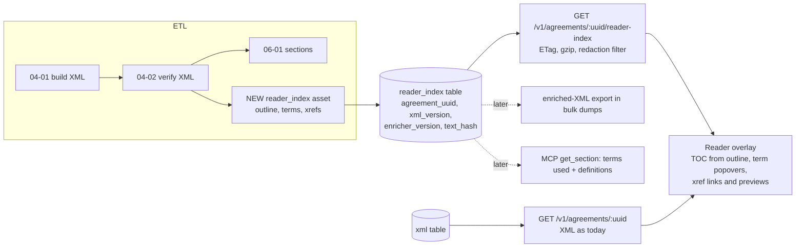

# Smart reader: live TOC, defined terms and cross-references

Status: design approved 2026-10-22 (Section 11); Phase 1 next. Owner: maintainer. Last updated 2026-10-22.

Prototype: [`smart-reader/prototype_enrich.py`](smart-reader/prototype_enrich.py) (read-only, local XML files).

## 1. Problem

A merger agreement is a graph that looks like a scroll. "Acquisition Proposal" is defined once in Section 1.1 or an Exhibit A and used 60 times. "Section 7.2(b)" points 40 pages away. Today a Pandects reader resolves both by hand: ⌘F, scroll, lose their place, scroll back.

Goals the user set:

1. **Smart TOC.** Clickable, jumps to the section, tracks your position, works on 150-section agreements.
2. **Live defined terms.** Hover or tap a term to see its definition in place; jump to where it is defined.
3. **Live cross-references.** "Section 7.2(b)", "Article IV" and "as defined in Section 1.1" become links with previews.
4. **Use the XML.** Pandects already stores every agreement as verified XML, so the enrichment should probably come from that XML rather than from browser-side guessing.

Non-goals for v1: editing, comparing agreements, linking to *other* agreements, and statute lookup (Section 11 covers these).

## 2. Current state

### 2.1 Reader (frontend)

| Piece | Where | What it does today |
|---|---|---|
| Page | `frontend/client/pages/Agreement.tsx` | Renders `AgreementReader` with `?focusSectionUuid=` and `?from=`. |
| Fetch | `frontend/client/hooks/use-agreement.ts:15` | `GET /v1/agreements/{uuid}` returns metadata plus the **whole XML as one string**. |
| Parse | `frontend/client/lib/xml-parser.ts:43` | Hand-written tag scanner. Keeps only `uuid` and `title` (`:34-35`). **Drops every other attribute, including `definition@term`.** |
| Render | `frontend/client/components/XMLRenderer.tsx:667` | Articles and sections become collapsible containers with `data-section-uuid`. **`<definition>` renders as a plain `div`** (`:523`). There is no virtualization; mounting uses `useTransition` and memoized nodes. |
| TOC | `frontend/client/components/TableOfContents.tsx:313` | A second regex pass over the raw XML. Two levels deep (article, section). |
| Scroll-spy | `frontend/client/hooks/use-scroll-spy.ts:76` | **Already solid**: IntersectionObserver reading line, hysteresis, suppression during programmatic jumps. |
| Jump | `frontend/client/components/AgreementReader.tsx:311` | `scrollToSection(uuid)` expands ancestors, retries, offsets for the sticky header. **No URL hash and no history entry**, so the browser Back button does not return you to where you were. |
| Find | `frontend/client/components/reader/find-highlight.tsx` | ⌘F highlighting with `<mark>`. |

There is no defined-term or cross-reference handling anywhere in the reader.

### 2.2 API (backend)

- `GET /v1/agreements/<uuid>` (`backend/services/agreements_service.py:976`) returns metadata plus `xml.xml` for the latest OK version. No ETag, no Cache-Control and no compression.
- **Anonymous callers get redacted XML.** `backend/redaction.py:9` replaces every section outside focus ± N with `[REDACTED]`. *Any feature that shows text from elsewhere in the document (definition popovers, xref previews) must respect this, or it leaks the redacted text.*
- `GET /v1/agreements/<uuid>/sections` returns the flat section index; `GET /v1/sections/<uuid>` returns one section's `xml_content`.
- There are no tables for definitions or terms.

### 2.3 XML and ETL

Built by `generate_xml` / `convert_to_xml` in `etl/src/etl/domain/f_xml.py:696-1165`. Verified by `04-02_verify_xml` (`etl/src/etl/defs/f_xml_asset.py:2626`, hard rules at `:1057-1266`).

```xml
<document uuid="…">
  <metadata>…</metadata>
  <frontMatter/> <tableOfContents/>
  <body>
    <text>recitals …</text>
    <article title="ARTICLE I DESCRIPTION OF TRANSACTIONS" uuid order standardId pageUUID>
      <section title="Section 1.5 Conversion of Shares." uuid order standardId pageUUID>
        <text>(a) Subject to the terms …</text>
        <text>(i) each share of Newco Common Stock held in treasury …</text>
        <definition standardID="&lt;placeholder&gt;" term="acquisition proposal">
          <text>“Acquisition Proposal” shall mean …</text>
        </definition>
        <pageUUID>…</pageUUID>
      </section>
    </article>
  </body>
  <sigPages/> <backMatter>  flat <text> lines: exhibits, schedules, annexes  </backMatter>
</document>
```

What matters for this design:

- **Text is flat.** A section is a list of `<text>` lines. "(a)" and "(i)" are characters at the start of a line, not structure, and there is no inline markup.
- **`<definition>` exists but is thin.** It is created only when a line *starts* with a quoted term followed by "means / shall mean / shall have the meaning" (`f_xml.py:757-788`). `term` is lowercased. It misses parenthetical definitions (`(the “Company”)`), mid-sentence definitions and the common glossary layout `Acquisition Proposal. “Acquisition Proposal” shall mean …` (sample `054f4c7c`: 165 "means" definitions in an Exhibit A, 0 `<definition>` elements).
- **Section uuids are deterministic** (uuid5 over agreement, normalized titles and orders; `f_xml.py:40-54`), so they are stable across rebuilds unless numbering or titles change. Inserting a section shifts every later uuid in that article. Article uuids ignore order, so two articles with the same title collide.
- **Versions.** Every build inserts `xml.version = max+1` and flips `latest`. Taxonomy then rewrites `standardId` into the same version in place, through an ElementTree round-trip (`etl/src/etl/domain/h_taxonomy.py:334`).
- **Exhibits and schedules are not structured.** Back matter is flat text; disclosure schedules are never filed at all.
- **Corpus (local, 2026-10-20):** 9,873 latest verified XMLs, averaging 337 KB (largest 2.4 MB), and 966,534 section rows. About 8,185 latest XMLs contain at least one `<definition>`.

## 3. The reference implementation (kirkland `standard-k` and `ingester`)

`standard-k` is a document *format* (ODX), not a detector. The detection lives in the sibling repo `kirkland/ingester` (`packages/docx/src/definitions.ts`, `citations.ts`). Both were read read-only.

**What transfers:**

- **Model.** Terms and cross-references are inline marks or nodes (`def`, `term`, `xref{target}`) over a block tree. Citation text is *derived* from the target's number, and a status overlay records `resolved | broken | ambiguous | out-of-scope`. We should keep the same separation between "what the text says" and "what we decided it points to".
- **Definition detection.** It uses an ordered set of declaration patterns with a `consumed` span list: leading (`“X” means`), named-as, "the term X", parenthetical (`(the “Company”)`, `(each, a “Seller”)`) and appositive. A **pointer** declaration ("has the meaning set forth in Section 5.4") counts only if nothing else declares the term; otherwise it becomes a link to the real declaration.
- **Term-use matching.** One case-sensitive alternation, longest spelling first ("Escrow Amount" before "Escrow"), with plural and possessive forms, a case-insensitive pass only over ALL-CAPS runs, and no marks in headings or inside the declaration. For speed, alternatives are bucketed by first character.
- **Cross-reference resolution.**
  - Index every numbered block by `word|normalized number`, with `5.08 = 5.8` and `Article III = Article 3`.
  - A key shared by two blocks is **ambiguous and not linked**.
  - Link the deepest block that exists ("6.3(g)" falls back to 6.3).
  - Link only if the target's derived label matches the printed label.
- **External filters.** `AUTHORITY_BEFORE` ("Code Section", "Treasury Regulations Section", `§`), "of the DGCL / of ERISA" after the number, "thereto" versus "hereto", and "this Section 2.4" forced internal.
- **Measurement.** Random sampling of marks for human verdicts. Reported: definition precision 99.2%; xrefs 12,510 resolved / 80 broken on 25 Word deals.

**What does not transfer:**

- The Word-specific parts: bookmarks, REF fields, tracked-change sides and bidi marks.
- The JSON block tree as a storage format. We have verified XML and a whole pipeline built on it, and switching the canonical format would be a rewrite.
- Some rules are fitted to individual deals in a 25-deal corpus. Our corpus is 10k EDGAR filings with OCR-ish text, older drafting styles and UK-style decimal numbering, so every borrowed rule has to be re-measured here.

## 4. Prototype results

`prototype_enrich.py` builds the index the design needs (articles, sections, a subsection tree inferred from paragraph enumerators, definitions, term uses and cross-references with a resolution status) and runs it over 10 latest verified agreements chosen across the size range. The whole run takes **0.65 s for 10 agreements**, about 65 ms each, so a full corpus pass is about 11 minutes on one core with no LLM calls.

| Agreement | Sections | Subsections found | Terms | Term uses (body) | Xrefs | In-document xrefs | Resolved exact | Resolved to section or better |
|---|---|---|---|---|---|---|---|---|
| 01b1b5c2 | 115 | 305 | 186 | 3,652 | 400 | 285 | 98.2% | 99.3% |
| 02b0b280 | 58 | 213 | 113 | 2,243 | 275 | 198 | 93.4% | 99.0% |
| 053261a1 | 118 | 98 | 66 | 1,062 | 156 | 126 | 73.8% | 74.6% |
| 054f4c7c | 82 | 248 | 167 | 3,252 | 381 | 320 | 91.6% | 98.8% |
| 0668f1f1 | 91 | 268 | 151 | 2,580 | 244 | 137 | 100% | 100% |
| 06798169 | 83 | 214 | 147 | 3,030 | 341 | 266 | 96.2% | 99.2% |
| 07191fe9 | 114 | 289 | 428 | 4,287 | 403 | 129 | 83.7% | 88.4% |
| 0769b9c5 | 96 | 315 | 191 | 4,419 | 401 | 341 | 96.5% | 98.8% |
| 07a7146e | 116 | 107 | 73 | 1,512 | 157 | 90 | 92.2% | 98.9% |
| 07b3d1c3 | 83 | 194 | 155 | 2,436 | 253 | 152 | 97.4% | 100% |
| **All** | 956 | 2,251 | 1,677 | 28,473 | 3,011 | 2,044 | **93.5%** | **97.0%** |

"In-document" covers references to Sections, Articles and clauses after statutes are removed (762 of the Section/Article mentions were external: Code, ERISA, DGCL, Sarbanes-Oxley, FBCA). "Resolved" means *a target exists*, not *the target is right*. Precision is unmeasured until the gold set exists (Section 9).

Exhibit, Schedule and Annex references are counted separately: of 205, 37 were external (Schedule 14D-9 and similar), 35 found a heading in back matter and **133 had nowhere to go**. Most of those 133 cite disclosure schedules (agreement `0668f1f1` cites 106) or exhibits that were filed separately or not at all.

What the misses taught us (each item is a rule the prototype now has, or a gap it still has):

1. **Roman versus alpha.** In "(c)", "c" is a letter, not 100. Only i–xx count as lowercase roman, and "(i)" right after "(h)" is the letter i.
2. **"Section 8" can be an article.** Older agreements number top-level parts "SECTION 8" with children 8.1, 8.2.
3. **A statute tail covers the whole run.** In "Sections 4062, 4063 or 4041 of ERISA" and "Section 355 or Section 361 of the Code", every member is external.
4. **Authority before the number.** "Code Section 409A", "Treasury Regulations Section 1.368-2(g)", "21 U.S.C. Section 360".
5. **Relative members inherit the prefix.** "Section 7.5(a) and (b)" means 7.5(b). They continue a run only when they match the enumerator kind of the previous item: "Section 7.6(b), (ii) Everest would…" starts a new enumeration and is not part of the run.
6. **Qualified clauses.** "clauses (i), (iv) or (xv) of Section 5.2(b)" resolve as 5.2(b)(i) and so on.
7. **Local clauses.** "clause (ii) above" usually points at an *inline* enumeration in the same sentence or section, not at a paragraph.
8. **Gaps the prototype still has:**
   - UK decimal numbering (`053261a1`: "Section 4.2.13", where the XML build had turned a definitions list into 118 "sections").
   - Definition-index tables ("SEC Reports § 4.06(a)").
   - "Listed Company Manual Section 312.03".
   - "Section 601 et seq. of ERISA".

The weakest agreement (`053261a1`, 74%) is weak because its XML structure is wrong, not because of the linker. **The resolution rate works as a free XML-quality signal** (see Section 9.3).

On definitions, a 40-term random sample of parenthetical definitions was clean by inspection. About 14% of terms (228 of 1,677) are declared in two places. Most are a declaration plus a glossary pointer, which the pointer-demotion rule handles. Some are party-specific redefinitions ("as such definition applies to Everest"), which have to keep both declarations.

## 5. Options

### A. Client-side only

Parse terms and references in the browser from the XML the page already receives.

- **For:** no ETL, API or schema work; ships the fastest; iterates with a page reload.
- **Against:**
  - **Redaction breaks it.** Anonymous readers receive `[REDACTED]` for most sections, so the definitions and targets are simply not there. To fix that we'd need a server-side index anyway, or we'd leak the text.
  - It re-runs about 2–5k regex matches over 2.4 MB documents on every page load, including on phones.
  - The API, MCP and bulk users get nothing.
  - There is no Python eval harness next to the ETL, and the detectors would be written twice (TS now, Python later).

### B. Rewrite the canonical XML inline

Add `<term ref>`, `<dfn>` and `<xref target status>` inside `<text>`. This is the user's hunch, taken literally.

- **For:**
  - One artifact. It flows into `sections.xml_content`, bulk dumps and the MCP for free.
  - It matches the standard-k model.
- **Against:**
  - **Mixed content breaks consumers silently.** `<text>` is a plain string everywhere today. With inline children, ElementTree's `.text` returns only the text *before the first child*. Taxonomy, sections extraction, embeddings, full-text search (`section_text_search`), the frontend parser, `redaction.py` and every external bulk-dump user would all truncate text without an error. Auditing and changing all of them is the real cost of B.
  - **Coupled iteration.** Every detector improvement means a new XML version. That re-triggers verify, sections, taxonomy and embeddings (the build queue keys off XML versions), or else rewrites a verified artifact in place.
  - **Decisions become indistinguishable from source.** An unresolved or wrong link baked into the canonical text looks the same as text from the filing.

### C. A derived reader index stored next to the XML (recommended)

An ETL asset reads the latest verified XML and writes a stand-off **reader index**. The index holds the outline, definitions, term occurrences and cross-references, with **anchors into the XML** (section uuid, text-node ordinal, character range). The canonical XML is untouched, and the frontend overlays the index onto the text it already renders.

- **For:**
  - Enrichment is ETL-time, deterministic, Python and testable, so the hunch holds in spirit. The XML is the input, and server-side enrichment is right.
  - The detector can be versioned and re-run in about 11 minutes without touching XML versions or downstream assets.
  - **Redaction-safe by construction.** The index carries offsets, not text, and previews read text from the XML the client already has (redacted or not).
  - API and MCP consumers can use it.
  - It does not block option B: an "enriched XML" export can be *generated* from canonical XML plus the index for bulk users later (Phase 4).
- **Against:**
  - There is a second artifact to keep in sync with the XML version.
  - Anchors need a precise text-offset contract between Python and the browser (Section 6.3).
  - It adds a new table and endpoint, and serving-schema work for the prod push.

**Recommendation: C**, plus one small canonical-XML fix that stays within the existing schema: widen `<definition>` detection in `f_xml.py` to cover the glossary layout. That improves the XML for everyone, and the index uses it as one signal among several.

## 6. Recommended architecture



### 6.1 Enricher (ETL)

A new pure module, `etl/src/etl/domain/reader_index.py`, holds no DB code: XML string in, index dict out, which makes it easy to test. The prototype is its first draft. A new asset (for example `07-01_reader_index`) runs after verify, over latest **verified** XMLs whose row is missing or stale.

A row is stale when any of these hold:

- `xml_version` changed;
- `enricher_version` (semver constant in the module) changed;
- `text_hash` changed. This is the SHA-256 of the concatenated text nodes, and it guards against in-place rewrites of the same version. Taxonomy's `standardId` rewrite does not change text, so it does not trigger a recompute.

Pipeline steps, all deterministic:

1. **Outline.**
   - Articles: roman → int; "ARTICLE", "Article" and "SECTION 8" styles.
   - Sections: normalized numbers, `7.02 = 7.2`, `5A` kept.
   - Subsections: inferred from paragraph enumerators with kind classification (alpha, roman, ALPHA, digit; i/v/x disambiguated by the previous sibling) and decimal paragraphs (`4.2.13`).
   - Inline enumerations are recorded as weak targets (paragraph-level only).
   - Attachments: back-matter heading lines ("EXHIBIT A", "Annex I").
2. **Declarations.**
   - `<definition>` elements, leading `“X” means`, parenthetical and appositive forms, "the term X", and pointers ("has the meaning set forth in Section 5.4").
   - Precedence: explicit declaration > parenthetical > pointer, with pointers demoted to links when a real declaration exists.
   - Keep multiple declarations when they differ in scope (party-specific).
   - Exclude definition-index tables from both declarations and uses.
3. **Term uses.**
   - Case-sensitive, longest first, with plural, possessive and "(s)" forms.
   - Case-insensitive only inside ALL-CAPS runs.
   - Skip headings, the declaration span itself and quoted spans.
   - **Common-word guard:** single-word terms that are common English words ("Law", "Effect", "Actions", "Sub", "Company" in some deals) are not matched sentence-initially and carry a lower confidence. The UI can choose whether to show them.
4. **Cross-references.**
   - Head words (Section, Article, Exhibit, Schedule, Annex, Appendix, clause, paragraph, §).
   - Lists and ranges. Range endpoints are linked; members in between are not expanded in v1.
   - Relative members with the same-kind rule, qualified clauses and local clauses ("above"/"below", searched within the current section).
   - "this Section" with no number goes to the current section.
5. **External filter.** Authority-before, statute-after ("of the Code/ERISA/DGCL/…Act", short acronyms), SEC forms (Schedule 13D/14D-9/TO), other instruments ("of the Company Disclosure Schedule", "of the bylaws", "Exhibit 21.1 of the 10-K"), and a **number-space plausibility check**: "Section 280G" in an agreement whose sections are all dotted is not internal.
6. **Resolution and status.**

   | Status | Meaning | UI |
   |---|---|---|
   | `resolved` | Exact target, and the label matches the printed text | Link + preview |
   | `section_fallback` | "6.3(g)" where (g) was not found, so the link goes to 6.3 | Link on "Section 6.3"; "(g)" stays plain text |
   | `ambiguous` | Two targets share the key | No link; tooltip shows the candidates |
   | `unlocated_attachment` | "Exhibit B" with no matching heading in back matter | Chip: "Exhibit B (not in this filing)" |
   | `disclosure_schedule` | Disclosure-letter or schedule sections | Chip, no link |
   | `external` | Statute, rule or other instrument | Plain text in v1; optional statute links later |
   | `unresolved` | Everything else | Plain text; counted in metrics |

   **Rule: a wrong link is worse than no link.** When in doubt, do not link.

### 6.2 Storage

New table `reader_index` in `pdx`:

| Column | Type | Note |
|---|---|---|
| agreement_uuid | char(36) | PK part |
| xml_version | int | PK part; matches `xml.version` |
| enricher_version | varchar(16) | |
| text_hash | char(64) | Staleness guard |
| payload | longtext (JSON) | Section 6.3 |
| n_terms, n_term_uses, n_xrefs, n_xrefs_resolved, n_xrefs_unresolved | int | Health metrics without parsing the JSON |
| created_date | datetime(3) | |

Keep the latest row per agreement, and keep old rows until the next push, for rollback. The table has to be added to the serving schema, the prod push and restore path, and `bulk/schema_docs/table_docs.yml`, since `push_to_r2.sh` enforces doc coverage. Prod's serving schema is narrower than local, so check that the table exists there and call the live endpoint after deploy.

### 6.3 Payload and the anchor contract

```jsonc
{
  "schema": 1, "enricher": "0.1.0", "agreement_uuid": "…", "xml_version": 7,
  "outline": [
    {"id": "a4", "kind": "article", "label": "IV", "title": "Covenants", "anchor": {"s": "<article-uuid>"},
     "children": [{"id": "s4.3", "kind": "section", "label": "4.3", "anchor": {"s": "<section-uuid>"},
       "children": [{"id": "s4.3(b)", "kind": "sub", "label": "4.3(b)", "anchor": {"s": "<section-uuid>", "t": 3}}]}]}
  ],
  "terms": [
    {"id": 12, "term": "Acquisition Proposal",
     "decls": [{"anchor": {"s": "<uuid>", "t": 0}, "span": [1, 21], "kind": "means"}],
     "confidence": "high"}
  ],
  // term uses, grouped by text node: [start, end, termId]
  "uses": {"<section-uuid>/5": [[14, 34, 12], [88, 99, 3]]},
  "xrefs": [
    {"at": {"s": "<uuid>", "t": 2}, "span": [41, 55], "text": "Section 7.2(b)",
     "status": "resolved", "target": "s7.2(b)"}
  ]
}
```

- **Anchor** = `s`: section uuid (or region name `frontMatter`, `body`, `backMatter`, plus an ordinal for non-section text) and `t`: ordinal of the `<text>` node within that container, in document order, *including* text inside `<definition>`.
- **Offsets are UTF-16 code units, measured over entity-decoded text**, the same string `normalizeXmlText` gives the React renderer. Python indexes code points, so the enricher converts. A shared fixture test (one agreement with curly quotes, `&amp;`, `§` and a non-BMP character) runs in both pytest and vitest to pin the contract.
- **Size:** about 2.8k term uses and 300 xrefs per agreement is roughly 60–100 KB of JSON raw and about 15–25 KB gzipped, against 337 KB of XML. This is an estimate from the prototype counts, to be measured in Phase 1.

### 6.4 API

`GET /v1/agreements/<uuid>/reader-index` returns the payload for the XML version that `/v1/agreements/<uuid>` serves.

- ETag = `xml_version:enricher_version`, `Cache-Control: public, max-age=…`, gzip.
- 404 when no index exists, and the reader degrades to today's behavior.
- **Redaction:** for anonymous callers, drop `uses` and `xrefs` anchored inside redacted sections, and replace declarations inside redacted sections with `{"redacted": true, "label": "Section 1.1"}`. The client can then say "Defined in Section 1.1 (sign in to read)" without seeing the text. Previews always read text from the XML the client already holds, so the endpoint never ships agreement text. Redacted regions are already handled.
- Optional later: `include=reader_index` on the agreement endpoint to save a round trip; terms used in a section on `/v1/sections/<uuid>` and MCP `get_section`, which helps LLM users a lot because they currently get "Acquisition Proposal" with no definition.

### 6.5 Frontend

The data pages are being polished by another session tonight. None of this should touch `Agreement.tsx`, `AgreementReader.tsx`, `XMLRenderer.tsx` or `TableOfContents.tsx` until that work lands; Phase 3 starts from whatever is on main then.

- **TOC from the outline, not regexes.**
  - Replaces `extractTOCFromXML` and the third index in `AgreementReader.tsx:102`.
  - Three levels; subsections collapsed by default and shown for the active section only.
  - Keep the existing scroll-spy and add a breadcrumb in the sticky header ("Article IV › 4.3 › (b)").
  - The TOC stays well under 1k rows even for large agreements, so it needs no virtualization.
- **Text overlay.**
  - When a `text` leaf renders, look up `uses` and `xrefs` for its anchor and split the string into segments.
  - Compose with find-highlight: find marks win visually, and both are just ranges.
  - Segment only expanded or visible sections.
- **`<TermRef>`.**
  - Dotted underline; hover intent of about 300 ms, or focus with Enter.
  - The hover card shows the declaration text (the declaration's text nodes, up to about 600 characters, with "more"), "Go to definition" and "N uses".
  - A tap on touch devices opens a bottom sheet.
  - A reader setting can switch term underlines off.
- **`<XRef>`.**
  - A link with a preview card: target title and the first lines of text.
  - Clicking jumps with the existing `scrollToSection` and reveal logic, and **pushes a history entry**, so Back returns you to the citing sentence. A "Back to §5.2(c)" chip appears after a jump.
  - Subsection targets highlight the paragraph briefly.
- **Deep links.** `#4.3(b)`-style hashes are resolved through the outline and survive uuid churn better than uuids. Keep `?focusSectionUuid=` for compatibility.
- **Long documents.** Measure before virtualizing. `content-visibility: auto` on article containers is the cheap first step; real virtualization conflicts with ⌘F and the scroll-spy, so it waits for evidence.
- **Parser fix.** `xml-parser.ts` should keep all attributes. That is needed anyway to render `<definition>` and is small.

## 7. Hard cases and decisions

| Case | Decision |
|---|---|
| Ambiguous section numbers (duplicate "Section 5.1" after a bad parse) | No link; record `ambiguous`; count it as an XML-quality signal |
| References from exhibits into the agreement ("Section 1.6(f) of the Agreement") | Resolve against body sections; "of the Agreement" means self |
| References inside an exhibit to its own paragraphs | Resolve within the attachment first, as the ingester does. Needs attachment segmentation (Phase 4) |
| Exhibits filed separately or not at all | `unlocated_attachment` chip. Later: link to the EDGAR exhibit in the same accession when we can identify it |
| Disclosure schedules | Never filed; chip only |
| Other agreements ("Section 2.1 of the Original Agreement", voting agreements) | External in v1. Later: link amendments to originals when both are in the corpus |
| Statutes (Code §, ERISA, DGCL, Exchange Act rules) | External in v1. Optional Phase 4: Cornell LII or eCFR links for a whitelist (IRC, ERISA, Exchange Act rules) |
| Ranges ("Sections 3.1 through 3.4") | Link the endpoints. Expanding the members is cheap with an outline but noisy in the UI; skip it in v1 |
| "hereof", "herein", "this Agreement" | Not links |
| Terms redefined for one party, or defined twice | Keep all declarations; the popover shows both with location labels |
| Terms that are common words | Lower confidence, no sentence-initial matches, hideable |
| Invalid (unverified) XML | No index; the reader degrades gracefully |

## 8. Versioning, backfill and cost

- **Compute:** about 65 ms per agreement in the prototype. Expect 2–3× once uses and anchors are emitted, so roughly 20–30 minutes single-process for the corpus, with no API spend.
- **Re-runs** are triggered by an enricher version bump, not by XML rebuilds. They don't re-trigger verify, sections, taxonomy or embeddings.
- **Prod:** follows the usual monthly push. The table is computed locally and shipped with the push, so nothing is written to prod directly.
- **Section uuid churn:** an XML rebuild makes a new version, and the index is recomputed for it. Old deep links that use uuids may break, which is why label-based hashes are the public format.
- **Storage:** about 10k rows × about 80 KB is roughly 0.8 GB uncompressed in MariaDB. Consider storing the payload gzip-compressed (`longblob`) if that matters.

## 9. Evaluation

### 9.1 Gold set

- **30 agreements, stratified:**
  - filing era: pre-2005, 2005–2014, 2015+;
  - source format: html or txt;
  - size;
  - numbering style: ARTICLE/Section, "SECTION 8" top level, UK decimal;
  - where definitions live: body section or Exhibit A glossary.
- **What gets labeled per agreement:**
  - **Declarations:** every term in the definitions section or exhibit, plus every parenthetical definition in 5 random sections.
  - **Xrefs:** every reference mention in 8 random sections plus the definitions section, each with the correct target or "external" or "no target in filing".
  - **Term uses:** 15 random terms, every occurrence in 3 random sections.
- **Who labels:** following the existing page-gold practice, a strong model drafts the labels from a fixed rubric, a second model checks them, and the user rules only on disagreements. Labels live as JSON fixtures under `etl/tests/fixtures/reader_gold/`.

### 9.2 Metrics and launch bar

| Metric | Definition | Launch bar |
|---|---|---|
| Xref link precision | Linked mentions whose target is correct | **≥ 99%** |
| Xref in-document recall | Gold internal mentions that get a correct link (including section fallback) | ≥ 95% |
| External classification precision | Mentions marked external that really are external | ≥ 98% |
| Declaration precision / recall | Against gold declarations | ≥ 98% / ≥ 95% |
| Term-use precision | Marked uses that are real uses of that term | ≥ 97% |
| Term-use recall | Against the labeled occurrences | ≥ 90% |

Precision gates launch; recall can grow afterwards. A pytest eval target prints the deltas on every enricher change, and CI fails on precision regressions.

### 9.3 Corpus health (no gold needed)

Every `reader_index` row carries counts, so we can rank agreements by unresolved or ambiguous xrefs, terms used but never declared, and terms declared but never used. The bottom of that list is mostly **broken XML structure** (for example `053261a1`, a definitions list parsed as 118 sections). That makes it a useful input to the XML validation queue. It should start as a report, not a verify rule, because turning it into a verify rule would flip statuses at scale.

## 10. Phases

| Phase | Scope | Exit criteria |
|---|---|---|
| **0** (this PR) | Design and prototype | Done: decisions in Section 11 |
| **1. Enricher** | `reader_index.py` module, gold set, eval harness, asset, local table, glossary-layout detection in the enricher (not `f_xml.py`, see 11.5) | Launch-bar metrics on gold; full local corpus run; health report |
| **2. API** | Endpoint, redaction filter, ETag, gzip, schema docs, serving schema, OpenAPI | Backend tests incl. redaction; live endpoint check after the push |
| **3. Reader** | Parser keeps attributes; TOC from outline and breadcrumb; xref links, previews and history; term popovers; a settings toggle; behind a flag | Vitest incl. offset-contract fixture; manual pass on 5 long agreements, phone and desktop |
| **4. Extensions** | Attachment segmentation in back matter, statute links, range expansion, MCP terms-in-section, enriched-XML bulk export, `content-visibility` and virtualization if measured slow | Each on its own |

Phases 1 and 2 are mostly independent of the UI work in flight. Phase 3 should start only after the current reader polish lands on main.

## 11. Decisions (2026-10-22)

The user answered the open questions on 2026-10-22. Items 3, 6 and 7 use the defaults proposed in the hand-off, and the user did not object to them.

1. **Anonymous readers: teaser popover.** A term whose definition sits in a redacted section stays marked. Its popover shows only "Defined in Section 1.1 (sign in to read)", with no definition text. The redaction filter in Phase 2 removes the definition body from the payload, so a hidden popover never ships the text.
2. **Bulk dumps: index table first.** `reader_index` ships in the dump as its own table, with prose in `bulk/schema_docs/table_docs.yml`. An enriched-XML export (inline `<xref>`/`<term>`) waits for Phase 4 and is built only if outside users ask for it. The index stays canonical.
3. **Statute links: Phase 4.** Code, ERISA and Exchange Act references are classified `external` and stay plain text until then.
4. **Gold labeling: as designed.** About 30 agreements. A strong model drafts the labels, a second model checks them, and the user rules only on disagreements.
5. **Glossary `<definition>` fix: in the index only for now.** The enricher detects the `Term. "Term" shall mean...` layout itself. `f_xml.py` is not changed in Phase 1. The canonical-XML fix lands later, batched with the next planned XML rebuild, so nothing is re-verified, re-sectioned or re-embedded just for this.
6. **XML quality signal: a report.** Low-resolution agreements go into a health report that feeds the validation queue. They do not become a verify rule.
7. **Common-word terms: hidden by default when low-confidence.** Terms like "Law" and "Effect" get a confidence flag, and the reader hides the low-confidence ones by default. A setting shows all of them.
