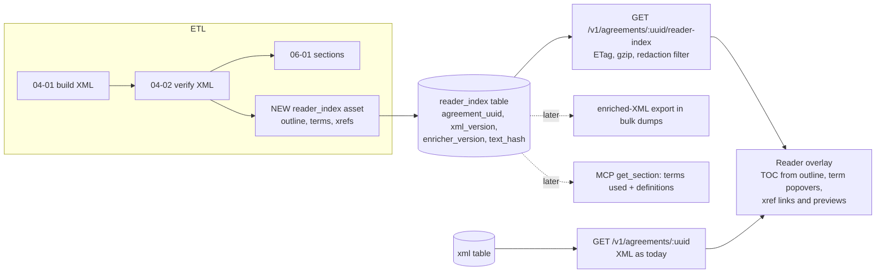

# Smart reader: live TOC, defined terms and cross-references

Status: design approved 2026-10-22 (Section 11); Phase 1 next. Owner: maintainer. Last updated 2026-10-22.

Prototype: [`smart-reader/prototype_enrich.py`](smart-reader/prototype_enrich.py) (read-only, local XML files).

## 1. Problem

A merger agreement is a graph that looks like a scroll. "Acquisition Proposal" is defined once in Section 1.1 or an Exhibit A and used 60 times. "Section 7.2(b)" points 40 pages away. Today a Pandects reader resolves both by hand: ⌘F, scroll, lose their place, scroll back.

Goals the user set:

1. **Smart TOC.** Clickable, jumps to the section, tracks your position, works on 150-section agreements.
2. **Live defined terms.** Hover or tap a term to see its definition in place; jump to where it is defined.
3. **Live cross-references.** "Section 7.2(b)", "Article IV" and "as defined in Section 1.1" become links with previews.
4. **Use the XML.** Pandects already stores every agreement as verified XML, so the enrichment should probably come from that XML rather than from browser-side guessing.

Non-goals for v1: editing, comparing agreements, linking to *other* agreements, and statute lookup (Section 11 covers these).

## 2. Current state

### 2.1 Reader (frontend)

| Piece | Where | What it does today |
|---|---|---|
| Page | `frontend/client/pages/Agreement.tsx` | Renders `AgreementReader` with `?focusSectionUuid=` and `?from=`. |
| Fetch | `frontend/client/hooks/use-agreement.ts:15` | `GET /v1/agreements/{uuid}` returns metadata plus the **whole XML as one string**. |
| Parse | `frontend/client/lib/xml-parser.ts:43` | Hand-written tag scanner. Keeps only `uuid` and `title` (`:34-35`). **Drops every other attribute, including `definition@term`.** |
| Render | `frontend/client/components/XMLRenderer.tsx:667` | Articles and sections become collapsible containers with `data-section-uuid`. **`<definition>` renders as a plain `div`** (`:523`). There is no virtualization; mounting uses `useTransition` and memoized nodes. |
| TOC | `frontend/client/components/TableOfContents.tsx:313` | A second regex pass over the raw XML. Two levels deep (article, section). |
| Scroll-spy | `frontend/client/hooks/use-scroll-spy.ts:76` | **Already solid**: IntersectionObserver reading line, hysteresis, suppression during programmatic jumps. |
| Jump | `frontend/client/components/AgreementReader.tsx:311` | `scrollToSection(uuid)` expands ancestors, retries, offsets for the sticky header. **No URL hash and no history entry**, so the browser Back button does not return you to where you were. |
| Find | `frontend/client/components/reader/find-highlight.tsx` | ⌘F highlighting with `<mark>`. |

There is no defined-term or cross-reference handling anywhere in the reader.

### 2.2 API (backend)

- `GET /v1/agreements/<uuid>` (`backend/services/agreements_service.py:976`) returns metadata plus `xml.xml` for the latest OK version. No ETag, no Cache-Control and no compression.
- **Anonymous callers get redacted XML.** `backend/redaction.py:9` replaces every section outside focus ± N with `[REDACTED]`. *Any feature that shows text from elsewhere in the document (definition popovers, xref previews) must respect this, or it leaks the redacted text.*
- `GET /v1/agreements/<uuid>/sections` returns the flat section index; `GET /v1/sections/<uuid>` returns one section's `xml_content`.
- There are no tables for definitions or terms.

### 2.3 XML and ETL

Built by `generate_xml` / `convert_to_xml` in `etl/src/etl/domain/f_xml.py:696-1165`. Verified by `04-02_verify_xml` (`etl/src/etl/defs/f_xml_asset.py:2626`, hard rules at `:1057-1266`).

```xml
<document uuid="…">
  <metadata>…</metadata>
  <frontMatter/> <tableOfContents/>
  <body>
    <text>recitals …</text>
    <article title="ARTICLE I DESCRIPTION OF TRANSACTIONS" uuid order standardId pageUUID>
      <section title="Section 1.5 Conversion of Shares." uuid order standardId pageUUID>
        <text>(a) Subject to the terms …</text>
        <text>(i) each share of Newco Common Stock held in treasury …</text>
        <definition standardID="&lt;placeholder&gt;" term="acquisition proposal">
          <text>“Acquisition Proposal” shall mean …</text>
        </definition>
        <pageUUID>…</pageUUID>
      </section>
    </article>
  </body>
  <sigPages/> <backMatter>  flat <text> lines: exhibits, schedules, annexes  </backMatter>
</document>
```

What matters for this design:

- **Text is flat.** A section is a list of `<text>` lines. "(a)" and "(i)" are characters at the start of a line, not structure, and there is no inline markup.
- **`<definition>` exists but is thin.** It is created only when a line *starts* with a quoted term followed by "means / shall mean / shall have the meaning" (`f_xml.py:757-788`). `term` is lowercased. It misses parenthetical definitions (`(the “Company”)`), mid-sentence definitions and the common glossary layout `Acquisition Proposal. “Acquisition Proposal” shall mean …` (sample `054f4c7c`: 165 "means" definitions in an Exhibit A, 0 `<definition>` elements).
- **Section uuids are deterministic** (uuid5 over agreement, normalized titles and orders; `f_xml.py:40-54`), so they are stable across rebuilds unless numbering or titles change. Inserting a section shifts every later uuid in that article. Article uuids ignore order, so two articles with the same title collide.
- **Versions.** Every build inserts `xml.version = max+1` and flips `latest`. Taxonomy then rewrites `standardId` into the same version in place, through an ElementTree round-trip (`etl/src/etl/domain/h_taxonomy.py:334`).
- **Exhibits and schedules are not structured.** Back matter is flat text; disclosure schedules are never filed at all.
- **Corpus (local, 2026-10-20):** 9,873 latest verified XMLs, averaging 337 KB (largest 2.4 MB), and 966,534 section rows. About 8,185 latest XMLs contain at least one `<definition>`.

## 3. The reference implementation (kirkland `standard-k` and `ingester`)

`standard-k` is a document *format* (ODX), not a detector. The detection lives in the sibling repo `kirkland/ingester` (`packages/docx/src/definitions.ts`, `citations.ts`). Both were read read-only.

**What transfers:**

- **Model.** Terms and cross-references are inline marks or nodes (`def`, `term`, `xref{target}`) over a block tree. Citation text is *derived* from the target's number, and a status overlay records `resolved | broken | ambiguous | out-of-scope`. We should keep the same separation between "what the text says" and "what we decided it points to".
- **Definition detection.** It uses an ordered set of declaration patterns with a `consumed` span list: leading (`“X” means`), named-as, "the term X", parenthetical (`(the “Company”)`, `(each, a “Seller”)`) and appositive. A **pointer** declaration ("has the meaning set forth in Section 5.4") counts only if nothing else declares the term; otherwise it becomes a link to the real declaration.
- **Term-use matching.** One case-sensitive alternation, longest spelling first ("Escrow Amount" before "Escrow"), with plural and possessive forms, a case-insensitive pass only over ALL-CAPS runs, and no marks in headings or inside the declaration. For speed, alternatives are bucketed by first character.
- **Cross-reference resolution.**
  - Index every numbered block by `word|normalized number`, with `5.08 = 5.8` and `Article III = Article 3`.
  - A key shared by two blocks is **ambiguous and not linked**.
  - Link the deepest block that exists ("6.3(g)" falls back to 6.3).
  - Link only if the target's derived label matches the printed label.
- **External filters.** `AUTHORITY_BEFORE` ("Code Section", "Treasury Regulations Section", `§`), "of the DGCL / of ERISA" after the number, "thereto" versus "hereto", and "this Section 2.4" forced internal.
- **Measurement.** Random sampling of marks for human verdicts. Reported: definition precision 99.2%; xrefs 12,510 resolved / 80 broken on 25 Word deals.

**What does not transfer:**

- The Word-specific parts: bookmarks, REF fields, tracked-change sides and bidi marks.
- The JSON block tree as a storage format. We have verified XML and a whole pipeline built on it, and switching the canonical format would be a rewrite.
- Some rules are fitted to individual deals in a 25-deal corpus. Our corpus is 10k EDGAR filings with OCR-ish text, older drafting styles and UK-style decimal numbering, so every borrowed rule has to be re-measured here.

## 4. Prototype results

`prototype_enrich.py` builds the index the design needs (articles, sections, a subsection tree inferred from paragraph enumerators, definitions, term uses and cross-references with a resolution status) and runs it over 10 latest verified agreements chosen across the size range. The whole run takes **0.65 s for 10 agreements**, about 65 ms each, so a full corpus pass is about 11 minutes on one core with no LLM calls.

| Agreement | Sections | Subsections found | Terms | Term uses (body) | Xrefs | In-document xrefs | Resolved exact | Resolved to section or better |
|---|---|---|---|---|---|---|---|---|
| 01b1b5c2 | 115 | 305 | 186 | 3,652 | 400 | 285 | 98.2% | 99.3% |
| 02b0b280 | 58 | 213 | 113 | 2,243 | 275 | 198 | 93.4% | 99.0% |
| 053261a1 | 118 | 98 | 66 | 1,062 | 156 | 126 | 73.8% | 74.6% |
| 054f4c7c | 82 | 248 | 167 | 3,252 | 381 | 320 | 91.6% | 98.8% |
| 0668f1f1 | 91 | 268 | 151 | 2,580 | 244 | 137 | 100% | 100% |
| 06798169 | 83 | 214 | 147 | 3,030 | 341 | 266 | 96.2% | 99.2% |
| 07191fe9 | 114 | 289 | 428 | 4,287 | 403 | 129 | 83.7% | 88.4% |
| 0769b9c5 | 96 | 315 | 191 | 4,419 | 401 | 341 | 96.5% | 98.8% |
| 07a7146e | 116 | 107 | 73 | 1,512 | 157 | 90 | 92.2% | 98.9% |
| 07b3d1c3 | 83 | 194 | 155 | 2,436 | 253 | 152 | 97.4% | 100% |
| **All** | 956 | 2,251 | 1,677 | 28,473 | 3,011 | 2,044 | **93.5%** | **97.0%** |

"In-document" covers references to Sections, Articles and clauses after statutes are removed (762 of the Section/Article mentions were external: Code, ERISA, DGCL, Sarbanes-Oxley, FBCA). "Resolved" means *a target exists*, not *the target is right*. Precision is unmeasured until the gold set exists (Section 9).

Exhibit, Schedule and Annex references are counted separately: of 205, 37 were external (Schedule 14D-9 and similar), 35 found a heading in back matter and **133 had nowhere to go**. Most of those 133 cite disclosure schedules (agreement `0668f1f1` cites 106) or exhibits that were filed separately or not at all.

What the misses taught us (each item is a rule the prototype now has, or a gap it still has):

1. **Roman versus alpha.** In "(c)", "c" is a letter, not 100. Only i–xx count as lowercase roman, and "(i)" right after "(h)" is the letter i.
2. **"Section 8" can be an article.** Older agreements number top-level parts "SECTION 8" with children 8.1, 8.2.
3. **A statute tail covers the whole run.** In "Sections 4062, 4063 or 4041 of ERISA" and "Section 355 or Section 361 of the Code", every member is external.
4. **Authority before the number.** "Code Section 409A", "Treasury Regulations Section 1.368-2(g)", "21 U.S.C. Section 360".
5. **Relative members inherit the prefix.** "Section 7.5(a) and (b)" means 7.5(b). They continue a run only when they match the enumerator kind of the previous item: "Section 7.6(b), (ii) Everest would…" starts a new enumeration and is not part of the run.
6. **Qualified clauses.** "clauses (i), (iv) or (xv) of Section 5.2(b)" resolve as 5.2(b)(i) and so on.
7. **Local clauses.** "clause (ii) above" usually points at an *inline* enumeration in the same sentence or section, not at a paragraph.
8. **Gaps the prototype still has:**
   - UK decimal numbering (`053261a1`: "Section 4.2.13", where the XML build had turned a definitions list into 118 "sections").
   - Definition-index tables ("SEC Reports § 4.06(a)").
   - "Listed Company Manual Section 312.03".
   - "Section 601 et seq. of ERISA".

The weakest agreement (`053261a1`, 74%) is weak because its XML structure is wrong, not because of the linker. **The resolution rate works as a free XML-quality signal** (see Section 9.3).

On definitions, a 40-term random sample of parenthetical definitions was clean by inspection. About 14% of terms (228 of 1,677) are declared in two places. Most are a declaration plus a glossary pointer, which the pointer-demotion rule handles. Some are party-specific redefinitions ("as such definition applies to Everest"), which have to keep both declarations.

## 5. Options

### A. Client-side only

Parse terms and references in the browser from the XML the page already receives.

- **For:** no ETL, API or schema work; ships the fastest; iterates with a page reload.
- **Against:**
  - **Redaction breaks it.** Anonymous readers receive `[REDACTED]` for most sections, so the definitions and targets are simply not there. To fix that we'd need a server-side index anyway, or we'd leak the text.
  - It re-runs about 2–5k regex matches over 2.4 MB documents on every page load, including on phones.
  - The API, MCP and bulk users get nothing.
  - There is no Python eval harness next to the ETL, and the detectors would be written twice (TS now, Python later).

### B. Rewrite the canonical XML inline

Add `<term ref>`, `<dfn>` and `<xref target status>` inside `<text>`. This is the user's hunch, taken literally.

- **For:**
  - One artifact. It flows into `sections.xml_content`, bulk dumps and the MCP for free.
  - It matches the standard-k model.
- **Against:**
  - **Mixed content breaks consumers silently.** `<text>` is a plain string everywhere today. With inline children, ElementTree's `.text` returns only the text *before the first child*. Taxonomy, sections extraction, embeddings, full-text search (`section_text_search`), the frontend parser, `redaction.py` and every external bulk-dump user would all truncate text without an error. Auditing and changing all of them is the real cost of B.
  - **Coupled iteration.** Every detector improvement means a new XML version. That re-triggers verify, sections, taxonomy and embeddings (the build queue keys off XML versions), or else rewrites a verified artifact in place.
  - **Decisions become indistinguishable from source.** An unresolved or wrong link baked into the canonical text looks the same as text from the filing.

### C. A derived reader index stored next to the XML (recommended)

An ETL asset reads the latest verified XML and writes a stand-off **reader index**. The index holds the outline, definitions, term occurrences and cross-references, with **anchors into the XML** (section uuid, text-node ordinal, character range). The canonical XML is untouched, and the frontend overlays the index onto the text it already renders.

- **For:**
  - Enrichment is ETL-time, deterministic, Python and testable, so the hunch holds in spirit. The XML is the input, and server-side enrichment is right.
  - The detector can be versioned and re-run in about 11 minutes without touching XML versions or downstream assets.
  - **Redaction-safe by construction.** The index carries offsets, not text, and previews read text from the XML the client already has (redacted or not).
  - API and MCP consumers can use it.
  - It does not block option B: an "enriched XML" export can be *generated* from canonical XML plus the index for bulk users later (Phase 4).
- **Against:**
  - There is a second artifact to keep in sync with the XML version.
  - Anchors need a precise text-offset contract between Python and the browser (Section 6.3).
  - It adds a new table and endpoint, and serving-schema work for the prod push.

**Recommendation: C**, plus one small canonical-XML fix that stays within the existing schema: widen `<definition>` detection in `f_xml.py` to cover the glossary layout. That improves the XML for everyone, and the index uses it as one signal among several.

## 6. Recommended architecture



### 6.1 Enricher (ETL)

A new pure module, `etl/src/etl/domain/reader_index.py`, holds no DB code: XML string in, index dict out, which makes it easy to test. The prototype is its first draft. A new asset (for example `07-01_reader_index`) runs after verify, over latest **verified** XMLs whose row is missing or stale.

A row is stale when any of these hold:

- `xml_version` changed;
- `enricher_version` (semver constant in the module) changed;
- `text_hash` changed. This is the SHA-256 of the concatenated text nodes, and it guards against in-place rewrites of the same version. Taxonomy's `standardId` rewrite does not change text, so it does not trigger a recompute.

Pipeline steps, all deterministic:

1. **Outline.**
   - Articles: roman → int; "ARTICLE", "Article" and "SECTION 8" styles.
   - Sections: normalized numbers, `7.02 = 7.2`, `5A` kept.
   - Subsections: inferred from paragraph enumerators with kind classification (alpha, roman, ALPHA, digit; i/v/x disambiguated by the previous sibling) and decimal paragraphs (`4.2.13`).
   - Inline enumerations are recorded as weak targets (paragraph-level only).
   - Attachments: back-matter heading lines ("EXHIBIT A", "Annex I").
2. **Declarations.**
   - `<definition>` elements, leading `“X” means`, parenthetical and appositive forms, "the term X", and pointers ("has the meaning set forth in Section 5.4").
   - Precedence: explicit declaration > parenthetical > pointer, with pointers demoted to links when a real declaration exists.
   - Keep multiple declarations when they differ in scope (party-specific).
   - Exclude definition-index tables from both declarations and uses.
3. **Term uses.**
   - Case-sensitive, longest first, with plural, possessive and "(s)" forms.
   - Case-insensitive only inside ALL-CAPS runs.
   - Skip headings, the declaration span itself and quoted spans.
   - **Common-word guard:** single-word terms that are common English words ("Law", "Effect", "Actions", "Sub", "Company" in some deals) are not matched sentence-initially and carry a lower confidence. The UI can choose whether to show them.
4. **Cross-references.**
   - Head words (Section, Article, Exhibit, Schedule, Annex, Appendix, clause, paragraph, §).
   - Lists and ranges. Range endpoints are linked; members in between are not expanded in v1.
   - Relative members with the same-kind rule, qualified clauses and local clauses ("above"/"below", searched within the current section).
   - "this Section" with no number goes to the current section.
5. **External filter.** Authority-before, statute-after ("of the Code/ERISA/DGCL/…Act", short acronyms), SEC forms (Schedule 13D/14D-9/TO), other instruments ("of the Company Disclosure Schedule", "of the bylaws", "Exhibit 21.1 of the 10-K"), and a **number-space plausibility check**: "Section 280G" in an agreement whose sections are all dotted is not internal.
6. **Resolution and status.**

   | Status | Meaning | UI |
   |---|---|---|
   | `resolved` | Exact target, and the label matches the printed text | Link + preview |
   | `section_fallback` | "6.3(g)" where (g) was not found, so the link goes to 6.3 | Link on "Section 6.3"; "(g)" stays plain text |
   | `ambiguous` | Two targets share the key | No link; tooltip shows the candidates |
   | `unlocated_attachment` | "Exhibit B" with no matching heading in back matter | Chip: "Exhibit B (not in this filing)" |
   | `disclosure_schedule` | Disclosure-letter or schedule sections | Chip, no link |
   | `external` | Statute, rule or other instrument | Plain text in v1; optional statute links later |
   | `unresolved` | Everything else | Plain text; counted in metrics |

   **Rule: a wrong link is worse than no link.** When in doubt, do not link.

### 6.2 Storage

New table `reader_index` in `pdx`:

| Column | Type | Note |
|---|---|---|
| agreement_uuid | char(36) | PK part |
| xml_version | int | PK part; matches `xml.version` |
| enricher_version | varchar(16) | |
| text_hash | char(64) | Staleness guard |
| payload_gz | longblob | Section 6.3 JSON, gzip-compressed (about 40 KB vs 190 KB raw); the API can serve it as-is with `Content-Encoding: gzip` |
| n_terms, n_term_uses, n_xrefs, n_xrefs_resolved, n_xrefs_unresolved | int | Health metrics without parsing the JSON |
| body_section_level_rate | decimal(5,4) | Ranks agreements for the health report |
| created_date | datetime(3) | |

Keep the latest row per agreement, and keep old rows until the next push, for rollback. The table has to be added to the serving schema, the prod push and restore path, and `bulk/schema_docs/table_docs.yml`, since `push_to_r2.sh` enforces doc coverage. Prod's serving schema is narrower than local, so check that the table exists there and call the live endpoint after deploy.

### 6.3 Payload and the anchor contract

```jsonc
{
  "schema": 1, "enricher": "0.1.0", "agreement_uuid": "…", "xml_version": 7,
  "outline": [
    {"id": "a4", "kind": "article", "label": "IV", "title": "Covenants", "anchor": {"s": "<article-uuid>"},
     "children": [{"id": "s4.3", "kind": "section", "label": "4.3", "anchor": {"s": "<section-uuid>"},
       "children": [{"id": "s4.3(b)", "kind": "sub", "label": "4.3(b)", "anchor": {"s": "<section-uuid>", "t": 3}}]}]}
  ],
  "terms": [
    {"id": 12, "term": "Acquisition Proposal",
     "decls": [{"anchor": {"s": "<uuid>", "t": 0}, "span": [1, 21], "kind": "means"}],
     "confidence": "high"}
  ],
  // term uses, grouped by text node: [start, end, termId]
  "uses": {"<section-uuid>/5": [[14, 34, 12], [88, 99, 3]]},
  "xrefs": [
    {"at": {"s": "<uuid>", "t": 2}, "span": [41, 55], "text": "Section 7.2(b)",
     "status": "resolved", "target": "s7.2(b)"}
  ]
}
```

- **Declarations** may carry `pointer` (the target of "has the meaning set forth in …": `Section 2.2`, or the printed words otherwise: `preamble`, `introductory paragraph`, `Parent Charter`) and `as`, the printed spelling when it differs from the term's (a glossary's "COMPANY" merged into the preamble's "Company", enricher 0.3.0).
- **Anchor** = `s`: section uuid (or region name `frontMatter`, `body`, `backMatter`, plus an ordinal for non-section text) and `t`: ordinal of the `<text>` node within that container, in document order, *including* text inside `<definition>`.
- **Offsets are UTF-16 code units, measured over entity-decoded text**, the same string `normalizeXmlText` gives the React renderer. Python indexes code points, so the enricher converts. A shared fixture test (one agreement with curly quotes, `&amp;`, `§` and a non-BMP character) runs in both pytest and vitest to pin the contract.
- **Size:** about 2.8k term uses and 300 xrefs per agreement is roughly 60–100 KB of JSON raw and about 15–25 KB gzipped, against 337 KB of XML. This is an estimate from the prototype counts, to be measured in Phase 1.

### 6.4 API

`GET /v1/agreements/<uuid>/reader-index` returns the payload for the XML version that `/v1/agreements/<uuid>` serves.

- ETag = `xml_version:enricher_version`, `Cache-Control: public, max-age=…`, gzip.
- 404 when no index exists, and the reader degrades to today's behavior.
- **Redaction:** for anonymous callers, drop `uses` and `xrefs` anchored inside redacted sections, and replace declarations inside redacted sections with `{"redacted": true, "label": "Section 1.1"}`. The client can then say "Defined in Section 1.1 (sign in to read)" without seeing the text. Previews always read text from the XML the client already holds, so the endpoint never ships agreement text. Redacted regions are already handled.
- Optional later: `include=reader_index` on the agreement endpoint to save a round trip; terms used in a section on `/v1/sections/<uuid>` and MCP `get_section`, which helps LLM users a lot because they currently get "Acquisition Proposal" with no definition.

### 6.5 Frontend

The data pages are being polished by another session tonight. None of this should touch `Agreement.tsx`, `AgreementReader.tsx`, `XMLRenderer.tsx` or `TableOfContents.tsx` until that work lands; Phase 3 starts from whatever is on main then.

- **TOC from the outline, not regexes.**
  - Replaces `extractTOCFromXML` and the third index in `AgreementReader.tsx:102`.
  - Three levels; subsections collapsed by default and shown for the active section only.
  - Keep the existing scroll-spy and add a breadcrumb in the sticky header ("Article IV › 4.3 › (b)").
  - The TOC stays well under 1k rows even for large agreements, so it needs no virtualization.
- **Text overlay.**
  - When a `text` leaf renders, look up `uses` and `xrefs` for its anchor and split the string into segments.
  - Compose with find-highlight: find marks win visually, and both are just ranges.
  - Segment only expanded or visible sections.
- **`<TermRef>`.**
  - Dotted underline; hover intent of about 300 ms, or focus with Enter.
  - The hover card shows the declaration text (the declaration's text nodes, up to about 600 characters, with "more"), "Go to definition" and "N uses".
  - A tap on touch devices opens a bottom sheet.
  - A reader setting can switch term underlines off.
- **`<XRef>`.**
  - A link with a preview card: target title and the first lines of text.
  - Clicking jumps with the existing `scrollToSection` and reveal logic, and **pushes a history entry**, so Back returns you to the citing sentence. A "Back to §5.2(c)" chip appears after a jump.
  - Subsection targets highlight the paragraph briefly.
- **Deep links.** `#4.3(b)`-style hashes are resolved through the outline and survive uuid churn better than uuids. Keep `?focusSectionUuid=` for compatibility.
- **Long documents.** Measure before virtualizing. `content-visibility: auto` on article containers is the cheap first step; real virtualization conflicts with ⌘F and the scroll-spy, so it waits for evidence.
- **Parser fix.** `xml-parser.ts` should keep all attributes. That is needed anyway to render `<definition>` and is small.

## 7. Hard cases and decisions

| Case | Decision |
|---|---|
| Ambiguous section numbers (duplicate "Section 5.1" after a bad parse) | No link; record `ambiguous`; count it as an XML-quality signal |
| References from exhibits into the agreement ("Section 1.6(f) of the Agreement") | Resolve against body sections; "of the Agreement" means self |
| References inside an exhibit to its own paragraphs | Resolve within the attachment first, as the ingester does. Needs attachment segmentation (Phase 4) |
| Exhibits filed separately or not at all | `unlocated_attachment` chip. Later: link to the EDGAR exhibit in the same accession when we can identify it |
| Disclosure schedules | Never filed; chip only |
| Other agreements ("Section 2.1 of the Original Agreement", voting agreements) | External in v1. Later: link amendments to originals when both are in the corpus |
| Statutes (Code §, ERISA, DGCL, Exchange Act rules) | External in v1. Optional Phase 4: Cornell LII or eCFR links for a whitelist (IRC, ERISA, Exchange Act rules) |
| Ranges ("Sections 3.1 through 3.4") | Link the endpoints. Expanding the members is cheap with an outline but noisy in the UI; skip it in v1 |
| "hereof", "herein", "this Agreement" | Not links |
| Terms redefined for one party, or defined twice | Keep all declarations; the popover shows both with location labels |
| Terms that are common words | Lower confidence, no sentence-initial matches, hideable |
| Invalid (unverified) XML | No index; the reader degrades gracefully |

## 8. Versioning, backfill and cost

- **Compute:** about 65 ms per agreement in the prototype. Expect 2–3× once uses and anchors are emitted, so roughly 20–30 minutes single-process for the corpus, with no API spend.
- **Re-runs** are triggered by an enricher version bump, not by XML rebuilds. They don't re-trigger verify, sections, taxonomy or embeddings.
- **Prod:** follows the usual monthly push. The table is computed locally and shipped with the push, so nothing is written to prod directly.
- **Section uuid churn:** an XML rebuild makes a new version, and the index is recomputed for it. Old deep links that use uuids may break, which is why label-based hashes are the public format.
- **Storage:** measured on the corpus: 11,790 rows × about 40 KB gzipped is roughly 470 MB (about 2.2 GB if stored raw), so the payload is stored compressed.

## 9. Evaluation

### 9.1 Gold set

- **30 agreements, stratified:**
  - filing era: pre-2005, 2005–2014, 2015+;
  - source format: html or txt;
  - size;
  - numbering style: ARTICLE/Section, "SECTION 8" top level, UK decimal;
  - where definitions live: body section or Exhibit A glossary.
- **What gets labeled per agreement:**
  - **Declarations:** every term in the definitions section or exhibit, plus every parenthetical definition in 5 random sections.
  - **Xrefs:** every reference mention in 8 random sections plus the definitions section, each with the correct target or "external" or "no target in filing".
  - **Term uses:** 15 random terms, every occurrence in 3 random sections.
- **Who labels:** following the existing page-gold practice, a strong model drafts the labels from a fixed rubric, a second model checks them, and the user rules only on disagreements. Labels live as JSON fixtures under `etl/tests/fixtures/reader_gold/`.

### 9.2 Metrics and launch bar

| Metric | Definition | Launch bar |
|---|---|---|
| Xref link precision | Linked mentions whose target is correct | **≥ 99%** |
| Xref in-document recall | Gold internal mentions that get a correct link (including section fallback) | ≥ 95% |
| External classification precision | Mentions marked external that really are external | ≥ 98% |
| Declaration precision / recall | Against gold declarations | ≥ 98% / ≥ 95% |
| Term-use precision | Marked uses that are real uses of that term | ≥ 97% |
| Term-use recall | Against the labeled occurrences | ≥ 90% |

Precision gates launch; recall can grow afterwards. A pytest eval target prints the deltas on every enricher change, and CI fails on precision regressions.

### 9.3 Corpus health (no gold needed)

Every `reader_index` row carries counts, so we can rank agreements by unresolved or ambiguous xrefs, terms used but never declared, and terms declared but never used. The bottom of that list is mostly **broken XML structure** (for example `053261a1`, a definitions list parsed as 118 sections). That makes it a useful input to the XML validation queue. It should start as a report, not a verify rule, because turning it into a verify rule would flip statuses at scale.

## 10. Phases

| Phase | Scope | Exit criteria |
|---|---|---|
| **0** | Design and prototype | Done: decisions in Section 11 |
| **1. Enricher** (done except the health report, 10.1–10.8; enricher 0.4.0 meets every launch-bar metric blind on held-out v4) | `reader_index.py` module, gold set, eval harness, asset, local table, glossary-layout detection in the enricher (not `f_xml.py`, see 11.5) | Launch-bar metrics on gold; full local corpus run; health report |
| **2. API** (built, 10.8; waiting on the prod push) | Endpoint, redaction filter, ETag, gzip, schema docs, serving schema, OpenAPI | Backend tests incl. redaction; live endpoint check after the push |
| **3. Reader** (built behind a flag, 10.9) | Parser keeps attributes; TOC from outline and breadcrumb; xref links, previews and history; term popovers; a settings toggle; behind a flag | Vitest incl. offset-contract fixture; manual pass on 5 long agreements, phone and desktop |
| **4. Extensions** | Attachment segmentation in back matter, statute links, range expansion, MCP terms-in-section, enriched-XML bulk export, `content-visibility` and virtualization if measured slow | Each on its own |

Phases 1 and 2 are mostly independent of the UI work in flight. Phase 3 should start only after the current reader polish lands on main.

### 10.1 Phase 1 progress (2026-10-22)

Landed on this branch: [`etl/src/etl/domain/reader_index.py`](../../etl/src/etl/domain/reader_index.py), the pure enricher (XML string in, Section 6.3 payload out, `ENRICHER_VERSION = "0.1.0"`), and `etl/tests/test_reader_index.py` (15 unit tests: outline, declarations, uses, xref statuses, anchors, UTF-16 offsets, text hash). Not wired into Dagster and writes nothing to any database.

Changes from the prototype:

- Emits anchors and UTF-16 spans per the contract. Corpus check: none of the 11,790 latest verified XMLs contains a carriage return or markup nested inside `<text>`, so ElementTree's decoded text has the same length as the string the reader renders.
- Pointers ("has the meaning set forth in Section 5.4") are no longer counted as `means` declarations, and are dropped when the term has a real declaration.
- Glossary layout (`Term. "Term" shall mean...`) is a declaration, and its leading heading is not counted as a use (decision 11.5).
- Back matter is split at attachment headings. A segment where at least three paragraphs open with a quoted term is treated as the agreement's own glossary, so its bare "Section 5.4" resolves to the body. In any other exhibit, a bare section reference stays unlinked (`exhibit_local`), because exhibits such as voting agreements number their own sections.
- "Section 4.4 of the Company Disclosure Letter" and dotted "Schedule 3.4" are `disclosure_schedule`, not `external`.
- Duplicate section numbers produce `ambiguous` with candidates, and no subsection targets under them.
- Article titles glued to their headings ("ARTICLE VIISURVIVAL") are accepted only when the roman prefix is the next article number in sequence.
- Common-word terms get `confidence: "low"` and no sentence-initial uses (decision 11.7).

Measured on 13 latest verified agreements (12 drawn by hash plus `053261a1`), body text, Section/Article/clause references, excluding external and disclosure-schedule:

| | Exact | Section level | n |
|---|---|---|---|
| All in-document references | 87.3% | 88.2% | 3,634 |
| Excluding inline enumerations ("clause (i) above" with no outline target) | 95.1% | 96.1% | 3,336 |

The prototype's 93.5% counted inline enumerations as resolved; v0.1.0 leaves them unlinked until paragraph-level targets exist. About 61 ms per agreement. The payload is about 190 KB raw and 40 KB gzipped, larger than the Section 6.3 estimate, mostly because `uses` keys repeat section uuids. Shortening those keys is a Phase 2 option if it matters.

### 10.2 Table, asset and corpus run (2026-10-22, overnight)

Landed on this branch:

- `etl/sql/migrations/20261022_reader_index.sql`: the `reader_index` table (Section 6.2, with `payload_gz`). **Not applied anywhere.** Creating it locally waits for Phase 2, because `push_to_r2.sh` enforces bulk schema-doc coverage, and an undocumented table could break the next push.
- `etl/src/etl/defs/l_reader_index_asset.py`: the manual asset `12_reader_index`, which depends on verify like `06_sections_asset` and belongs to no job. It picks latest verified XMLs that have no row for their version at the current `ENRICHER_VERSION` and upserts rows built by `reader_index_row()`. It asserts the table exists and issues no DDL. It does not yet re-check `text_hash` against stored rows; in-place rewrites of one version are rare, and a version bump catches them.
- Tests: `etl/tests/test_l_reader_index_asset.py` (row builder, queue SQL, paging with a fake engine, missing-table guard) and the asset-graph test. All 622 ETL tests pass, and `import etl.definitions` loads 78 assets.

Two rules were added after the first corpus pass surfaced a cluster of agreements resolving 0%:

- **UK numbered clauses:** "clause 9.4" resolves like "Section 9.4", and "clause 5" resolves to the top-level clause. Numbered "paragraph 9.1" stays unlinked, because in UK deals it usually points into a schedule.
- **Named attachments:** "Section 2.1 of Exhibit B", "paragraph 3 of Schedule 2" and "Part", "Annex" or "Appendix" tails are `unresolved` with detail `attachment_local`, never linked to the body.

**Corpus run (read-only, all 11,790 latest verified XMLs):**

- **Errors and speed:** 0 parse errors. 67 ms mean and 135 ms p95 per agreement, 13 minutes single-process.
- **Volume:** 1.82M terms, 36.8M term uses, 4.42M references.
- **Reference statuses:**
  - resolved: 2.49M
  - section fallback: 77k
  - ambiguous: 17k
  - unresolved: 628k (of which 219k are inline enumerations and 232k are exhibit-local)
  - unlocated attachment: 90k
  - external: 638k
  - disclosure schedule: 478k
- **Per-agreement rates** (body text, in-document references, inline enumerations counted as misses): median 87.0% exact and 88.9% section level; mean 84.5% and 86.8%.
- **Health tail** (decision 11.6): 251 agreements below 50% section level, 443 below 70% and 1,433 below 80%. Also 154 agreements with duplicate section numbers, 70 with no numbered sections and 38 with no defined terms. Spot checks of the lowest group found broken structure (definitions parsed as sections) and UK drafting; the remaining 14 agreements at 0% have very few references each.
- **The per-agreement CSV** (`reader_index_health_2026-10-22.csv`) is in the session notes folder, not in the repo. It is the first input for the validation-queue report.

### 10.3 Gold-set pilot (2026-10-23)

Five agreements, one per stratum, none used to tune the enricher: `a4f68407` (pre-2005, txt, terms defined inline with no definitions article), `ac898a77` (2005–14), `f1e944db` and `dcaec060` (2015+), and `03f4e108` (UK-style clauses). Tooling: [`gold_rubric.md`](smart-reader/gold_rubric.md) and `etl/src/etl/utils/reader_gold.py`. Each packet holds a definitions excerpt of up to 40 paragraphs, 4 seeded random sections and the outline. Sonnet drafted the labels without seeing the enricher's output, and Opus checked them. Agreed items are in `etl/tests/fixtures/reader_gold/`, and each file's `pending_disputes` holds the items awaiting the user's ruling. Fixes that only shorten a quoted context are applied automatically.

**Cost:** about 1.0M subagent tokens in total, roughly 100k per drafter and 100k per checker. Packets are only about 6k tokens each, so nearly all of the cost is fixed per-agent overhead. For the full 30, giving each agent 3 agreements should bring the cost to an estimated 2.5–3M tokens, against about 6M at one agreement per agent.

**Labels:** after adjudication, 161 declarations, 170 references (111 internal) and 12 term-use rows. 16 items went to the user, and 5 context-only fixes were applied automatically.

**First score:** the enricher started at 92.4% link precision (108 of 117 links correct), against the 99% bar. Fixes for the error patterns the pilot exposed:

- "Section 3.2(a) of the Company Schedules" is now `disclosure_schedule`, and so is a reference joined to one by "or" or "and".
- A bare "clause (i)" stays unlinked when the citing paragraph enumerates (i) itself, or when it sits in a definitions section (5 or more declarations). Those items belong to one definition.
- Multi-word statute names ("Section 3 of the Spanish Civil Code") are external.
- An attachment heading ("Annex 3.7") no longer links to itself.
- Declarations now cover `(the entity so determined, the "X")`, `referred to herein as "X"`, `the term "X," when used ... means`, and a pointer wrapped in a `<definition>` element. Plural terms also match their singular ("Acquired Employees" and "Acquired Employee").

**Rulings (2026-10-23).** The user accepted all five recommended rulings on the 16 disputed items, now in rubric v1.2:

1. Single-letter formula variables are not declarations.
2. Lowercase correlatives ("control", "controlled") are not declarations.
3. An attachment that is mentioned but not filed is `not_in_filing`.
4. A "Schedule 12.2" that mirrors the agreement's section numbers is `disclosure_schedule`.
5. Drafter errors were fixed in the checker's favor, except one "Section 3.13 of the ... Disclosure Schedule" that stays `disclosure_schedule`.

All five fixtures are adjudicated, and `etl/tests/test_reader_gold_fixtures.py` keeps them consistent in CI.

**Score against the adjudicated gold** (pilot set; optimistic, because these agreements drove the fixes):

| Metric | Pilot | Launch bar |
|---|---|---|
| Xref link precision | 100% (109/109) | ≥ 99% |
| Xref in-document recall | 98.2% (109/111) | ≥ 95% |
| Declaration precision / recall | 94–100% / 100% per agreement | ≥ 98% / ≥ 95% |
| Term-use precision / recall | 100% / 89–100% (2 agreements only) | ≥ 97% / ≥ 90% |

The full set of 30 must be scored held-out, with no rule changes in between, to give a real precision number. Term-use evidence is thin: rubric v1 picked terms that never occur in the sampled sections, so v1.1 picks terms that do.

**Known gaps** left for the held-out set to measure, not fixed now:

- `(this "Agreement")` is not a declaration yet.
- Terms that start with `$` ("$18 Earn Out Shares") are not matched.
- "clauses (f) or (g) of the definition of X" does not resolve.
- One extra "Material Adverse Effect" declaration appears in `a4f68407`.

**Corpus after the fixes** (read-only, 11,790 XMLs): 0 errors, 80 ms per agreement. Resolved references fell from 2.49M to 2.44M and ambiguous ones from 17k to 6.7k; most of the difference is now unlinked `inline`, as intended. Terms rose from 1.82M to 1.86M and uses from 36.8M to 38.4M. The median body section-level rate is 87.5%.

Remaining for Phase 1:

1. Gold set of about 30 agreements (Section 9.1, decision 11.4) and the precision/recall eval harness. Precision is unmeasured until then; the rates above only say that a target was found. This step spends model tokens, so it should start when the user is around to rule on disagreements.
2. Turning the health CSV into the validation-queue report format.
3. Known gaps to score against the gold set: "this Section" with no number, ALL-CAPS term uses, "§" heads, paragraph-level targets for inline enumerations, and statute-number plausibility ("Section 1300 et seq.").

### 10.4 Held-out gold set (2026-10-23)

Thirty agreements none of the earlier work touched, drawn across the strata (11 2015+/html, 7 2005–14/html, 2 2005–14/txt, 2 pre-2005/html, 4 pre-2005/txt, 4 UK). Rubric v1.2, three agreements per agent, Sonnet drafting and Opus checking. The enricher stayed frozen at `7e1771de` until scoring was done. Fixtures are in `etl/tests/fixtures/reader_gold/` with `"set": "heldout-v1"`; open disputes stay in each file's `pending_disputes` until the user rules on them.

**Cost:** about 2.75M subagent tokens: drafters 1.38M and checkers 1.37M, so about 92k per agreement against about 200k in the pilot.

**Score, US filings (26 agreements), frozen enricher.** UK/AU drafting is out of scope and is reported separately.

| Metric | Held-out (US) | Launch bar |
|---|---|---|
| Xref link precision | 97.6% (402/412) | ≥ 99% |
| Xref in-document recall | 96.4% (402/417) | ≥ 95% |
| Declaration precision / recall | 91–100% / 45–100% per agreement (most ≥ 90%) | ≥ 98% / ≥ 95% |
| Term-use precision / recall | 72–100% / 0–100% per agreement | ≥ 97% / ≥ 90% |

Exact-target links were 86.4%; the rest landed on the right section without the subsection. Those are 20 legitimate fallbacks plus 32 in `f4b4ba89`, which writes "Section 6.2 (a)" with a space.

The 10 wrong or unlabeled links:

- **8 in `c33015cb`**: "Section 3.14(a) to the Anadarko Disclosure Schedule". The range joiner consumed " to " before checking that a section number followed, so the disclosure-schedule tail was never seen (7 links). The eighth was "Section 3.2 to the disclosure schedule" in lowercase.
- **2 in `62618fe9`**: "clauses (i) and (ii) of Section 3.4(c)". The enricher links Section 3.4(c), which is correct; the labels only recorded the qualified clauses. This is a gap in the gold convention, not an enricher error.

UK (4 agreements): 92.3% precision (36/39) and 39% recall. Not tuned.

**After the freeze** (same gold, so no longer a clean held-out number): the joiner only consumes "to"/"and"/"or" when a number follows, and "disclosure schedule" matches in any case. US precision is now 99.5% (402/404), and the only remaining misses are the two correct `62618fe9` links. Confirming 99% on unseen agreements needs a fresh batch.

**Not yet analyzed:** low declaration recall in `9d022d6c` (45%), `59653f66` (57%) and `df342ced` (78%), and low term-use recall in `e2468cb7` and `d2a1d5ae` (31%).

**US disputes, settled (2026-10-23).** The user accepted the checker's side on all five:

- `9ade6054`: two statute titles after "commonly referred to as" are not declarations.
- `d2a1d5ae`: the Carveout Financial Information count is 3, and "Principal" (as defined in FAR 2.101) is an external pointer.
- `fc8cf572`: a Schedule 1 or 2 that is itself the disclosure schedules is `disclosure_schedule`.
- `8645c6ff`: the "Agreement" count in P50 is 2.
- `a29e4efa`: `"$"` is a declaration.

UK-only disputes (`1b8f3f3c`, `98444543`, `5d15a253`) are listed in their fixtures.

**Rubric questions the agents raised:**

- Does "every second qualifying term" start at the 1st or the 2nd? Every drafter took the 1st, 3rd, 5th…
- What to do when fewer than 5 terms qualify.
- Should the Section inside "clause (i) of Section 3.4(c)" get its own label? Recommendation: yes, which settles the `62618fe9` gap.
- Lowercase-first acronyms such as "cGMP".
- Is "Tax or Taxation" one term or two?
- Should preamble or recital pointers be marked `not_in_filing`?

Rubric v1.3 (2026-10-29) settles all six with the defaults above: the 1st, 3rd, 5th… term, filled from the skipped ones when fewer than 5 result; the qualifying Section gets its own label; "cGMP"-style acronyms are declarations; "X or Y means" is two entries; and preamble pointers have `pointer: "preamble"`. Two fixtures gained the labels this implies (`62618fe9`, `98af24ef`).

### 10.5 Enricher 0.2.0 and a second held-out set (2026-10-29)

**Fixes from the held-out-v1 analysis** (commit `7591cbd3`, enricher 0.2.0). These used held-out v1, so v1 numbers after them are no longer clean:

- **Declarations:**
  - Runs of quoted terms before "means": `"Tax" or "Taxes" means`.
  - A short qualifier before "means": `"Affiliate" of any Person means`.
  - Correlatives: `"Controlled", "Controlling" … have correlative meanings`.
  - Parentheticals that end in a quoted term, including `(this "Agreement")`, nested parentheses and two terms in one parenthetical.
  - Chained "referred to herein as … and … as the X".
  - `references to "$"` and other symbol terms.
  - Pointers to the preamble, introductory paragraph or another document.

  Quotes are paired before a run is walked back from its keyword. The first version, a single regex, backtracked badly on straight quotes.
- **Xrefs:**
  - Qualified clause lists ("clauses (i) through (v) of Section 3.4(c)") fall back to the section they name.
  - "Section 6.2 (a)", with a space, parses.
  - All-caps "ARTICLE VII" links, except at the start of a paragraph or in a table of contents.
  - A relative "(b)" must move forward in its list.
- **Corpus audit before freezing:** 600 random latest verified XMLs, old enricher against new. Sonnet judged a blind sample of what changed: 217 of 238 new declarations and 196 of 210 new or changed links were correct. The errors were fixed before the freeze: quoted section titles after "Section 2.3", "references to "Schedules"", amendment instructions, quoted percentages, tables of contents and backward relative items.

**Held-out v2.** Thirty US agreements that nothing earlier touched, also kept out of the 600-agreement audit sample. Stratified as 11 2015+/html, 7 2005–14/html, 3 2005–14/txt, 3 pre-2005/html and 6 pre-2005/txt; one non-US draw was skipped. Rubric v1.3, three agreements per agent, Sonnet drafting and Opus checking, with the enricher frozen at `7591cbd3` until scoring was done. Fixtures carry `"set": "heldout-v2"`. Cost: about 1.35M drafter and 1.36M checker subagent tokens, roughly 90k per agreement. The two audit rounds cost about 0.9M more.

| Metric | Held-out v2, blind (`7591cbd3`) | Launch bar |
|---|---|---|
| Xref link precision | 96.8% (420/434) | ≥ 99% |
| Xref in-document recall | 94.0% (420/447) | ≥ 95% |
| Declaration precision / recall | 99.9% / 93.7% (795 gold) | ≥ 98% / ≥ 95% |
| Term-use precision / recall | 97.1% / 89.1% (487 gold) | ≥ 97% / ≥ 90% |

The 14 wrong links:

- 8 in `c55efec3`: "Section 3.2 of the Seller’s Disclosure Letter". The possessive broke the disclosure-schedule tail.
- 2 in `b25fc0d0`: "Sections 8.2, 8.4 … thereof", meaning another document.
- "Section 5.17(a) of the Public Disclosure ----- Schedule", across a page break.
- "Section 1.3.22. of the Company Disclosure Letter", with a stray period.
- "Section 4 para 1 and 2 AWG", a German statute.
- "Article III" in an Articles of Association glossary that the enricher took for the agreement's own glossary. This one is not fixed.

Declaration recall was low mainly because of an unquoted colon glossary (`Business Day: any day other than …`, `25b7de22`) and "is herein called", "referred as", "The term X shall include", ", in relation to X, means" and `A "X" is an …`. Term-use recall was low mainly because old filings declare "COMPANY" or "HSR ACT" and write "the Company" and "the HSR Act".

**Fixes after scoring** (not blind; working tree on top of `7591cbd3`):

- **Xref tails:** possessives, page-break dashes and "item 1 of" in disclosure-schedule tails; a stray period before a tail; "thereof" (unlinked, `other_document`); and "para N" statutes.
- **Lists:**
  - A list can step out of a parenthetical: "(other than Sections 1.1, 6.2 (a)), 6.6 (f)".
  - A relative "(b)" falls back to its printed section and keeps its own span.
  - A relative item must be followed by list-like text (a comma, "and", "of", "shall"…).
  - A relative item cannot follow `),` and cannot jump more than three letters outside a range, so "(x) … (y)" pairs stay unlinked.
- **Declarations:** the forms above. The colon glossary counts only inside a body section titled as definitions, needs five distinct entries, and skips notice labels. Document-part words ("Section", "Article", "Schedule", …) are never terms. 'so-called "X"' and 'references … to the "X" shall refer to' are not declarations.
- **Term uses:**
  - All-caps terms also match their title-case form.
  - Terms that differ only by all-caps spelling merge into one term. Each declaration keeps its printed spelling in a new optional `as` field.
  - An exact declared term is never claimed by another term's plural form.
  - "-ses" plurals give both singulars ("Bonuses" gives "Bonus" and "Bonuse").

A second audit of what these changes did on the same 600 agreements first found 84 of 150 new declarations and 54 of 150 new term uses wrong. The causes were charter articles ("FIRST: …"), signature and notice blocks taken as colon-glossary entries, and an interpretive 'the terms "Article", "Section" … refer to' declaring "Section" as a term. After the definitions-title, notice-label and document-part rules, 5 of those 84 declarations and 1 of the 54 uses remain. Every item judged correct survived except 4 declarations, and 3 of the 8 wrong links remain, all numbering mismatches in other documents' sections.

| Metric | v2 after fixes | v1 after fixes | Pilot |
|---|---|---|---|
| Xref link precision | 99.8% (422/423) | 100% (412/412) | 100% (109/109) |
| Xref in-document recall | 94.4% (422/447) | 98.3% (412/419) | 98.2% (109/111) |
| Declaration precision / recall | 99.9% / 98.2% | 99.6% / 99.1% | 100% / 100% |
| Term-use precision / recall | 98.8% / 99.6% | 98.0% / 100% | 100% / 97.3% |

These are fit to the gold they were fixed against. The only blind number for this enricher would come from a third batch.

**v2 recall** is held down by one rubric question. 17 of the 25 misses are clauses inside a definition: "clauses (a) through (c)" of the Initial Marketing Period definition (`dd824313`), "clauses (a), (b), and (d) in the definition thereof" (`a79d5ac8`) and "paragraph (e) above" (`ad7a582f`). The drafters labeled them `s1.1(a)` and so on, but Section 1.1 has no such subsections, and in `dd824313` its real (a) is a different paragraph. The enricher leaves them unlinked on purpose. As `inline` (ruling 1 below), v2 recall is 98.1% (422/430).

**Corpus run** (read-only, all 11,790 latest verified XMLs, enricher 0.3.0):

- **Errors and speed:** 0 errors. 144 ms mean and 273 ms p95 per agreement, measured with six processes sharing the machine; 4.9 minutes wall time.
- **Volume:** terms rose from 1.86M to 1.96M and uses from 38.4M to 42.1M.
- **Reference statuses:**
  - resolved: 2.46M (from 2.44M)
  - section fallback: 102k (from 77k, mostly qualified and relative clause lists)
  - ambiguous: 6.6k
  - unresolved: 627k
  - external: 624k
  - disclosure schedule: 486k
  - unlocated attachment: 79k
- **Per-agreement rates:** the median body section-level rate is 88.7% (from 87.5%), the mean 86.7%.
- **Health tail:** 216 agreements below 50%, 394 below 70% and 1,417 below 80%.

**Rulings (2026-10-29).** The user accepted every recommended ruling, now in rubric v1.4:

1. **Clauses inside a definition** are `inline`. This covers the 17 labels above, the two disputed "this clause (b)/(c)" mentions in `dd824313`, `f4b4ba89`'s "clauses (i) through (x)" of definition (q) and pilot `dcaec060`'s "clauses (f) or (g) of the definition".
2. **Drafting typos** are labeled by the printed number. `b04ab879`'s "Sections 12(a) and 12(b)" are `not_in_filing`.
3. **The checker's side** on the other six.
4. **The smaller defaults:**
   - an all-caps legend is not a use;
   - an "[omitted]" attachment is `not_in_filing`;
   - the head-word list stays closed;
   - a trailing period inside the quotes is dropped unless it ends an abbreviation.

No v2 disputes remain.

**Score under the rulings** (US filings; v2 and v1 are fit to the gold they were fixed against):

| Metric | Held-out v2 | Held-out v1 | Pilot | Launch bar |
|---|---|---|---|---|
| Xref link precision | 99.8% (422/423) | 100% (412/412) | 100% (97/97) | ≥ 99% |
| Xref in-document recall | 98.1% (422/430) | 98.8% (412/417) | 100% (97/97) | ≥ 95% |
| Declaration precision / recall | 99.9% / 98.1% | 99.6% / 99.1% | 100% / 100% | ≥ 98% / ≥ 95% |
| Term-use precision / recall | 98.8% / 99.6% | 98.0% / 100% | 100% / 97.3% | ≥ 97% / ≥ 90% |

The pilot column now leaves out the UK agreement `03f4e108`, as the held-out columns always have.

**Remaining for Phase 1:**

1. ~~A third held-out batch of about 30 agreements, scored blind against enricher 0.3.0.~~ Done; see 10.6.
2. Turning the health CSV into the validation-queue report format.
3. The `Article III` miss in an Articles of Association glossary: glossary-exhibit detection cannot yet tell the agreement's own glossary from an attached charter's.

### 10.6 Held-out v3: a blind score for enricher 0.3.0 (2026-10-29)

**Held-out v3.** 30 more agreements, none of them in any earlier gold set or in the 600-agreement audit sample. The draw used seed `heldout-v3-2026-10-29` and the v2 strata: 11 2015+/html, 7 2005–14/html, 3 2005–14/txt, 3 pre-2005/html and 6 pre-2005/txt. Labeling used rubric v1.4, three agreements per agent, Sonnet drafting and Opus checking. The enricher was frozen at `799fd00b` (0.3.0) until scoring was done. Fixtures carry `"set": "heldout-v3"`. Cost: about 1.37M drafter and 1.34M checker subagent tokens.

The draw filter missed two non-US agreements. They are kept as fixtures but left out of the headline, as the UK pilot agreement is:
- `476ff715`, an Israeli share purchase. Its glossary is a flattened two-column table (`“Affiliate” With respect to a Person: …`) with no "means", so the enricher finds 9 of its 73 declarations.
- `fad0c1d1`, a French share purchase.

The checkers were much quieter than in v2. Across 30 agreements they raised 11 disputes, and 4 of the 10 checkers changed nothing. So every enricher-versus-gold difference below was read against the source text.

| Metric | Held-out v3, blind (`799fd00b`, 28 US) | Held-out v2, blind (`7591cbd3`) | Launch bar |
|---|---|---|---|
| Xref link precision | 99.2% (368/371) | 96.8% (420/434) | ≥ 99% |
| Xref in-document recall | 95.8% (368/384) | 94.0% (420/447) | ≥ 95% |
| Declaration precision / recall | 99.1% (684/690) / 97.9% (684/699) | 99.9% / 93.7% | ≥ 98% / ≥ 95% |
| Term-use precision / recall | 96.4% (377/391) / 99.5% (377/379) | 97.1% / 89.1% | ≥ 97% / ≥ 90% |

**The 3 wrong links:**
- 2 in `7b58170c`: "Section 4.14(b), (c), (m) or (o) of the Code" (a typo for 414). The "of the Code" tail after the list does not reach back to the first item, so the enricher links them to `s4.14`.
- 1 in `1be86269`: a scoring artifact. P46 mentions Schedule 3.4 twice, and the gold's two identical 10-word contexts both locate to the first mention. Without it, precision is 99.5%.

**The 16 missed links:**
- 5 in `818da315`: lowercase head words ("section 3.5", "article VI", "clauses (3) through (6) of section 3.16(a)(viii)").
- 4 in `8df32dde`: lists with a descriptive parenthetical after each item ("Sections 4.1 (Organization; Subsidiaries), 4.2 (Authority …), and 4.7 (Broker’s Fees)").
- 5 in `2cfa592a`:
  - "Article Three", spelled out;
  - "this paragraph (i)", "this paragraph (ii)" and "clause (i) above", all unresolved;
  - "Article 8", in a filing whose outline has no article numbers.
- 2 in `7f2ffe23`: "Article III" cells in a TERM/SECTION index table, read as "Exchange Act Article III" and so `external`.

**The 15 missed declarations, all forms the enricher does not know yet:**
- words between the term and "means":
  - `"Beneficial Owner" and derivatives thereof, … mean`;
  - `"KNOWLEDGE" with respect to (i) the Company means`;
  - `As used herein, "Fully-Diluted Shares" as of any time shall mean`;
- `"X" or "Y," or a variation thereof, means` (2 terms);
- `"Expenses" includes` and `"Expenses", as used in this Agreement, shall include` (2);
- a parenthetical that runs on after the term (`(a "Certificate", it being understood …)`, `(the "Senior Subordinated Notes")` after a number, and nested parentheses before `"Excluded Shares")`);
- a right quote used as the opening quote (`”Knowledge”`, `”Company Material Adverse Change”`, 2 terms);
- `referred to in this Agreement as the “Closing Date.”`;
- `"Exhibits" means`, which the document-part rule from 10.5 now drops;
- `("TRA "97")`, a stray straight quote in the filing (the enricher declares "TRA").

**The 6 extra declarations:**
- 3 capitalized correlatives in `2daafa64` ("Controlled", "Controlled by", "Controlling"), which are disputed (ruling 4 below);
- 2 quoted German glosses in `2cfa592a` (`("Beherrschungs- und Gewinnabfuhrungsvertrag")`);
- "TRA".

**The 14 extra term uses:**
- 11 in `76b77434`: "Company" as a use of the declared "Companies" (ruling 7 below).
- 2 in `e6ba82d1`: "Company" inside "Continental Stock Transfer & Trust Company" and "Investment Company Act".
- 1 in `3cb5bafb`: "Agreement" inside the undefined "Ancillary Agreement".

**Rulings** (recommendations as put to the user):

1. **"the Schedule 13E-3" as a defined term** (`818da315`, 2 missing): label these as `external` xrefs, as the checker did. Links are unaffected.
2. **A pointer to another document** ("Calculation Agent … in the Confirmations", `fd7b948a`): `external`, as the checker did.
3. **"this Annex A"** in `9b99c57c`'s glossary (missed by the drafter): `x-annex-a`.
4. **Capitalized correlatives** ("Controlled", "Controlled by", "Controlling"; `2daafa64`): declarations, as the checker did and as `2cfa592a`'s drafter and checker did. This extends the 2026-10-23 ruling, which excludes only lowercase correlatives.
5. **"to Control"** (`2cfa592a`): removed, because it starts lowercase.
6. **Lowercase "person"** as a use of an all-caps PERSON (`c6be02c1`, 3 rows): not a use, as the checker did.
7. **A singular use of a term declared in the plural** ("Company" for "Companies", "Ancillary Agreement" for "Ancillary Agreements"): it counts. The rubric is silent. The drafters of `6baf72eb`, `8df32dde`, `2cfa592a` and `fd7b948a` already counted it, and `76b77434`'s did not. Counting it would recount `76b77434` and put term-use precision at about 99%.
8. **A TERM/SECTION index table** (`7f2ffe23`, `6f3a18a2`, `2f397684`): each row is a pointer declaration, as two of the three drafters read it. `7f2ffe23` would need its roughly 100 pointers and its term uses relabeled. Pointers affect only pointer coverage and which terms the term-use sample takes, not declaration precision or recall.

**Rulings (2026-10-29).** The user accepted all eight, now in rubric v1.5. Rulings 1–6 took the checker's side. For ruling 7, `76b77434`'s "Companies" uses were recounted: 13 instead of 2, all "Company" or "Companies’" in the defined sense. For ruling 8, `7f2ffe23`'s index got 82 pointers, and an Opus agent redid its term uses (5 terms, 28 uses). The index prints "Company" and "Proxy Statement" where the declarations print "COMPANY" and "PROXY STATEMENT", so the scorer now matches a gold term to an enricher term case-insensitively when there is no exact match. The enricher is unchanged. No v3 disputes remain.

| Metric (US filings) | Held-out v3, blind, under v1.5 | Held-out v2 | Held-out v1 | Pilot | Launch bar |
|---|---|---|---|---|---|
| Xref link precision | 99.2% (369/372) | 99.8% (422/423) | 100% (412/412) | 100% (97/97) | ≥ 99% |
| Xref in-document recall | 95.8% (369/385) | 98.1% (422/430) | 98.8% (412/417) | 100% (97/97) | ≥ 95% |
| Declaration precision / recall | 99.6% (687/690) / 97.9% (687/702) | 99.9% / 98.1% | 99.6% / 99.1% | 100% / 100% | ≥ 98% / ≥ 95% |
| Term-use precision / recall | 99.3% (417/420) / 99.5% (417/419) | 98.8% / 99.6% | 98.0% / 100% | 100% / 97.3% | ≥ 97% / ≥ 90% |

Only the v3 column is blind. Rescoring v1, v2 and the pilot under v1.5 changed none of their numbers.

What is left before calling the enricher done:
- **Link recall** is 0.8 points above the bar. Its misses are the forms listed above: lowercase head words, lists with a parenthetical after each item, spelled-out numbers, and local "this paragraph (i)".
- **The 15 missed declaration forms** listed above.
- **The two non-US agreements'** glossary forms (`476ff715`'s flattened term/definition table), which are out of scope for headline numbers.

Fixing any of these would be fit to v3, so a fourth batch would be needed for a new blind number.

**Accepted without dispute:**
- dotted subsection ids (`s6.7.9`) for numbers the outline does not list;
- an `x-schedule-…` id, rather than `disclosure_schedule`, when a schedule numbered like a section has a filed heading.

### 10.7 Enricher 0.4.0 and held-out v4 (2026-10-29)

**Order of work.** The v4 labels were drafted and checked while 0.4.0 was being built from the v3 misses, so the batch was drawn first and the enricher was written without opening any v4 draft, check or packet. 0.4.0 was committed (`3c7e0878`) before v4 was scored.

**Held-out v4.** 30 more US agreements, none in any earlier gold set or the 600-agreement audit sample. The draw used seed `heldout-v4-2026-10-29` and the same strata as v2 and v3. A governing-law filter now skips non-US filings; it skipped 2. Labeling used rubric v1.5, Sonnet drafting and Opus checking. The checker brief now asks each checker to make its own list before opening the draft. Fixtures carry `"set": "heldout-v4"`. Cost: about 1.42M drafter and 1.42M checker subagent tokens.

**What 0.4.0 changes** (fit to v3; v3 under 0.4.0 scores 100% / 98.2% links, 99.6% / 99.7% declarations and 99.8% / 99.5% uses):

- **Declarations:**
  - words between the term and "means" ("and derivatives thereof", "or a variation thereof", "with respect to (i) the Company", "as of any time");
  - `"X" includes` at the start of a paragraph, item or sentence;
  - a closing curly quote used to open a term;
  - "referred to in this Agreement as";
  - parentheticals that run on after the term, and `collectively, "X"` inside one;
  - a document part defined on purpose (`"Exhibits" means`), which still never matches uses.
- **References:**
  - lowercase "section" and "article";
  - spelled-out article numbers ("Article Three");
  - captions between list items ("Sections 4.1 (Organization), 4.2 and 4.7");
  - an "of the Code" tail reached past unconsumed list items;
  - "clauses (3) through (6) of section 3.16(a)(viii)".
- **What stays unlinked:**
  - a lowercase head citing another document ("article 15 of the Decree");
  - civil-code colon numbers ("articles 7:17");
  - "Seller Disclosure Schedule section 3.4(c)";
  - "Articles Four and Five of the Company Articles".
- **Typed numbers:** "Section 4,02" reads as 4.02.
- **Term uses:** never inside a statute or company name ("Investment Company Act", "General Corporation Law", "Deutsche Bank Trust Company").

**Corpus audit.** 0.3.0 and 0.4.0 were compared on the 600-agreement sample. On it, 0.4.0 makes 447 new declarations, removes 83, changes 2,564 reference statuses, adds 5,866 uses and removes 4,236. Most removed uses moved to newly declared longer terms, such as "Closing" into "Closing Date".

Sonnet judged a blind sample of 580 changes in round 1:

| Change | Correct | Wrong | Unsure |
|---|---|---|---|
| New declarations | 98 | 10 | 2 |
| Removed declarations | 50 | 0 | 0 |
| New links | 95 | 9 | 6 |
| Now external | 90 | 0 | 0 |
| Added uses | 94 | 5 | 11 |
| Removed uses | 109 | 0 | 1 |

What the wrong items were:
- **Declarations:** all 10 were real declarations. The audit context marked the first occurrence of the term, not the declared span (`referred to in this Agreement as the “MSDC Financing.”` showed as "[[MSDC Financing]] Commitment"), the same mistake as round 1 of the v2 audit.
- **Added uses:** the wrong and unsure items were "Schedule 2.8(c)" counted as a use of a declared "Schedules". That is fixed.
- **Links:** lowercase heads citing other documents, which is fixed.

Round 2 sampled 120 new links and 60 added uses again. All 60 uses and 109 of the 120 links were judged correct:
- 7 wrong: 3 OCR commas (fixed), 1 colon number (fixed) and 3 one-off citations of other documents.
- 4 unsure: inline clauses linked to their parent section.

**Scorer fixes**, made after scoring and limited to the scorer:
- **Repeated contexts:** gold items that repeat a context now locate to successive occurrences. `050572a3` prints the same 15-section list twice, and `1be86269` (v3) prints "Schedule 3.4" twice with no 10-word difference.
- **Term names:** a gold term matches an enricher term in another number. `b577064e`'s index row says "COMPANY SUBSIDIARY", and the agreement declares "COMPANY SUBSIDIARIES".

| Metric | Held-out v4, blind (`3c7e0878`, 30 US) | Same, before the scorer fixes | Launch bar |
|---|---|---|---|
| Xref link precision | 100% (602/602) | 98.9% (602/609) | ≥ 99% |
| Xref in-document recall | 98.2% (602/613) | 98.2% | ≥ 95% |
| Declaration precision / recall | 99.0% (694/701) / 97.5% (694/712) | same | ≥ 98% / ≥ 95% |
| Term-use precision / recall | 98.0% (434/443) / 97.5% (434/445) | 97.8% / 89.9% | ≥ 97% / ≥ 90% |

This is the first blind batch that meets every launch-bar metric. Pilot, v1 and v2 are unchanged by 0.4.0 and the scorer fixes. v3 link precision goes from 99.7% to 100% with its duplicate-context artifact gone.

**The 11 missed links:**
- 8 in `11127aa1`: all-caps "CLAUSE (VI) or (XIII) of SECTION 2.4(B)". "CLAUSE" is not an all-caps head, and an all-caps "SECTION" in a paragraph with three or more caps heads reads as a table of contents.
- 2 in `22cf3a13`: "Section 2.1(d), (e) and (l)". "(l)" is taken as the roman numeral 50, so it looks like a jump, not the next letter.
- 1 in `ea35b11e`: "Schedule A" in an index row "Section 1.2 of Schedule A", marked external with the section.

**The 18 missed declarations:**
- "Tax", "Taxable" and "Taxes" in one glossary form (`4be10641`, and "Tax" in `054ddbae`).
- Capitalized correlatives (`fa0b76ed`).
- "Knowledge" and "Material" (`de57cbed`).
- `a "Bonus Plan Payment."` with no parentheses.
- "$".
- Three price and ratio terms defined inside formulas (`050572a3`, `22cf3a13`).
- "Old Certificates".
- "Affiliate", in a form with a carve-out sentence.
- A term broken by page-break dashes ("Applicable Securities --- Laws"), which the enricher declares with the dashes.

**The 7 extra declarations:**
- "Offeror" and "Vintage", quoted names that are not definitions.
- "GUST" ("referred to as “GUST”", which the drafter treated as an informal name).
- "Agreement" and "Continuing Employee" in `de57cbed`.
- The dashed term.
- "$" in `bbd28634` (ruling 7 below).

**The 11 missed and 9 extra uses:**
- Mostly the two page-split uses (rulings 4 and 5).
- "Certificate" in headings ("Officers’ Certificate").
- `b577064e`'s "Company" inside "Knowledge of the Company" (ruling 6).

**Rulings** (the user accepted all seven recommendations on 2026-10-30, and the fixtures carry them):

1. **"otherwise known as “TBiz”"** (`71d34d87`): a declaration, as the checker said.
2. **A pointer that prints a subsection** ("in this Section 10.1(a)", `de57cbed` CERCLA and RCRA): `s10.1(a)`, as printed, as the checker said.
3. **A capitalized correlative's kind** (`054ddbae` "Taxes"): `means`, per v1.5, as the checker said.
4. **A term split across a page-break paragraph boundary** (`a621ea6f` "the Acquired / Corporations", `bd2e4684` "U.S. Bancorp Common / Stock"): count it in neither paragraph, as the drafters' counts do. A per-paragraph count can only see whole uses, and the split is an artifact of the filing's page breaks.
5. **Same as 4**, for the second agreement.
6. **"Company" inside "Knowledge of the Company"** when that phrase is its own declared term (`b577064e`): not a use of "Company", per the existing longer-term rule. The checker accepted the draft only because the declaration was outside the packet. This recounts `b577064e`.
7. **"All references to “$” … are to U.S. dollars"** (`bbd28634`): "$" is declared, as rubric v1.2 and the earlier gold have it.

Rulings 1, 2, 3, 6 and 7 apply rules already in rubric v1.5. Ruling 4 is new, and the rubric records it as a dated ruling.

| Metric | Held-out v4 under the rulings (0.4.0) |
|---|---|
| Xref link precision / recall | 100% (602/602) / 98.2% (602/613) |
| Declaration precision / recall | 99.1% (695/701) / 97.2% (695/715) |
| Term-use precision / recall | 99.1% (439/443) / 98.9% (439/444) |

"TBiz" and "Taxes" add two missed declarations, and "$" in `bbd28634` turns an extra declaration into a correct one. The two pointers are excluded from declaration recall, like every pointer. Ruling 6 removes six "Company" uses that the enricher rightly left out. Rulings 4 and 5 restore the two disputed counts without the split uses, and the enricher matches both.

### 10.8 Phase 2: the API and the corpus run (2026-10-30)

**Local table and corpus run.** The `reader_index` migration is applied to local `pdx`. Enricher 0.4.0 indexed all 11,790 latest verified XMLs in about 40 minutes, with 0 failures, using the `12_reader_index` asset logic. Totals:

- 1.97M terms, 42.2M term uses and 4.43M cross-references, of which 2.58M are linked.
- The average body section-level rate is 87.0%. 214 agreements are below 50% and 1,328 below 80%, for the health report.
- Stored size is 505 MB of gzip payload, 592 MB on disk against 5.05 GB for `xml`. A payload averages 44 KB and the largest is 247 KB, above the 15–25 KB estimated in 6.3; a long glossary drives it.

**Endpoint.** `GET /v1/agreements/<uuid>/reader-index` serves the row for the XML version `/v1/agreements/<uuid>` serves:

- **404** when the agreement is not public or has no row for its current XML version.
- **Encoding.** When the client accepts gzip, the stored bytes go out as they are, with `Content-Encoding: gzip`. Otherwise the payload is decompressed.
- **Caching.**
  - The weak ETag is `xml_version-enricher_version`. Anonymous variants add a redaction version and the focus window.
  - `Cache-Control: private, no-cache`, because the payload changes when a caller signs in. A browser revalidates every time, and an unchanged index costs a 304.
- **Anonymous callers.** They get the redaction window of the XML endpoint (`focus_section_uuid`, `neighbor_sections`):
  - An item is kept only when its exact anchor (container and text ordinal, walked with the enricher's rules) is a `<text>` that the redacted XML still shows. Anything else is dropped, so a shape either walk misreads stays hidden.
  - Declarations in hidden text become `{"redacted": true, "label": "Section 1.1"}`.
  - Outline titles that quote hidden text (subsection lead-ins, attachment headings) are blanked.
  - Section and article titles stay, as they do in the redacted XML.
- **Boot without the table.** The model is reflected optionally, so a serving schema without `reader_index` still boots, and the endpoint returns 404.

**Dump and docs.**
- `reader_index` is in `bulk/public_tables.txt`, with prose in `table_docs.yml`.
- The generated DBML and `bulk-data-schema.md` are regenerated.
- The OpenAPI specs and `frontend/shared/api.gen.ts` are regenerated.
- The `xml` table already ships whole, so the index adds no new text.

**Checks.**
- All 586 backend tests pass, and basedpyright reports 0 errors.
- A redaction test builds anchors with the real enricher on uuid-less sections and articles, an article preamble, and back matter. The filter in the first commit fails this test 5 times; the current filter passes it.
- An independent review found that the first filter, which hid whole containers, leaked text from uuid-less sections and articles. The current XML builder never emits such sections, and 0 exist locally. The review also found attachment headings in hidden sections and `gzip;q=0` being ignored. All three are fixed.
- Against the local database, 150 random agreements were requested twice each as an anonymous caller (no focus, and a random focus with 1 neighbor). That gave 300 responses and 45,612 kept items, and none points at text the redacted XML hides.
- Response times:

  | Request | Agreement with the most cross-references |
  |---|---|
  | Anonymous request | about 0.6 s, mostly parsing the XML for redaction |
  | Gzip payload size | 165 KB |
  | Revalidation | 304 |

**Still to do before Phase 3 can use it:**

1. **Get the table into prod.** It goes out with the next push, in this order:
   1. **Redeploy pandects-bulk.** The restore checks the dump's public table set against the `public_tables.txt` baked into that image, so a stale image aborts the restore.
   2. **Push and restore.** Run `push_to_r2.sh`, then `restore_prod.sh`.
   3. **Restart the API machines.** The backend reflects `reader_index` once at boot, and a suspended machine resumes with the old reflection. Until a restart, the endpoint keeps returning 404.
   4. **Check prod.** Confirm the table exists in the serving schema, and call the live endpoint.
   5. **Check prod disk.** The table is about 590 MB, and rows for superseded XML versions are never pruned, so check the prod volume's headroom before the first restore.
2. **Health report.** Turn the health numbers into the validation-queue report, decision 11.6.
3. **Glossary miss.** Fix the glossary-exhibit miss in Articles of Association, from 10.5.

### 10.9 Phase 3: the reader (2026-10-30)

The reader uses the index behind a flag. The flag is on in development and on a build with `VITE_SMART_READER=1`. The production build sets it since 2026-11-18 (`frontend/fly.toml`). Any one production browser can opt in with `localStorage.setItem("pandects.reader.smart", "1")`. With the flag off, or with no index for the agreement (404), the reader works exactly as before.

**What it does:**

- **Anchors.** `client/lib/reader-index.ts` walks the parsed XML the same way `_collect_texts` does. It gives every `<text>` element its `<container>/<t>` key and the text the enricher read.
- **Contract test.** One fixture, `etl/tests/fixtures/reader_offset_contract/`, has entities, a non-breaking space, a non-BMP character, a `<definition>`, a page marker and a section without a uuid. The pytest and the vitest both check it, so a change on either side fails one of them. The test caught one real difference on its first run: an escaped `&#160;` is decoded before the non-breaking-space replacement on the enricher side, and the reader now does the same.
- **Every range and anchor is checked before it is used.** Declarations and subsection anchors are checked too: the text at a subsection's anchor has to start like its outline title. Anonymous redaction can shift ordinals in a container that holds a section without a uuid, and a misaligned declaration then shows only where it is defined. A jump whose exact paragraph never renders lands on its section or region.
- **Range checks in detail.** A cross-reference has to slice to exactly its printed text. A term use has to share all but its last two characters with the term, which covers plurals, possessives and singulars of plural terms. Anything that doesn't line up is dropped. A stale index, or an anonymous document whose ordinals moved, therefore loses underlines rather than drawing them on the wrong words.
- **Terms.** Terms get a dotted underline. Low-confidence terms are hidden by default (decision 11.7), and the More menu offers Underline / Underline all / Off, remembered per browser.
  - A 300 ms hover, or a click, opens one shared popover. It shows the definition excerpt, "Go to definition" and the use count.
  - On phones, a tap opens a bottom sheet.
  - A definition in redacted text shows "Defined in Section 1.1. Sign in to read it" (decision 11.1).
- **Cross-references.** Resolved and section-fallback references are links, with a preview on hover or keyboard focus.
  - Following one pushes a history entry with the target's outline id as the hash (`#s4.5(a)`), and a "Back to Section 1.1(a)" chip appears.
  - The browser's Back restores the exact scroll position.
  - Subsection targets flash briefly.
- **Deep links.** A `#s6.4` hash on load resolves through the outline. It wins over `?focusSectionUuid=` for where the page opens, so a URL copied after following a cross-reference opens where it was copied. The focus section still sets the anonymous redaction window and the match marker.
- **Contents and breadcrumb.** The current section lists its subsections in Contents. A breadcrumb row (Article › Section) sits in the sticky header on md+, and its height stays the same as you scroll.
- **Find.** While find is open, text renders without the overlay, so find marks win.

**Checked by hand on 2026-10-30, against the local DB:**

- **Desktop:** hover previews, Go to definition, a cross-reference jump, then Back (scroll restored to the pixel) and Forward (hash re-resolved), and a fresh deep link.
- **Phone width:** tap-to-sheet, and a fresh deep link.
- **Anonymous with a focus section:** no term or link inside `[REDACTED]` blocks, and the teaser card.
- **Largest index in the corpus** (`1e21d9f3`, 31.5k term uses and 3.3k xrefs): 27.8k underlines and 1.9k links. Switching underlines off and on re-renders the whole document in about 0.4 s on a dev build. Reading and scrolling stayed smooth, so `content-visibility` and virtualization stay in Phase 4 until measured otherwise.

**Known gaps:**

- **Keyboard access to terms.** Term underlines are not tab stops, since thousands of them would swamp keyboard navigation. Keyboard users get the cross-reference links and their previews, but not term popovers.
- **Attachments.** The outline has no attachment nodes until Phase 4 segments back matter, so Contents shows no exhibit level.
- **Unlinked references.** Disclosure-schedule, external and unresolved references stay plain text.

**Still to do:**

1. **Prod data.** Done with the 2026-11-18 release: `reader_index` is in the serving schema (34,658 rows, one current row at enricher 0.7.0 for each of the 12,198 served agreements), and the API reflects it.
2. **Manual pass.** Not done in production. The maintainer chose on 2026-11-18 to turn the flag on first; a production build with the flag was checked locally before the change.
3. **Then the flag.** Done 2026-11-18: `frontend/fly.toml` sets the build argument `VITE_SMART_READER=1`. Remove that line to put the reader back behind the per-browser flag.

### 10.9.1 After the flag went on (2026-11-18)

- **Printed table of contents.** The agreement's own table of contents (`<tableOfContents>`) was plain text. With an outline, each entry that names an article or a section links to it (`tocEntryOutlineId` in `client/lib/reader-index.ts`): by number first ("ARTICLE II", "2.1", "Section 5.08"), then by heading. A number that two sections share gets no link, and neither does an entry whose words plainly differ from the heading with that number (an exhibit's own sections). Exhibits and schedules stay plain text until the outline has attachment nodes. A click is a history entry like a cross-reference, so Back returns to the table.
- **Term underlines.** The dotted underline of a defined term was 1px at 35% of the text color and hard to see. It is now 1.5px in the link color at 70%.
- **Favorites check.** `GET /v1/me/favorites/exists` carried every section uuid of the agreement in one query string. Past about 100 sections the request line went over gunicorn's 4,094 bytes and the server rejected it, so no section showed its saved state. The client now sends 90 uuids per request.

### 10.10 Enricher 0.5.0 (2026-10-30)

The reader health report (PR #223) listed 100 US agreements the enricher reads poorly though their XML is sound. 0.5.0 fixes the main shapes behind them:

- **Dotted subsections.** A paragraph that opens "5.16.1" or "Section 5.16.1" is a subsection, and the "(a)" paragraphs after it nest under it (5.16.1(a), not 5.16(a)). A section's own "(b)" after its dotted paragraphs goes back to the section's list. "Section 5.16.1(c)" with no paragraph (c) falls back to 5.16.1. "Section 5.16.9" with no such paragraph stays unlinked rather than falling back to 5.16, because the gold showed that fallback is often wrong (the paragraph lives in an exhibit).
- **"Article 2.1".** It resolves as a section when there is no article 2.1.
- **Flat agreements.** A numbered article with no `<section>` inside and no untagged "1.1" paragraphs gets its "(a)" paragraphs as subsections, and "Section 2(c)" with no (c) falls back to the item.
- **Precision guards.** Subsections of a duplicated section or flat item are not link targets. Paragraphs after a dotted number for another section are skipped. Only a paragraph that became a subsection loses its leading number as a reference.

**Gold** (all 125 fixtures): links 2,052 → 2,058, exact 1,923 → 1,928, misses 79 → 73, wrong links unchanged at 2. An adversarial review found six ways the first draft could link wrongly; all six are fixed and have tests.

**Corpus** (local, 11,790 agreements, 7 minutes with 8 processes, 0 failures):

| | 0.4.0 | 0.5.0 |
|---|---|---|
| Average body section-level rate | 87.0% | 87.6% |
| Agreements below 50% / below 80% | 214 / 1,328 | 134 / 1,185 |
| Unresolved dotted-subsection references | 5,590 | 275 |
| Unresolved "Article 2.1" references | 1,048 | 154 |
| Health report: enricher-gap agreements | 100 | 69 |

The 58 `sections_tagged_as_articles` agreements stay in the report, since that check counts the shape and not whether it resolves. Letter-suffix sections ("Section 2.4A", 80 references) and consistent Roman schemes ("Section VIII.2(e)", e.g. f04d10bd) are not handled yet.

**XML structure.** The 40 structure rows are a data fix, not an enricher one. A read-only triage found 34 with verified source-text fixes: 21 with numbering that restarts at 1.x in every article (prefix-only rewrite, under the b9c87e30 ruling), 3 with Roman prefixes and 10 with a number glued to its title. Of the other 6, 5 are left as they are and 731d4045 is left by ruling, because its own TOC prints 1.x. All 34 were applied locally: 2,813 text fixes on 1,236 pages, then a scoped XML build, verify and sections run. All 34 came out verified with 0 hard-rule violations, 0 duplicate and 0 unnumbered sections, and a body section-level rate of 0.78 to 1.0, matching the offline rebuilds exactly. Backups are `pages_xmlfix_backup_20261030`, `tagged_outputs_xmlfix_backup_20261030` and `xml_xmlfix_backup_20261030`; results and the rollback are in `ma_validation_review/reader_health_20261030/xml_structure_apply_20261030.md`.

**Prod.** Pushing 0.5.0 rows is part of the next data push (10.8): the asset recomputes every row whose enricher version is older.

### 10.11 Enricher 0.6.0: letter suffixes (2026-10-30)

10.10 left "letter-suffix sections" open. A scan of the 0.5.0 corpus showed that a real "Section 2.4A" already resolves (134 references) when the outline has that section. Most unresolved references of that shape were statutes (Section 409A, 280G, Minn. Stat. 302A, NYSE 303A). Fewer than 100 references were the agreement's own, and they had three causes:

- **Lettered paragraph groups.** Some sections split into "A. Before the Acceptance Time:", "B. After …", each group with its own (a), (b) list. The agreement cites them as "Section 8.1A(d)" or "Section 5.3(A)(a)". The outline now has group nodes `8.1(A)` with their paragraphs under them as `8.1(A)(d)`.
  - **When a section counts as grouped.** It needs at least two groups running A, B, C…, with "A." before any enumerated paragraph, and each group's list starting over at (a), (1) or (A). An (i) also counts as a start, unless the list before it ended at (h) or the next item is (j).
  - **What this rules out.** "A." lists nested inside an (n) item, and "(A)" enumerators, are not groups.
  - **Resolving.** "Section 8.1A(d)", where there is no section 8.1A, resolves only through a real group. "Section 8.1(t)" resolves to the one group that has a (t). When two groups both have one, it falls back to the section.
- **Glued text.** "Section 6.4Section 6.3(a)" was read as section "6.4S". A head glued to the number before it now starts its own reference, and the glued number is dropped. The same change finds heads after stray characters, as in "ýýSection 6.17".
- **Disclosure Memorandum.** "Section 6.12 of the Disclosure Memorandum" is a disclosure-schedule reference. Before, it linked to the agreement's own Section 6.12, which in those agreements is the rep that the memorandum section qualifies (60 agreements, about 1,800 references).

**Gold.** All 125 fixtures are unchanged: 1,928 exact links, 128 section links, 2 wrong. The gold set has no grouped sections.

**Corpus.** Run locally over all 11,790 agreements, with 0 failures. A dry-run diff against 0.5.0 changed about 105 agreements:
- 60 for the Disclosure Memorandum;
- about 270 references newly or more precisely linked through groups;
- about 30 garbled glued references dropped.

Two adversarial reviews found 11 ways the first draft linked wrongly or lost a link. They included a crash when a section number is duplicated, and "(A)" paragraphs treated as groups. All 11 are fixed and have tests.

**Known limits:**
- A clause "(b)" in a section where two groups both have a (b) stays ambiguous.
- An "A./B." list that introduces a section's own (a), (b) list nests those paragraphs under group B in the outline. Links still land on the right paragraphs.
- Consistent Roman schemes ("Section VIII.2(e)") were still open; 10.12 handles them.

**Prod.** Pushing 0.6.0 rows is part of the next data push. The asset recomputes every row whose enricher version is older.

### 10.12 Enricher 0.7.0: Roman section numbers (2026-11-02)

Four served agreements number their sections under the Roman article number: "VIII.2 Termination", cited as "Section VIII.2(e)". These are 791dd229, b85bde4e, f04d10bd and f0e6c573, all hand-accepted. Before 0.7.0 their sections had no number, so almost every internal reference in them stayed unresolved. In f04d10bd, for example, 19 resolved and 220 did not.

**Roman scheme.** A body counts as a Roman scheme when at least three of its section titles are Roman-dotted and they are a majority of its sections. Only then:
- **Outline.** A "VIII.2" section gets the key `s8.2`, and its node label keeps the printed "VIII.2". Paragraphs under it are labeled the same way: "VIII.2(b)(i)", and "VIII.2.1" for a dotted paragraph. A paragraph printed "8.2.1" keeps its own number. Defined-term "in" labels show the printed number.
- **References.** "Section VIII.2(e)", lists ("Sections IV.1 and IV.2"), ranges, and qualified clauses ("clause (b) of Section VIII.1") resolve to these keys. "Article VIII" and "Article VIII.1" resolve too.

A stray "I.1" section, such as an embedded plan, and lettered articles ("A.1", "B.1", "C.1") do not make a scheme.

**Limits on Roman numbers.** Roman numbers are limited to I–XXXIX. A bare "L" or "C" before a dotted number is a French code article ("Article L.233-3") or a lettered section ("Section C.6"). The first draft read these as Roman, and the corpus dry run caught it.

**Corpus.** A dry run over all 11,907 latest verified agreements, with 0 failures, compared 0.6.0 and 0.7.0:
- The 4 Roman agreements gain about 600 resolved references. f04d10bd goes to 208 resolved and 29 unresolved.
- Elsewhere, outlines are unchanged and 27 agreements change only their references:
  - Roman-dotted references to another document now span their whole number: "Section IV.2.1", "Section I.01 of the Plan". About 15 move from unresolved to external.
  - Three "Article V.5" references keep their Article V link with a wider span.
  - A stray "I" in "Article 726 I.2" (a French tax code cite) no longer links to Article I.
  - No reference gains a wrong link.

**Gold.** All 125 fixtures are unchanged: 1,928 exact links, 128 section links, 2 wrong. None of them uses a Roman scheme.

**Reviews.**
- **First review:** found 5 ways the first draft linked wrongly. Among them, Roman reference matching broke Exhibit links everywhere, and a single "I.1" section made a whole agreement Roman. All 5 are fixed and have tests.
- **Second review:** found that "VIII.2.1" paragraphs were not outlined, so their "(a)" was keyed under VIII.2. This is fixed and has a test.

**Known limits:**
- In a Roman scheme, an embedded arabic "1.1" section (a plan inside the agreement) shares the key `s1.1` with "I.1". Both lose their subsection targets as duplicates.
- Agreements that title sections in arabic but cite them in Roman ("Section V.10(c)" in 01202579) stay unresolved, because the scheme is read from section titles only.

**Prod.** As with 0.6.0, the next data push carries the 0.7.0 rows.

### 10.13 Enricher 0.8.0: a bare "Section 8" is not "ARTICLE VIII" (2026-11-18)

**Report.** In TechTarget (`f02240cd`), "Section 2" linked to Article II. The text is in Annex B, the separation principles: "the provisions of Section 3 of this Annex B ... pursuant to this Section 2". It means the annex's own Section 2. The agreement's definitions index had the same fault: "Annex B, Section 1" linked to Article I.

**Cause.** Rule 2 in Section 10 ("Section 8" can be an article) fired whenever no section numbered 8 existed. That is always the case under "ARTICLE VIII" with sections 8.1, 8.2. The glossary test for back matter (three or more paragraphs that open with a quoted term) also counts an annex or exhibit that has its own definitions. Its bare references then reach the resolver as references to the body.

**Size.** Of the 12,198 served agreements, 2,810 had at least one bare "Section N" linked to an article: 30,168 links in all. A stratified sample of 60 links from 60 agreements, each read in context, split cleanly on how the target article prints its own heading:

| Target article heading | Right | Wrong target | Should not be a link |
|---|---|---|---|
| "ARTICLE"/"Article" (28) | 3 | 5 | 20 |
| "SECTION 8" or "8." (32) | 24 | 0 | 8 |

Under "ARTICLE" headings, the wrong targets are OCR splits ("Section 7. 2(b)", which means 7.2(b)). The links that should not exist cite a statute or regulation ("Section 4 of Revenue Procedure 2004-53", "Section 5 of the (U.S.) Federal Trade Commission Act"), another document ("Section 7 of ... the Investor Rights Agreement"), a disclosure schedule ("Section 2. 15(u) of the Disclosure Schedule"), or an exhibit's own section (voting agreements, bylaws, notes, registration rights agreements). The 3 right ones are two flat articles (no sections inside) and one "this Section 8" inside Article VIII.

**Rule.** A bare "Section N" (and "clause N", and the bare members of a list such as "Sections 4 and 5") resolves to article N only when that article is flat, or when its heading does not start with ARTICLE, Article, PART or Part. Otherwise it stays `unresolved`. "Section 2" still resolves to a section numbered 2 when one exists. "Article II", "Section 2.01" and statute tails are unchanged.

**Corpus.** A dry run over all 12,198 served agreements, with 0 failures, compared 0.7.0 and 0.8.0:
- Outlines are unchanged.
- 11,354 references in 2,289 agreements change: 11,351 article links become `unresolved`, and 3 `ambiguous` become `unresolved`. Of these, 9,937 are bare "Section N", 1,331 are bare list members ("5" in "Sections 4 and 5", or "3" in a regulation number like "Section 1.368-3"), and 86 are "clause N".
- A second sample of 30 removed links, one per agreement: 28 removals are right and 2 lose a right link. Both are body text that cites "ARTICLE VIII" as "Section 8" ("termination rights under Section 8").
- TechTarget loses all 21 of its links of this kind. None was right.

**Gold.** All 125 fixtures are unchanged: 1,928 exact links, 128 section links, 2 wrong. No fixture has a bare "Section N" under an "ARTICLE" heading.

**Known limits:**
- About 1 in 10 of the removed links was right: body text that calls an "ARTICLE" a "Section". These now show as plain text.
- OCR splits ("Section 7. 2(b)") stay unresolved. Joining them to 7.2(b) is a separate rule (done in 0.9.0, section 10.14).
- Under "SECTION 8" or "8." headings, statute tails the parser misses ("Section 5 of the (U.S.) Federal Trade Commission Act") and exhibits with their own definitions still link wrongly. About a quarter of that group in the sample. The glossary test for back matter needs a tighter signal before that can change.

**Prod.** The new rule reaches the served data only after the local `reader_index` table is rebuilt at 0.8.0 and the next production release is pushed.

### 10.14 Enricher 0.9.0: a space inside a section number (2026-11-19)

**What the 0.8.0 rebuild showed.** The local `reader_index` was rebuilt at 0.8.0 on 2026-11-19: 12,198 agreements, 0 failures, 11,351 references in 2,289 agreements from an article link to unresolved, as the dry run said. A look at the agreements that lost the most links found two groups. Knight / Swift (33b74998) lost 141 links inside attached bylaws ("Section 6 of this Article II"), which is right. Vurv / Taleo (c1cf60c6) lost 139 links printed as "Section 1. 6(c)", with a space after the period. Under 0.7.0 the parser read that as "Section 1" and linked ARTICLE I, the right article though not the section; under 0.8.0 it has no link. A scan of the 2,289 agreements counts at most 1,268 removed links of this kind, 825 of them in 55 agreements.

**Rule.** After a section item that is a bare whole number, a period, white space and one more whole number (with an optional letter and enumerators) continue the same number: "Section 1. 6(c)" is Section 1.6(c), and "Sections 3. 1, 3. 2 and 3.3" are three sections. The space may also sit before the period ("Section 1 .6") or after the zero of the second part ("Section 9. 0 3(a)" and "Section 2.0 4" are 9.03(a) and 2.04; no section number ends in ".0"). A clause that names such a section ("clause (ii) of Section 4. 2") takes the joined number. The rule sits next to the older one for "Section 4,02". The join does not happen across a line break, when the second number is a count ("Section 8. 15 days after", "5 Business Days", "2 shares", "6%"), when a deeper number follows ("Section 4. 4.2 Covenants", a heading after the end of a sentence), or for any head other than "Section". A joined number with no such section stays unresolved; it does not fall back to the article.

**Review.** An independent reviewer read 111 joined references of the first version in context, from 60 agreements: 104 right and 7 wrong, all of the form "Section 9. 0 3(a)", which that version read as 9.0. The rule above now covers that form. A scan of 2,000 other agreements found no join where the second number was not part of a section number.

**Corpus rebuild at 0.9.0 (local, 2026-11-19).** 12,198 agreements, 0 failures. The rebuild compared each stored 0.8.0 payload with the new one, reference by reference (`reader_080/xref_changes_090.tsv` in the validation folder). 1,263 references in 271 agreements changed; no outline, term or term use changed:

| From | To | References |
|---|---|---|
| unresolved | resolved | 762 |
| unresolved | disclosure schedule ("Section 2. 3(g) of the Disclosure Schedule") | 211 |
| not a reference | resolved or section-level link (later members of a list) | 93 |
| unresolved | section-level link | 77 |
| article link | the section (resolved 36, section-level 39) | 75 |
| unresolved | unresolved (the text of the reference is longer) | 34 |
| resolved | disclosure schedule | 5 |
| unresolved | external | 3 |
| not a reference | unresolved | 2 |
| external | external | 1 |

The 75 article links that moved to a section are in agreements whose articles print as sections, where 0.8.0 still linked "Section 1" to the article.

**Against the released 0.7.0 index.** Over the served agreements, `n_xrefs_resolved` goes from 2,652,005 to 2,641,581, `n_xrefs_unresolved` from 717,094 to 727,394 and `n_xrefs` up by 95; 2,199 agreements have a changed count.

**Gold.** The 125 fixtures are unchanged.

**Known limits:**
- A self reference with a plan or statute in its tail is stored as external: "this Section 2. 6(d) under the Company Option Plan". The tail rules do this for unsplit numbers too.
- "Section 1.6. 2" and the like are not joined: nearly all such text is a heading that follows a full section number ("Section 6.06. 280G Calculation").

### 10.15 Enricher 0.10.0: back matter (2026-11-20)

**Background.** After the 0.9.0 rebuild, a census sorted the unlinked and wrongly linked references into classes and read samples of each (`reader_090_census/PROPOSALS.md` in the validation folder). It proposed rules 1 to 12. Enricher 0.10.0 ships rules 1 to 12, a rule for lost section numbers (rule 13, section 10.17) and four rules from a second round of the census (R1 to R4, section 10.18). Sections 10.15 to 10.18 give each group. Back matter is the text after the agreement's body: exhibits, annexes, schedules, glossaries and indexes. Rules 1, 4, 2, 6 and 7 change how the enricher reads it.

**Method.** The rules were applied in the order 1, 4, 2, 6, 7. Each rule was measured on top of the rules before it in its group, with a corpus dry diff over all 12,198 agreements (`measure_chain.py`; per-rule files in `reader_0100/backmatter/`). Then 30 changed references were read in context and labeled improved, regressed or neutral. A rule was kept only with at most 3 regressed of 30. When a sample failed, the rule got a guard, and the guarded rule was measured and read again. The per-rule commit ids in sections 10.15 to 10.20 are from the working branches; the squash merge does not keep them, and a git bundle of those branches is kept in the validation folder as `reader_0100/branches_final.bundle`.

| Rule | Commits | Refs changed | Agreements | Main transitions | Sample (improved / regressed / neutral) |
|---|---|---|---|---|---|
| 1 own numbering ends a back-matter glossary segment | 990e82ef, 395b6a2b | 70,155 | 942 | resolved to unresolved 56,478; section_fallback to unresolved 12,244; external to resolved 591 | 25 / 2 / 3 |
| 4 a back-matter index of defined terms belongs to the agreement | 0c9a17ad | 16,732 | 172 | unresolved to resolved 15,662; to section_fallback 871 | 27 / 0 / 3 |
| 2 back-matter headings and contents lines are not references | cee70f89, fe591f26 | 63,548 | 1,212 | unresolved to absent 63,114; resolved to absent 384 | 30 / 0 / 0 |
| 6 attachment names in back matter resolve to the agreement's attachments | 314a26c6, d52dbdad | 12,844 | 2,028 | unresolved to resolved 4,300; resolved to unresolved 782; status only 7,762 | 22 / 1 / 7 |
| 7 a UK "clause N.M" inside a Schedule means the agreement | 20efc2d6, 9e6ca5e1, 3a5aca95 | 791 | 75 | unresolved to resolved 753; to section_fallback 38 | 29 / 1 / 0 |

**Rule 1: own numbering ends a glossary segment.** Before 0.10.0, any back-matter segment that defined terms counted as the agreement's glossary, so its bare section references resolved against the main agreement. Many such segments are attached agreements (registration rights, LLC, voting, CVR and exchangeable-share provisions) with their own numbered sections. In the census, 17 of 19 links in segments with their own numbering were wrong. Now a segment with three or more paragraphs that open with their own section number, and at least one such paragraph per five definitions, is an attached document. Its bare section references stay exhibit-local; a tail that names the main agreement still resolves. Numbered definitions ("1.1 “Term” means") count as glossary entries, not as own numbering. Code: `OWN_NUMBER`, `_OWN_NUMBERING_MIN` (3), `_OWN_NUMBERING_RATIO` (5), `_back_segments` and `_glossary_exhibit_texts`.
- Guard (395b6a2b): gold fixture 03f4e108 prints "Annex 3.7" with paragraphs 3.7.1 to 3.7.5, which are the agreement's own Section 3.7 set out at the back. The first version counted them as own numbering and lost the gold link. Paragraph numbers that start with the annex's own dotted number no longer count.

**Rule 4: an index of defined terms belongs to the agreement.** A back-matter paragraph with four or more "Term Section N.M" pairs, in a segment without its own numbering, is an index of the agreement's defined terms. Its segment now resolves against the main agreement, as glossary text does. Before, these references stayed exhibit-local and unresolved; the census read 8 of 8 as the agreement's own sections. Prose citations and table-of-contents lines (a page number before the next place) do not count as pairs. Code: `INDEX_PLACE`, `_index_pairs` and `_INDEX_MIN_PAIRS` (4).

**Rule 2: back-matter headings and contents lines are not references.** In back matter, a section or article reference that opens its paragraph and is followed by a title ("Section 9.1 Amendments.", "Section 8. Fees and Expenses.") is an attachment's own heading. A paragraph with four or more mixed-case "Section N.M Title page" entries is a table of contents. Before, both counted as unlinked references and inflated the unlinked count; the body already skipped its own headings. Neither yields references now, and body text is unchanged. Code: `BACK_HEADING_TITLE`, `BACK_TOC_ENTRY`, `_BACK_TOC_MIN` (4) and `_names_main_heading`.
- Guard (fe591f26): the first sample had 3 of 30 regressed. The dropped lines included a list of omitted disclosure schedules ("Section 5.4 - Authority; Non-Contravention; Approval"), a table of disclosure schedules and the agreement's own table of contents printed in back matter. The guard keeps a heading whose printed title equals the title of the agreement's section with that number as a reference. It does the same for a contents paragraph where at least half of the entries, and two or more, match. The review found that `_names_main_heading` returns False when the reference already has a status, so the guard works only in segments that define terms. Elsewhere in back matter, the agreement's own contents page or a list of omitted disclosure schedules is still dropped from the reference list; no link is lost.

**Rule 6: attachment names in back matter resolve to attachments.** In back-matter text, "Exhibit C", "Annex I" or "Schedule 3" now goes through the attachment lookup. Before, the exhibit-local rule, which was meant for section numbers, also caught attachment names. The rule applies only in segments without their own numbering (or that define terms), because an attached agreement's "Exhibit A" is its own exhibit. Code: `_ATTACHMENT_HEADS`, `_HERETO_BEFORE`, `_HERETO_AFTER`, `_OWN_ATTACHMENT_TAIL` and `_printed_after`.
- Guard (d52dbdad): in a preview of the corpus diff, about one in ten new links named a form's own exhibit ("attached hereto as Exhibit A", "Exhibit A hereto") or another document's ("Annex A of this release", "Schedule 1 of the Company's constitution"). A tail that names another document now keeps the exhibit-local reading. After "hereto", the link stays only when the named attachment is printed later in back matter than the reference. This keeps 2 right gold links in b25fc0d0 ("Schedule A, attached hereto" in an amendment).

**Rule 7: a UK "clause N.M" inside a Schedule means the agreement.** UK schedules number their own items as paragraphs and cite the agreement as "clause 9.2". In a back-matter segment headed "Schedule", a dotted clause reference now resolves against the main agreement. Before, it stayed exhibit-local. Bare "clause 9" and paragraphs are unchanged. Code: `_SCHEDULE_HEAD`, `THIS_BEFORE`, `_OWN_DEED`, `_OTHER_DOC_TAIL`, `_ABOVE_BELOW`, `_CLAUSE_DOTTED` and `_SECTION_DOTTED`.
- The rule as proposed failed the census check (5 of 30 wrong), and the first guard failed a new sample (5 of 30).
- Guard (9e6ca5e1): a "this" before the reference ("this clause 9.3" in a warranties schedule), a schedule that calls itself "this Deed" or "this Covenant" (a tax deed set out in a schedule), and a tail "of the <Capitalized>" other than "of this agreement" ("clause 2 of the Tax Covenant") keep the exhibit-local reading.
- Guard (3a5aca95): "above" and "below" tails stay local ("clause 2.1 above" in a warranties schedule is the schedule's own paragraph). The tail check allows a comma ("clause 3.1 of, the Primary Policy"). The rule applies only when the body cites "clause N.M" at least as often as "Section N.M" (and, after review fix F6 in section 10.20, at least once). One US agreement had 1 "clause N.M" against 131 "Section N.M" in its body, and its schedule's "clause 11.3(b)" had linked to Section 11.03 Severability.

**The group against 0.9.0.** On their own branch, the five rules change 149,013 references in 3,063 agreements, with 0 build failures. 22,576 links are added and 69,653 removed; 48,657 unlinked headings and contents lines leave the list; 8,127 references change only their status. In the gold fixtures the only change removes one wrong link (8742300d); no right gold link is lost.

**Known limits:**
- Rule 1 loses about 2 in 24 right links: an exhibit that amends the main agreement, and a second copy of the agreement in back matter. No cheap guard was found.
- One rule 6 regression is "attached as Exhibit A" written without "hereto".
- The rule 2 sample labels correct heading removals as improved. Counted as neutral, rule 2 still has 0 regressed.
- The rule 2 guard works only in segments that define terms. Elsewhere in back matter, the agreement's own contents page or a list of omitted disclosure schedules is still dropped from the reference list; no link is lost.
- An attachment's own sections still have no outline nodes, so they stay unlinked. That needs attachment segmentation (Phase 4).

### 10.16 Enricher 0.10.0: statuses and targets (2026-11-20)

Rules 3, 10, 9, 8, 12, 11 and 5 change the status of a reference (external, disclosure_schedule, unresolved) or which target it links to. They were applied in that order. Each rule was measured on top of the rules before it in its group, over all 12,198 agreements; a fix was measured from its tip against the tree before it (per-rule files in `reader_0100/targets/`). The bar was the same as in section 10.15: at most 3 regressed of 30 read in context, or 4 of 40 for rule 5. Gold fixtures do not change under any rule (1,928 exact, 128 section, 2 wrong on base and tip).

| Rule | Commits | Refs changed | Agreements | Links added / removed / moved | Sample (improved / regressed / neutral) |
|---|---|---|---|---|---|
| 3 bare "Section N", N of 40 or more, no node: external | a9237ed0 | 37,105 | 7,832 | 0 / 0 / 0 | 30 / 0 / 0 |
| 10 self markers beat statute and other-document tails | 5d6531f1, 343028ca | 530 | 430 | 512 / 0 / 0 | 30 / 0 / 0 (before the fix 19 / 2 / 9) |
| 9 regulation numbers after a hyphen | 5a05c160 | 90,790 | 9,725 | 59 / 113 / 8 | 30 / 0 / 0 |
| 8 full attachment labels | 248ca2ae | 5,492 | 786 | 2,859 / 48 / 106 | 28 / 0 / 2 |
| 12 small tail fixes | b4c5806d, 8dfaae64 | 3,571 | 838 | 48 / 1,453 / 3 | 30 / 0 / 0 (the fix's own changes 30 / 0 / 0) |
| 11 "Section N" to ARTICLE N in self-style agreements | 00b14968, af634fb2 | 286 | 122 | 286 / 0 / 0 | 30 / 0 / 0 (before the fix 27 / 3 / 0) |
| 5 nearest-scope tie-break for ambiguous clauses | e1ce6d64, 712fed76 | 4,450 | 1,833 | 2,361 / 0 / 7 | 27 / 0 / 13 of 40 |

**Rule 3: large bare section numbers are external.** "Section 262", "Section 280G" and "Section 338(h)(10)" with no section, subsection or article of that number become `external` instead of `unresolved`. The census read 79 of 79 such references with N of 40 or more as a statute or another document. "Section 13" or "Section 16" of the Exchange Act stays unresolved, because small numbers are too often the agreement's own articles. The rule changes the status only. Code: `_is_large_bare_number`, `_LARGE_BARE` and `_LARGE_BARE_MIN` (40), in the section branch of `_resolve`.

**Rule 10: self markers beat statute and other-document tails.** The census found 406 references in 307 agreements that the enricher stored as external although they cite the agreement itself, mostly because an Act search was not anchored to the reference or a run joined by "and" or "or" took an external run's status. Now a run after "this", or with a "hereof" tail, stays internal even when an Act or another document is named later. A verb before "of the ... Act" keeps a reference internal ("Section 6.3 shall ... of the Securities Act"). A "this Section" run is no longer pushed to external by a run joined to it. Statute lists stay external. Code: `THIS_BEFORE`, `HEREOF_TAIL`, `ACT_LATER`, `_act_later`, `_VERB`, and the `prev_self` flag in `_find_refs`.
- Guard (343028ca): the self markers apply in the body only. In back matter, 24 of the 26 links rule 10 added were wrong: an exhibit's own "this Section 4.3" linked to the main agreement. Back matter keeps the 0.9.0 status logic (the `back` argument of `_find_refs`).

**Rule 9: a regulation number after a hyphen is one reference.** "Section 1.368-3" and "Section 1.1502-6(a)" were read as "1.368" plus a list member "3", and the stray member could link to an article. Now the whole number is one reference, and its tail still makes it external. "Sections 2.1-3.1" and "Section 2.1 - 3" are still ranges. Code: `REG_HYPHEN`. Most of the 90,790 changed references touch no link.

**Rule 8: full attachment labels.** "Exhibit C-1" and "Exhibit I-1" were read as a Roman "C" or "I" plus a range member "-1". They are now one label. An attachment heading also keeps its enumerators, so "Annex 2.02(a)" and "Annex 2.02(b)" are two attachments; a bare "Annex 2.02" still finds the first. "Exhibits I-III" is unchanged. Code: `ATTACHMENT_ITEM`, `ATTACHMENT_ENUMS` and the attachment key in `_build_outline`.

**Rule 12: small tail fixes.** The census saw single wrong links from tails the parser missed. `STATUTE` and the Act search now accept a year before "Act" ("of the 1934 Act"). `OTHER_DOC` accepts a possessive name ("of the Company's Amended and Restated Certificate of Incorporation"). `INCLUSIVE` stops ", inclusive," from hiding a tail ("Sections 2.2 to 2.5, inclusive, of the Distribution Agreement"). `AUTHORITY_BEFORE` accepts "CFR" and "Regs.".
- Guard (8dfaae64): the possessive made "Section 4.16(b) of Seller's Disclosure Schedule" external; 16 of the first 30 sampled changes were of this kind. `DISCLOSURE` now accepts the same possessive opening. 1,596 such references get `disclosure_schedule`, and 285 more wrong links go.

**Rule 11: "Section N" to ARTICLE N in self-style agreements.** Enricher 0.8.0 (section 10.13) stopped linking a bare "Section N" to an "ARTICLE N". The census found that the removal was right for nearly all of them, but agreements that write "this Section N" inside article N call their articles "Section N". In such an agreement, a body "Section N" that prints its head, has no tail naming anything but this agreement and has no OCR continuation of the number links to article N again. Back matter never does. The broader body rule read 7 of 30 right in the census and is not used. Code: `_self_cites_article`, `_SELF_SECTION_CITE`, `_self_cited_article`, `_Outline.self_cited_articles`, `_OTHER_TAIL` and `_plain_tail`.
- Guard (af634fb2): the first sample had 3 wrong article links, all statutes: "9 U.S.C., Section 1 et seq.", "Health Code, Chapter II, Section 1 et seq." and "Section 5f.103-1(c) of the Treasury Regulations". An "et seq." tail and a letter glued to the number now count as tails that name something else. This removes exactly those 3 links and nothing else.

**Rule 5: nearest-scope tie-break for ambiguous clauses.** When "clause (ii)" has several candidates in the section, the rule keeps those whose parent is the paragraph that holds the reference or one of its ancestors. It resolves only if exactly one is left. References whose tail names another document, an annex or a paragraph are skipped. A qualifier is also read after a comma ("clauses (A)-(D) of, the foregoing Section 5.2(a)") and after a list ("clauses (i) through (xiii) or clause (xvi) of Section 4.12(a)"). Before, all these stayed `ambiguous`. Code: `_nearest_scope`, `_Outline.para_index`, `CLAUSE_OF_OTHER` and the wider `QUALIFIED`.
- Guard (712fed76): gold fixture 869a5c84 reads "(other than clause (i) thereto)" as an inline item of another document, and the tie-break had linked it to Section 5.2(i). A "thereof" or "thereto" tail now skips the tie-break, and the 125 gold fixtures score as before.

**The group against 0.9.0.** On their own branch, the seven rules change 142,129 references in 11,156 agreements. 6,125 links are added, 1,614 removed and 124 moved. 46,820 stray fragments disappear. 134,266 changes touch only the status or the text.

**Known limits:**
- 2 back-matter statuses slip from unresolved to external (no link involved).
- "of Seller's Disclosure Statement" stays `external` under these rules; rule L7 (section 10.19) changes it to `disclosure_schedule`.
- Rule 5 has one class that is not sized, a coarser fallback; 1 of its 7 link moves was read (`labels/extra_rule5_link_moves.txt`).
- Rule 9's 117 changes from `disclosure_schedule` to `unlocated_attachment` were not read (no link involved).

### 10.17 Enricher 0.10.0: section numbers that the filed text lost (2026-11-20)

**Cause.** The census found 67 agreements whose section numbers are unusable, so most of their references stayed unresolved. A triage showed that 63 of the 67 are hand-accepted and that the filed text itself lost the numbers. Their headings print "Section i.. Merger.", "Closing.", ".1 Consideration", or "Section 1.1" in every article. The source cannot be fixed, and the rulings say never to invent sections. Rule 13 therefore infers each number from the agreement's own text and from position, and the XML stays as filed.

**Rule.** `_positional_numbers` in `reader_index.py` works per article:
- A section that says "this Section N.M" about itself is Section N.M (`THIS_SECTION`, `THIS_ARTICLE`). A unique printed N.M in Article N stands too. These are fixed points.
- Sections between two fixed points are counted (`_count_between`). They get numbers only when the count arrives exactly at the next fixed point.
- The stretch after an article's last fixed point is numbered only when at least 2 fixed points sit where counting puts them and at most 1 in 5 does not.
- Article numbers are taken from the text when the printed ones do not get that far (`_printed_article_key`, `_majority`).
- The texts of a renumbered section take the new number, so its "clause (b)" and a term's "in Section ..." go by it. `_Outline.positional_sections` counts the sections numbered this way.

**Guards added after failed checks:**
- 9d9df009: a paragraph that opens "Section 5.12.5 of the Company Disclosure Schedule" matched `DECIMAL_PARA` and became sub node 5.12.5. Its own reference was then skipped as a heading, and later "(b)" paragraphs could be filed under it. Before the guard, 20 such paragraphs in 9 agreements matched, and 10 in 4 agreements were read as numbered paragraphs. Such a paragraph is now left alone when the text after the number matches `DISCLOSURE`.
- a41bdc36: in 7 agreements, a few stale "this Section 6.6" phrases replaced correct printed numbers; in 335e9c67, Article IV lost all 24 numbers. Complete printed article numbers now stay. Garbled printed article numbers count only where the count agrees, and no article number is given twice.
- 20538c5d: a check against tables of contents found self statements left from earlier drafts. In ba469def, the sixth section of Article III says "this Section 3.5" four times, while the table of contents and four definition pointers call it 3.6. In 401af4ee, one "this Section 14.1" made two articles 14 and 15, where the table of contents prints XIII and XIV. A stated number that no count agrees with now numbers nothing. It still stops the count around it.

**Corpus diff at the head.** The diff ran over all 12,198 agreements against 0.9.0:
- 135 agreements get 6,094 section numbers; 63 of the census's 67 get 5,678 of them. 14 also get article numbers from the text.
- References change in 105 agreements. Linked references rise by 11,483; total references rise by 5.
- Terms and term uses do not change. The "Defined in Section" label changes on 7,537 declarations.

| From | To | References |
|---|---|---|
| unresolved | resolved | 8,003 |
| unresolved | section_fallback | 3,177 |
| ambiguous | resolved | 293 |
| section_fallback | resolved | 33 |
| ambiguous | section_fallback | 27 |
| resolved | resolved, new target | 24 |
| resolved | unresolved | 17 |
| none | disclosure_schedule | 5 |
| unresolved | ambiguous | 1 |
| ambiguous | unresolved | 1 |

**Sample.** Of 30 changed references from 26 agreements, read in context, 27 improved, 3 are neutral and 0 regressed (`rule13_final_sample.tsv`).

**Lost or changed links.** All 43 were read. 17 are "Section 280G": statute references that had linked to a heading named "280G", which is right to unlink. 19 are the same paragraph under its new number. 5 are a bare "Section N" that now goes to Article N, as meant. In c912a4c1, "Section 2.7" names a section that does not exist, which is right to unlink. The rest ("Exhibit 2.3, Section 10" and "clauses (i)") are neutral.

**Printed-source check.** In 12 agreements (7 outside the 67), 564 numbers were checked against tables of contents, definition pointers and text references: 0 wrong after the fixes. Over all 135 agreements, 2,107 numbers match the table of contents and 1,600 match definition pointers. The reported mismatches are tables of contents that print the same broken numbers (731d4045, ff587761), the same heading in two articles, heading typos that the table of contents copies, and stale pointers that the table of contents contradicts.

**Known limits:**
- About 15 numbers from lone statements are now dropped, and some were right (97b6fef7's 5.23 and the 4 sections after it).
- In 8c2cea65, sections 8.4 and 8.5 follow position with no printed confirmation.
- One existing test now expects no numbers for Article II.
- 4 of the 67 agreements get no numbers from this rule.

### 10.18 Enricher 0.10.0: round 2 of the census (2026-11-20)

**Background.** The first census did not sample 17 classes of unlinked references. Round 2 read 30 references in each of them (`reader_090_census/round2_PROPOSALS.md`, `round2_samples.tsv`). Class sizes count the 727,394 unlinked references of 0.9.0. Four rules came out of it, R1 to R4, and each passed the same bar as sections 10.15 and 10.16: a corpus dry diff over all 12,198 agreements (R4 over the 81 agreements that can change), then 30 changed references read in context, with at most 3 regressed. Six smaller follow-up rules (L1 to L6) are handled separately; section 10.19 describes them with the later rules L7 to L9.

| Rule | Commits | Census class | Refs changed | Agreements | Main transitions | Sample (improved / regressed / neutral) |
|---|---|---|---|---|---|---|
| R1 a "thereof" inside a parenthetical keeps its section | 5c159648 | U05 A | 201 | 120 | unresolved to resolved 197; to section_fallback 3; to disclosure_schedule 1 | 30 / 0 / 0 |
| R2 a clause list takes the section printed after it | fcbb05cd | U13 A, U04, U03 | 1,984 | 1,054 | unresolved to section_fallback 1,497; unresolved to resolved 299; ambiguous to resolved 82; resolved to another target 86 | 28 / 0 / 2 |
| R3 "clause (iv) thereof" means the section printed just before | 8982f2be | U05 A | 529 | 237 | unresolved to resolved 324; to section_fallback 205 | 30 / 0 / 0 |
| R4 "III. REPRESENTATIONS" is article III | 95e1897b, f32f44e4 | U16 E | 1,530 | 80 | all unresolved to resolved | 30 / 0 / 0 |

**R1: a "thereof" inside a parenthetical keeps its section.** In "Section 3.22 (except for paragraph (g) thereof)", the old `THEREOF` pattern took "(except for paragraph (g)" as one parenthetical, found the inner "thereof" and read the section as part of a document named before. The new `THEREOF_AFTER` skips only parentheticals with no "(" inside, so the "thereof" must follow the reference itself. The status block uses `THEREOF_AFTER`, and the old pattern was removed from the code.

**R2: a clause list takes the section printed after it.** When `QUALIFIED` stops before the section, the clause stays unlinked or links to a clause of the current section. This happens with a Roman number outside `_LOWER_ROMANS` ("clauses (i) through (xxi) of Section 6.3(b)"), a comma ("clauses (D), (E) and (J), of Section 8.2(b)") or a sentence phrase ("clause (x) of the fourth sentence of Section 5.2"). `LATE_QUALIFIED` (with `_late_qualifier`) now reads the rest of the list, an optional "above", "in each case," and "of the first, last, penultimate, preceding or introductory sentence, paragraph or proviso of", up to a dotted "[this] Section N.M(...)". It does not fire when that section's own tail names a statute, another document, a disclosure schedule or an attachment. The 2 neutral cases in the sample had a right old link and a right new one that is coarser ("clauses (i) through (xxi) of this Section 5.1" written inside 5.1(b)). Of 22 other target changes read first, 18 corrected a wrong link to a clause of the current section, and 4 were coarser but still right. About 289 of the 1,984 references (approximate) would also come from rule 5; both rules give the same target there.

**R3: "clause (iv) thereof" means the section printed just before.** In "Section 6.01(a) (other than clauses (iii) and (xx) thereof)", the "thereof" is the section of this agreement printed just before. Before, such a clause run had detail `other_document` and stayed unlinked. `_thereof_section` now qualifies it by the last section run of the same paragraph, as if it read "clause (iv) of Section 6.01(a)". A run with any other head clears that memory. Guards: the section is internal (no status), dotted (`_THEREOF_SECTION`) and not itself a qualified clause; the gap is at most 160 characters and, after whole parentheticals are dropped (`_PAREN_PAIR`), holds no "." or ";" and no capitalized word. The capitalized-word guard drops the one wrong case of the census draw ("this Section 3.7(a) only, the exceptions to the Central Material Adverse Effect definition set forth in clauses (1) and (5) thereof").

**R4: "III. REPRESENTATIONS" is article III.** Some agreements title their articles "I. THE MERGER" or "III. REPRESENTATIONS AND WARRANTIES OF THE COMPANY". `ARTICLE_NUM` wanted the word "ARTICLE" before a Roman number, so the outline had no article nodes, and every "Article III" in these agreements stayed unlinked. `ARTICLE_NUM` now also keys a title that opens with a Roman number I to XXXIX, a period and a capital. The number goes to group 1, so the article walk and rule 13's helper read it unchanged. All changed references are "Article N" or members of an "Articles" list, and every target heading in the sample matches ("VII. TERMINATION", "IX. INDEMNIFICATION"). No term or term use changes.
- Guard (f32f44e4): the first version let a bare "Section 6" link to such an article, because its title lacks the word ARTICLE. It linked the "6" of "Section 1.1502-6" to article VI (1 regressed of 30). `_ARTICLE_WORD` now treats a Roman number and a period like "ARTICLE VI", so a bare "Section 6" never links to it. The rule was measured again after the fix.

**Classes left alone, with the evidence:**
- **An attachment's own numbering** (U07, U06 B, U08 B, U16 B, U21 B, U25 B, U28 B). 30 of 30 (U07), 19 of 30 (U06), 23 of 30 (U08), 13 of 30 (U16), 23 of 30 (U21) and 27 of 30 (U25) are sections, articles or schedules of an attached escrow agreement, charter, bylaws, voting agreement or plan. The outline has no nodes for an attachment's own sections, so no right target exists. That needs attachment segmentation (Phase 4). Rule 1 (section 10.15) already stops these from linking into the main agreement.
- **Inline items** (U13 D, 20 of 30). "clause (iii) of the definition of Cause" and "this clause (c)" are items of the same paragraph or definition. The outline has no inline nodes.
- **"Section 251(h) thereof"** (U05 C, 19 of 30). These keep detail `other_document` and stay unlinked, which is right. Making them external would mark 2 of 30 wrongly (an exhibit's "the Merger Agreement ... Section 2.5 thereof" means the main agreement), and it changes no link.
- **Sections missing from the outline** (U18, U21 E, U25 E). Headings without numbers, "§4."-style headings and empty outlines are XML structure defects (rule 13 and the XML structure queue), not parser rules.
- **The rest of U28.** "sub-section (i) above" is inline; lettered statute paragraphs with a tail go to the follow-up rules.

### 10.19 Enricher 0.10.0: follow-up rules of round 2 (2026-11-20)

**Background.** Round 2 of the census (section 10.18) left six follow-up rules, L1 to L6, that needed code from the other branches. The combined check of section 10.20 then found three more defects, which became L7 to L9, and L1b widens L1. Evidence is in `reader_0100/round2b/` in the validation folder.

**Method.** Each rule was measured against the tree just before it, over all 12,198 agreements, with 0 failures. The changed references are split into those printed in the main agreement body (front matter counts with it) and those printed in back matter. Samples took body references first, and when a rule changed fewer than 30 body references, all of them were read. The reason is the owner's priority: links from the main agreement text matter most, and back matter is low priority. The bar was the same as before, at most 3 regressed of 30. After a fix, the rule was measured again on the agreements that its first version changed (`diff_subset.py`).

| Rule | Commits | Body refs (agreements) | Back-matter refs | Transitions | Sample (improved / regressed / neutral) |
|---|---|---|---|---|---|
| L1 no node and a tail naming another document: external | 6a646c3c | 2,404 (1,321) | 1,614 | unresolved to external | 29 / 1 / 0 |
| L1b L1 also reaches hyphenated and Roman numbers | 0a293bef | 1,315 (712) | 280 | unresolved to external | 29 / 1 / 0 |
| L5 an attachment of another document: external | ea1d2087 | 995 (479) | 160 | 875 to external, 119 to disclosure_schedule, 1 unlocated to external | 29 / 1 / 0 |
| L3 "ARTICLE ONE" is article 1 | 21e99b28 | 230 (13) | 1 | 229 unresolved to resolved, 1 external to resolved | 30 / 0 / 0 |
| L2 Roman "Section VIII" links to article VIII | f36ad49b, 35047caa | 99 (16); 109 before the fix | 0 | unresolved to resolved | 30 / 0 / 0 (first version 25 / 5 / 0) |
| L6 "K&S", "D&O", "U.S." are not items | e5320d27, 535cb33c | 312 (207); 599 before the fix | 33 | references disappear: 169 external, 128 unresolved, 15 unlocated; 0 links removed | 30 / 0 / 0 (first version 24 / 6 / 0) |
| L4 "Article 3.2.11" falls back to section 3.2 | 6f742e73 | 140 (6) | 27 | unresolved to section_fallback | 30 / 0 / 0 |
| L7 "Disclosure Statement" is the disclosure schedule | d8067f14 | 523 (41) | 43 | 519 external to disclosure_schedule; 4 wrong links removed | 29 / 1 / 0 |
| L7b "of the Schedule of Exceptions" is the disclosure schedule | c5f8c5f5, 959ac0bd | 468 (14); 472 before the fix | 1 | external to disclosure_schedule; 0 links removed | 30 / 0 / 0 (first version 29 / 1 / 0) |
| L8 "Sections 7.16-17" is a range | d3230b6d, 88e68d0c | 2 (1); 22 before the fix | 0 | 2 links added (s7.16 and s7.17) | 2 / 0 / 0, all read (first version 2 / 20 / 0) |
| L9 a clause qualified by a section finds its one matching descendant | 375a1786, ae315fb2 | 313 (113); 403 before the fix | 2 | section_fallback to resolved (links move to the exact clause) | 29 / 0 / 1 (first version 28 / 2 / 0) |

**L1: no node and a tail naming another document.** "Section 7.3 of Revenue Procedure 2004-53" and "Article 12 under the Stockholders Agreement" stayed `unresolved`, so the reader counted them as broken internal links. Round 2 read such tails as statutes or other documents in six classes. Now, when the outline has no node, a tail "of", "under" or "pursuant to" a capitalized name makes the reference `external`. The name must not be this agreement, an attachment, an article, a disclosure schedule or "thereof"; "Section 9.5 of Article IX" is a charter's or bylaws' own numbering. Self markers (rule 10) keep a reference unresolved. In back matter the rule applies only when the main agreement has no such node either. Status only. Code: `NAMED_OTHER_TAIL` and `_names_other`, in `_resolve`.

**L1b: L1 also reaches numbers no section can have.** "Section 1.368-2(g) of the Treasury regulations": a hyphenated or Roman number that `SECTION_TARGET` cannot read returned `unresolved` before the L1 check. It now gets the same check. A test covers this case.

**L5: an attachment of another document.** "Section 2 of Exhibit B to the Escrow Agreement" and "item 3 of Annex A to the Commitment Letter" stayed unresolved; round 2 read all 11 such references in its class sample as attachments of another document. A tail that names an attachment of a Letter, Agreement, Announcement, Plan, Indenture, Memorandum or Schedule now gives `external`, or `disclosure_schedule` when it names a disclosure schedule. "to the Agreement" and "to the Merger Agreement" stay this agreement's attachment. Status only. Code: `OTHER_ATTACHMENT_TAIL`.

**L3: "ARTICLE ONE" is article 1.** An article title that spells its number ("ARTICLE ONE", "Article Seventeen") had no number key, so its references stayed unlinked. Such a title is now keyed by the number, in the outline walk and in the numbering by position of section 10.17, so "Article One", "Article 1" and "Article I" all link to it. The title still opens with "ARTICLE", so a bare "Section 1" does not link to it. Code: `SPELLED_ARTICLE` and `SPELLED_ITEM`. The sample read 1 extra row as regressed: an older behavior, given under the limits.

**L2: a bare Roman "Section VIII" links to article VIII.** Some agreements head their articles "SECTION VIII." and cite them as "Section VIII"; round 2 found these unlinked. In the body, a bare Roman "Section VIII" (no ".", "-", "(", letter or second letter item after it) now links to article VIII when that article's heading opens "SECTION", or the reference reads "this Section VIII". The run's tail must be plain, and nothing up to 60 characters past the run may name another document ("of that certain", "of the X", "of Exhibit", a possessive name). Code: `_roman_section_article`, `_ROMAN_BARE_NEXT` and `_ROMAN_OTHER_LATER`.
- Guard (35047caa): the first sample had 5 of 30 wrong. Some European agreements group Arabic articles ("4. Escrow Accounts") into Roman parts and cite a part as "this Section IV (Escrow)". The article heading itself must now print the Roman number.

**L6: "K&S", "D&O", "U.S." are not items.** `REF_ITEM` read a single capital in a name as "Section K" or "Schedule D". A single capital, or Roman letters, followed by "&", and a single non-Roman capital followed by ".X.", is now a name, and the reference is not recorded. Code: `REF_ITEM`.
- Guard (535cb33c): the first sample had 6 of 30 wrong. The ".X." exclusion also dropped "Article IV.B.4", "Section I.E.1 above" and "article II.B.2", which include body references to this agreement's own articles. Now ".X." stops only a single non-Roman capital ("U.S."); a Roman item is stopped only by "&".

**L4: "Article 3.2.11" falls back to section 3.2.** Round 2 found dotted article references with no node where section 3.2 exists. A dotted article reference of three or more parts with no node now falls back to the longest existing dotted section prefix of two or more parts (`section_fallback`), only when nothing follows the run. A two-part "Article 5.12" has no dotted prefix, so foreign-code citations stay unresolved. Code: the article branch of `_resolve`.

**L7: "Disclosure Statement" is the disclosure schedule.** The combined check (section 10.20) found "Disclosure Statement" cites ending as `external` where `disclosure_schedule` is right (66190354 alone has 58 rows). `DISCLOSURE` now also accepts "Disclosure Statement(s)", so "Section 3.13(b) of the Matrix Disclosure Statement" gets `disclosure_schedule`. Code: `DISCLOSURE`.

**L7b: "of the Schedule of Exceptions" is the disclosure schedule.** The same check found "Schedule of Exceptions" cites ending as `external`. `DISCLOSURE` now also accepts "Schedule of Exceptions", so "Section 3.13(b) of the Schedule of Exceptions" gets `disclosure_schedule`. Status only. Code: `DISCLOSURE`.
- Guard (959ac0bd): the first version removed the link of "this Article VI" in "an express reference is made in this Article VI to such Schedule of Exceptions". "Schedule of Exceptions" now counts only after "of", "in" or "on".

**L8: "Sections 7.16-17" is a range.** The one regression of the combined body sample was "Warranties contained in Sections 7.16-17 (Taxes)" (af8db1d6): `REG_HYPHEN` (rule 9) glued "-17" onto "7.16". For a section head, the hyphen tail is no longer glued when the base is N.M with one- or two-digit parts, the tail is a larger number with as many digits as M, and no authority word precedes the reference. The tail becomes the range end "7.17", with its span on the printed "17". "1.368-2", "54.4980B-9", "2510.3-101", "13.1-725", "Schedule 1.1-2" and "Exhibit 7.1-2" stay glued. Code: `_section_range_end`.
- Guard (88e68d0c): the first version split 20 of its 22 body changes wrongly. Disclosure schedules number items "1.1-5" and "4.1-2", so "Section 1.1-5 of the Disclosure Schedule" is one schedule item. The number now stays whole when a disclosure-schedule tail follows it. The af8db1d6 case links both ends of the range.

**L9: a clause qualified by a section finds its one matching descendant.** The combined check found 14 body links that moved from a clause to its parent section. In "clauses (i) through (xxiii) of this Section 6.4", (i) sits under 6.4(a). When the section has no direct child "(i)", a single descendant that ends in "(i)" is now the target. With none or several, the reference falls back to the section as before. Code: the clause branch of `_resolve` and `_QUALIFIER_GOES_ON`.
- Guard (ae315fb2): the first sample had 2 of 30 links in the wrong paragraph. "the foregoing clauses (i)-(iii) in this Section 2.6" are inline items of the reference's own paragraph, and in "clauses (i) through (iv) of Section 6.01.(a)" the qualifier stopped at 6.01. L9 now skips a reference inside the section it names whose paragraph repeats the enumerator, and a qualifier that goes on with "." or a space before "(".

**Known limits** (each is one wrong row in a passing sample, unless stated):
- L1: "Section Article 4(ww) of First Mariner's Disclosure Memorandum" became external; `DISCLOSURE` misses a possessive name of two words.
- L1b: "Section (c) of the Compliance with Laws Schedule" should be `disclosure_schedule`.
- L5: "Section 2 of Part 4 of the Schedule" in a UK agreement became `disclosure_schedule`; it is the agreement's own schedule.
- L7: "Section 5.2(g) of the Debtor Disclosure Statement" is a Chapter 11 disclosure statement, and external was right.
- L3 exposes older behavior: "Article 2 of Subchapter 1 of the California Administrative Code" links to the new article 2 node (`L3_extra_read.tsv`). The article branch links an existing node whatever the tail says.
- With the L6 fix, "Article IV.B.4 of the Certificate of Incorporation" links to this agreement's Article IV again (older behavior, not caused by these rules).
- "regulation section 2510.3-101" with no tail stays unresolved: `AUTHORITY_BEFORE` is case-sensitive and has no lowercase "regulation". Not changed, not measured.
- The per-rule diffs after L2 and L6 ran on trees without those two fixes; the fixes and the later rules touch different references.

### 10.20 Enricher 0.10.0: combined check, review and what stays open (2026-11-20)

**Combined dry diff of the 17 rules.** The 17 rules of sections 10.15 to 10.18 were merged at integration commit 75276a83 and compared with the stored 0.9.0 index (`reader_080/rebuild_diff.py --dry`, files in `reader_0100/combined_int1/`). The run covered all 12,198 agreements with 0 failures. 11,406 agreements change; the outline changes in 658 and terms in 91. This diff does not include the rules of section 10.19 or the review fixes below. The measured totals of the full rebuild are in the changelog entry.

| Where the reference is printed | Links added | Links removed | Links moved | Status or text only | Agreements |
|---|---|---|---|---|---|
| Main agreement body | 20,526 | 1,567 | 242 | 120,576 | 11,145 |
| Back matter | 23,611 | 69,704 | 16 | 68,462 | 3,689 |

The largest body transitions are external to external (text) 38,042; external to absent 37,869; unresolved to external 35,749; unresolved to resolved 10,169; unresolved to section_fallback 4,690; ambiguous to resolved 2,390; ambiguous to unresolved 2,052; and disclosure_schedule to resolved 2,036. Of the 1,567 body links removed, 1,053 go from resolved to disclosure_schedule and 222 from resolved to external.

**Body sample.** A reader read 70 body references from 70 agreements in context:

| Group | n | Improved | Regressed | Neutral |
|---|---|---|---|---|
| Lost link, now disclosure_schedule | 8 | 8 | 0 | 0 |
| Lost link, other transitions | 17 | 16 | 1 | 0 |
| Link moved to a new target | 15 | 9 | 0 | 6 |
| New link | 20 | 20 | 0 | 0 |
| Status only, ends external or unresolved | 10 | 4 | 0 | 6 |

- The one regression, "Sections 7.16-17 (Taxes)", became rule L8.
- 21 agreements lose 20 or more body links (921 rows), all to disclosure_schedule (863) or external (58). Six were read, all right: the old links pointed back at the citing sentence ("Section 5.03(s) of Seller's Disclosure Schedule").
- Of the 242 body moves, 96 are attachment id changes (same node, more exact id), 94 are clause references that move to another section ("clause (b) of the first sentence of Section 4.6"), 33 are finer, 14 are coarser (these became rule L9) and 5 go from a section id to an article id.
- "Disclosure Statement" and "Schedule of Exceptions" cites that ended as external became rules L7 and L7b. Each label in this sample comes from one reading.

**Independent review.** An Opus reviewer read the diff of the 17 rules (06bdc122..1deb8fa1) read-only and reproduced each finding on a small XML (`reader_0100/review_fixes/REVIEW_17rules.md`). It found the rest sound, including the timing of the other new patterns and the consumers of the payload. The fixes are on their own branch (`reader_0100/review_fixes/SUMMARY.md`), measured on full snapshots over all 12,198 agreements with 0 failures:
- **F1, a slow pattern.** `LATE_QUALIFIED` (rule R2) backtracked exponentially on spaced enumerators: `" (b)" * 12 + " x"` took 11 s, because its 300-character cap is checked after the match. Three `\s*` in a row also made long space runs cubic: 1,000 spaces took 6.7 s. The item repeat is now possessive with no inner repeat, and each run of spaces goes to one possessive `\s*+`. 12 items took 3.85 s in the pipeline before and take under 1 ms now. No reference changes. The test `test_spaced_enumerator_run_is_fast` builds 30 spaced enumerators and 3,000 spaces after a clause and needs each under 0.5 s. The other patterns: `LEFTOVER_ITEMS` (older than 0.10.0) is cubic on space runs but runs only on the 90-character tail (about 1 ms). The patterns added in 0.10.0 are at most quadratic on 3,000 spaces, the slowest being `_HERETO_AFTER` at 0.14 s (`f1_regex_timings.txt`).
- **F2, rule 5.** "clause (ii) of subparagraph (a) above" inside 5.1(b)(iii) resolved to s5.1(b)(ii), although the text names (a)(ii); `CLAUSE_OF_OTHER` guarded "of paragraph" only. `PARENT_ENUM` now covers "of (sub)paragraph / subsection / sub-clause / clause (a)". The clause links to that parent's child when it is one unique node; otherwise it stays ambiguous. A named enumerator followed by "of ..." or "thereof" gets no nearest-scope tie-break. 5 body references in 2 agreements change, all 5 read as improved. Code: `PARENT_ENUM`, `NAMED_ENUM`.
- **F3, inferred numbers.** The payload had no field to mark a number from rule 13. Sections numbered by `_positional_numbers`, and articles numbered from the text, now carry `"inferred": true`; no other node has the field, so the payloads of other agreements do not change. In this fix, sub nodes under an inferred section (s1.4(a)) did not carry it; fix R2 of section 10.21 adds it to them. The backend passes the field through unchanged, and nothing in `backend/` or `frontend/` changed. The frontend still prints an inferred number like a printed one (`Section ${node.label}` in `outlineNodeName`, `ReaderOverlayLayer.tsx`), and `tocEntryOutlineId` in `reader-index.ts` matches contents lines by label. How to show an inferred number is an open display decision.
- **F3, tail sections.** The reviewer built a case where trailing pseudo-sections were numbered ("Signature Page Follows" became s1.4). On the corpus, 2,908 sections in 68 agreements and 496 articles get a number after their article's last fixed point. 944 are confirmed by the printed table of contents or a definition pointer; 100 are contradicted, 74 of them in 731d4045 and ff587761, whose tables of contents print the same broken numbers; 1,864 are unchecked. A read of titles found no signature-page notes, no "[Remainder of page]", no testimonium lines and no exhibit lists, so no guard was added.
- **F4.** `attachments_located` counted alias keys ("ANNEX 2.02(a)" and "(b)" gave 3). It now counts distinct nodes.
- **F5.** R3's `_thereof_section` can link across a lowercase other document ("Section 3.1 and the escrow agreement, including clause (ii) thereof"). A scan of all 331 R3 conversions found 0 such gaps, so no guard was added.
- **F6.** Rule 7's `>=` let a body with no dotted references count as UK-drafted. The rule now needs at least one "clause N.M" in the body. No reference changes.
- **Finding 4 and the cleanup.** The rule 2 guard works only in segments that define terms (section 10.15); this is recorded as a limit because back matter is low priority. The lead removed the unused `THEREOF`, replaced `_THIS_BEFORE` with `THIS_BEFORE`, renamed `_THIS_SECTION` to `_SELF_SECTION_CITE` and removed a redundant attachment-key condition.

**Known limits** (collected from sections 10.15 to 10.19):
- Back matter, rule 1: about 2 in 24 right links are lost (an exhibit that amends the main agreement; a second copy of the agreement in back matter).
- Back matter, rule 2: the guard works only in segments that define terms; elsewhere the agreement's own contents page or a list of omitted disclosure schedules is dropped from the reference list. No link is lost.
- Back matter, rule 6: "attached as Exhibit A" without "hereto" can link wrongly.
- An attachment's own sections have no outline nodes and stay unlinked until attachment segmentation (Phase 4). The same goes for inline items, which have no outline nodes.
- Rule 10: 2 back-matter statuses slip from unresolved to external (no link involved).
- Rule 5: one class, a coarser fallback, is not sized (1 of 7 link moves read). Rule 9: 117 changes from disclosure_schedule to unlocated_attachment were not read.
- Rule 13: about 15 numbers from lone statements are dropped, some of them right (97b6fef7's 5.23 and the 4 after it); 8c2cea65's 8.4 and 8.5 follow position with no printed confirmation; 4 of the census's 67 agreements get no numbers. Of the 2,908 tail-numbered sections, 1,864 are unchecked against a printed source. The frontend shows an inferred number like a printed one.
- Follow-up rules: the single wrong rows of L1, L1b, L5 and L7; the older article-branch behavior that L3 and the L6 fix expose; "regulation section 2510.3-101" stays unresolved.
- `LEFTOVER_ITEMS` is cubic on space runs; it runs only on a 90-character tail.

### 10.21 Enricher 0.10.0: blind body sample, body clause rules and the second review (2026-11-20)

**Why.** An Opus reader drew a blind sample of body references from 200 of the 12,198 agreements, at integration commit b5074ed5 (the 17 rules plus L1 to L9; `reader_0100/blind_sample/`). Links are right in 59 of 60 read (98.3%, Wilson 95% interval 91.1% to 99.7%). Of 60 unlinked references, 10 should link (16.7%; about 49,000 in the corpus, an estimate with range 21,000 to 77,000) and 41 are inline items with no node to link to. All 30 references with no link by design (external, disclosure_schedule, unlocated_attachment) are right. Three clause guards cause most of the unlinked references that should link, so rules B1 to B3 relax them.

**Method.** Every diff ran dry on the same 1,500 served agreements (`subset_1500.txt`, seed 20261121; files in `reader_0100/body_clauses/`). Subset counts are measured. Corpus figures are estimates: the subset count times 12,198 / 1,500. A B rule was kept only with at most 2 regressed of 30 changed body references, from at least 20 agreements.

| Rule | Body references changed on the subset (corpus estimate) | Sample |
|---|---|---|
| B1 "this clause (b)" inside paragraph (b) links that paragraph | 662 in 371 agreements (about 5,400), all unresolved to resolved | 30 improved of 30 |
| B2 a clause link inside a definitions section stays in its own scope | 240 in 125 agreements (about 1,950), all unresolved to resolved | first 29 of 30; after the guard 30 of 30 |
| B3 an item is inline only when it occurs outside every reference | 329 links added in 117 agreements (about 2,700), after all guards | after two guards 28 improved, 2 regressed; 14 improved, 1 regressed of the 15 rows that stay after the own-paragraph guard |

**B1.** Before, the inline guard fired on "this clause (b)" printed inside paragraph (b), so the reference stayed unresolved. Now "this clause (b)" inside a paragraph whose own leading enumerators include "(b)" links to the one node anchored at that paragraph whose key ends in "(b)". The blind sample read 12 of 12 such references as right. Code: `_own_paragraph`.

**B2.** Before, a guard dropped any clause link inside a definitions section, even one that resolved in its own scope. Now the link stays when the target's parent is a paragraph in the reference's own scope chain, and no tail names a definition, a rule or a statute ("of the definition of", "of Rule 13a-15"). Code: `_definitions_scope_ok`.
- Guard: repeated keys in a definitions section can put the node in another definition ("sub-paragraphs (b) or (c) above" linked the "Control" definition's (c)). A first guard, no declaring paragraph between target and reference, removed 94 links, and 13 of 14 read were right, so it was dropped. The kept guard counts only declaration paragraphs that open with a quoted term; it removes 6 links.

**B3.** Before, the inline guard fired when a letter was printed twice in a paragraph ("clause (b) below" printed twice). Now an item counts as inline only when it occurs outside every reference and outside the paragraph's leading number. Code: `_mark_loose`.
- Guard 1: a section named later in the same clause keeps the old inline count ("clauses (a) and (b) and, solely ..., clauses (d) and (e) of Section 3.02" had linked 6.2(a)).
- Guard 2: when B3 lifts the old count and no single node fits, the reference stays `unresolved` and never becomes `ambiguous`. On the subset this removed 95 new ambiguous references and 34 links, so B3 only adds links. Before guard 2 the first sample was 19 improved, 10 neutral, 1 regressed.
- Own-paragraph guard (62708d62): both regressed rows after the two guards were a bare "clause (a)" or "such paragraphs (a)" inside paragraph (a), with no "this", linked to the reference's own paragraph (c44021fa 1.1(a), 2efb807a 6.16(a)). Such a link has almost no value for a reader. A link that B3 adds to the reference's own paragraph without "this" now stays unresolved. Code: `_self_link`. The guard removes 319 of 648 B3 links on the subset (213 agreements; about 2,600 in the corpus, an estimate), none in back matter. Of 20 removed links read, 19 pointed at the right paragraph and 1 at a wrong one ("paragraphs (e) and (f), respectively, of Rule 13a-15").

**B4, not coded.** "clause (f) of the definition of T" could link where the definition prints its items as paragraphs. Only 1 of 60 sampled definitions has nodes for its items, so the rule is not needed.

**Second review and fixes R1 to R5.** The same Opus reviewer read the delta 1deb8fa1..906c2856 (L1 to L9, the first review fixes and two merge conflicts) read-only (`reader_0100/review_fixes/REVIEW_delta.md`). On 250 random verified agreements built with both versions it found 0 build failures, no build over 3 s and no body link lost. The fixes, measured on the subset:
- **R1:** L9 linked "clause (i) of Section 6.4" to s6.4(c)(i) when the section's opening paragraph lists its own items (i), (ii) inline. A qualified clause whose item is in the section's opening sentence now stays at section level (`_Outline.lead_text`). 0 changes on the subset (28 deep links probed, 0 blocked).
- **R2:** paragraph nodes under an inferred section number now carry `inferred: true`. No reference changes; 1,595 nodes in 16 agreements gain the field, and all other outlines are byte-identical.
- **R3:** L1 marked a qualified clause into a missing section as external while the section beside it stayed unresolved. A qualified clause is now judged by the text after its printed section, and a tail that names only a party ("Section 4.7 of the Company") is not another document (`_names_other`, `_PARTY_ONLY_TAIL`). 0 body changes after its guard; 71 back-matter references in 1 agreement go from external to unresolved. Guard: the first version regressed all 4 body rows read ("Section 19(c) of the Company 423 Plan", "Section 2(a) of the Parent/HIM Agreement", "clause (i) of Section 16 thereof"). A party name followed by a digit, "/" or "&" is a document name, and a qualified clause whose section is followed by "thereof" stays `external`. The guard restores exactly those 4.
- **R4:** L6 dropped "Article I&II"; it keeps its link again. 0 changes on the subset (unit test).
- **R5:** a court's "Disclosure Statement" ("Section 3.1(b) of the Disclosure Statement Order") is not a disclosure schedule: 2 references in 1 agreement go from disclosure_schedule to external, 2 improved of 2. "Section A of Power Disclosure Letter" (a party name with no article) is a disclosure schedule: 113 references in 50 agreements (about 920 in the corpus, an estimate), 83 wrong links removed and 30 external to disclosure_schedule; all 113 read as improved.

**Third review and fixes T1, T2.** The reviewer then read the delta d1f53067..e557f0df (B1 to B3, R1 to R5) on synthetic XML (`reader_0100/review_fixes/REVIEW_third.md`). B1, B2 and the R fixes were clean, and no new regular expression took more than 2 ms on hostile strings of up to 20,000 characters.
- **T1:** B3 linked "clause (a) of the first sentence of this Section", "clause (a) of the preceding sentence" and "clause (a) of such letter" to the section's paragraph (a). B3 now keeps the old inline count when the tail names a sentence, a proviso, a paragraph or "such" document (`_B3_OTHER_TAIL`), when the section's own lead-in lists the item outside references (`_lead_loose`), and when a spaced item ends a section reference before a lowercase word ("Section 4.2 (a) the Company shall", `_ref_spans`).
- **T2:** R1 tested the lead-in by plain substring, so "Subject to Section 6.4(i), Parent shall:" blocked the right link for "clause (i) of Section 6.5". R1 now counts the item only outside the lead-in's own references.
- Measured on the 117 subset agreements that hold a B3 link: 0 body links removed, 0 added, 0 back-matter changes (`T12_summary.json`). Two drafts removed 7 right links; all 7 were read and each cause was fixed before the final version.

**Known limits:**
- R1, R4, T1 and T2 change nothing on the subset; only their unit tests exercise them.
- One known wrong B3 link class remains: "such paragraphs (a) or (b)" in a continuation paragraph under 1.1(a) (c44021fa) means Annex I's paragraphs, and the own-paragraph guard does not see it. It is 1 of the 15 sampled rows that remain.
- Inline items of a sentence have no node to link to: 41 of 60 unlinked references in the blind sample.
- One reader labeled all blind-sample rows, and patterns 2 and 3 were sized from reads of 12 and 15.

**Open item.** The `inferred` field is in the stored payload, but not yet in the API schema (`backend/schemas/public_api.py`, `backend/openapi/ui-openapi.json`, whose `ReaderOutlineNode` has `additionalProperties: false`) or the frontend types. The frontend also does not map a spelled label such as "ONE" to 1 (`normalizeOutlineLabel`). These changes touch `backend/` and `frontend/`, which deploy to production. They wait for the owner's go-ahead and should land before the December data release.

## 11. Decisions (2026-10-22)

The user answered the open questions on 2026-10-22. Items 3, 6 and 7 use the defaults proposed in the hand-off, and the user did not object to them.

1. **Anonymous readers: teaser popover.** A term whose definition sits in a redacted section stays marked. Its popover shows only "Defined in Section 1.1 (sign in to read)", with no definition text. The redaction filter in Phase 2 removes the definition body from the payload, so a hidden popover never ships the text.
2. **Bulk dumps: index table first.** `reader_index` ships in the dump as its own table, with prose in `bulk/schema_docs/table_docs.yml`. An enriched-XML export (inline `<xref>`/`<term>`) waits for Phase 4 and is built only if outside users ask for it. The index stays canonical.
3. **Statute links: Phase 4.** Code, ERISA and Exchange Act references are classified `external` and stay plain text until then.
4. **Gold labeling: as designed.** About 30 agreements. A strong model drafts the labels, a second model checks them, and the user rules only on disagreements.
5. **Glossary `<definition>` fix: in the index only for now.** The enricher detects the `Term. "Term" shall mean...` layout itself. `f_xml.py` is not changed in Phase 1. The canonical-XML fix lands later, batched with the next planned XML rebuild, so nothing is re-verified, re-sectioned or re-embedded just for this.
6. **XML quality signal: a report.** Low-resolution agreements go into a health report that feeds the validation queue. They do not become a verify rule.
7. **Common-word terms: hidden by default when low-confidence.** Terms like "Law" and "Effect" get a confidence flag, and the reader hides the low-confidence ones by default. A setting shows all of them.
